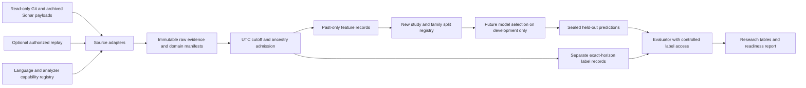

# Multi-language architecture — proposed Phase 5 design

Date: 2026-10-15. **Architecture only; none of the new components/schemas below is implemented.** Evidence and research decision: [Phase 5 report](PHASE_5_RESEARCH_REPORT.md). Feature classifications/column authority: [feature matrix](FEATURE_AVAILABILITY_MATRIX.md). Execution sequence after authorization: [Phase 5.1 plan](PHASE_5_1_IMPLEMENTATION_PLAN.md).

## Design paradigm and invariants

A **single-node batch pipeline with ports/adapters and immutable artifact bundles**. One Python CLI coordinates read-only sources and, only when separately authorized, sequential historical measurement jobs. No microservices, new database server, queue, orchestration platform, multi-tenancy or dashboard dependency.

| Decision | Binds | Prevents / rule |
| --- | --- | --- |
| ML-AD1: additive study/schema v2 | Every new adapter, feature/target/split builder | Existing `forecasting_mvp` schema1 IDs, frozen Java data/splits/baselines/Chronos results/reports stay unchanged. New namespace `forecasting_multilanguage/` and output root/study ID; do not bump old global constants. |
| ML-AD2: state-first measurements | Every source adapter | A timestamp alone is not a code state. Require repository family, immutable revision, analysis identity, scope and analyzer-domain provenance. |
| ML-AD3: native maintainability target | Importers, targets, evaluators | Use documented native maintainability stock in estimated minutes under one compatible metric-mode family. Never add bug/security efforts, allocate project debt to languages by size, or turn classifier probability into effort. |
| ML-AD4: separate event/computation/knowledge clocks | Feature builder and dataset admission | Past source state, later retrospective analysis and historical online availability are different claims; mode must be explicit. |
| ML-AD5: no fabricated states | Cutoff resolver/context builder | No nearest-date target, unknown-debt interpolation or carry across an unmeasured change. Unknown stays null with a reason. |
| ML-AD6: language capability registry | File inventory, analysis planner, normalizer | Supported-by-product, installed, enabled, successfully analyzed and historically measured are distinct flags. Mixed scope must report unsupported/failed portions. |
| ML-AD7: exact durations | All examples | Only30/60/90×86,400 seconds UTC in this contract. Weekly21/28/84/91-day and calendar-month labels remain separate contracts. |
| ML-AD8: strict predictor payload | Feature/model/evaluation interfaces | No numerical future measurements, future paths, label status or partition role can enter predictor X; evaluation stores are separate. |
| ML-AD9: study isolation and honest confirmation | Split/model/evaluation code | Old Java benchmark remains historical/exploratory. New families, frozen selection, all-ID prediction seals and custodian-controlled labels are needed for new confirmation. |
| ML-AD10: typed failure and bounded jobs | Analysis and future model workers | Resource/software/identity failures abort; only registered recoverable data/model conditions get explicit statuses. Do not silently emit zero, persistence or a partial-scope whole-repository value. |

All decisions are PROPOSED for the next study; they preserve rather than override published Phase0–4.2.1 behavior/artifacts. Code, weights and numerical outputs are not changed by this document.



Optional replay is a future acquisition route, not something run in Phase5. The label branch may prepare/restrict future truth in a custodian-controlled store; it is not accessible to the feature builder or inference worker. Metadata routing/checksums may be read without parsing numerical labels.

## Components and responsibilities

| Proposed module | Input -> output | Responsibilities and failure behavior |
| --- | --- | --- |
| `registry.py` | Versioned capability/source config -> immutable registration | Canonical languages, runtime/scanner requirements, source/license status, scope policy, snapshot mode; no network/model/scan side effects on import |
| `adapters/v2.py` | SQLite `mode=ro` + existing admitted historical/Git identities -> candidate snapshots/events | Supplement by exact project+analysis/SHA joins; retain row provenance and missing values. Quality-profile-only old domains get `LEGACY_DOMAIN_UNVERIFIED`, not a fabricated complete hash |
| `adapters/sonar_archive.py` | Archived raw export + manifest -> candidate snapshots/measures | Match project, revision, analysis ID, metric mode and payload checksums. Latest `/api/measures/component` response is not historical evidence for another analysis |
| `git_events.py` | Cutoff-reachable Git graph + numstat evidence -> admitted past events | UTC and ancestry, first-parent semantics, duplicate/conflict resolution from pinned diffs, binary/rename flags and complete-window proofs |
| `inventory.py` | Immutable source tree + policy/registry -> language/scope inventory | Production/test/generated/vendor classification from that revision, not today's filesystem. Unknown extensions remain explicit; reconcile native analyzed files/languages against expected scope |
| `analysis_plan.py` | New selected historical states + capability/domain registration -> replay plan only | Select Maven/Gradle/.NET/CLI route and resource/build requirements. A separate explicitly authorized runner would execute it; phase5 does not create jobs or alter project config |
| `admission.py` | Candidate snapshots + provenance + domain -> observations or exclusions | One consistent code state; duplicate analysis conflict -> reject; incomplete scope/domain -> quarantine or an explicitly different partial-scope study |
| `features.py` | Admitted states/events through cutoff -> feature and lineage stores | F0/F1 initially; F2 only after churn gate. Every input dependency/event time is auditable; invalid/future inputs fail closed |
| `targets.py` | Origin identity + exact horizon + independent endpoint state proof -> label status/value | No feature computation. Future target may be observed, missing, excluded or domain-incompatible; no number for unknown truth |
| `cohorts.py` | Exposure inventory + metadata-only coverage + fixed policy -> split/ID registry | Family-level holdouts, chronological purging, fixed cutoffs/target IDs and attempted-ID registry. No model results used for selection |
| `io.py` | Approved typed records -> new local JSON/CSV bundles/manifests | Atomic publication, SHA-256, deterministic field/order rules; aborted job must not publish COMPLETE |
| Future `models/` and `evaluation/` | Allowed past-only X / sealed predictions + separate labels | Not part of Phase5.1 implementation. Use the research protocol; original benchmark/evaluator is not overwritten |

Existing pure timestamp/hash/CSV helpers may be imported with a pinned code hash if their semantics match; no changes to old modules are required. Do not call old dataset/scan orchestration to obtain features by side effect.

## Language/analyzer capability design

Sonar's current supported-language matrix includes Java, Python, JavaScript, TypeScript, C#, Go and C++; product/edition capabilities differ. C++ is absent from the current Community Build column; use a licensed appropriate Server/Cloud analyzer route when later authorized. No C++ pricing or license availability is assumed for this host. [Current capability matrix](https://docs.sonarsource.com/sonarqube-server/analyzing-source-code/languages/overview), [edition comparison](https://www.sonarsource.com/products/sonarqube/downloads/).

| Language | Canonical native key | Proposed acquisition route / prerequisite | Initial pilot disposition |
| --- | --- | --- | --- |
| Java | `java` | Archived native snapshots, or Maven/Gradle with revision-correct bytecode/JDK; multi-file Java analysis needs compiled classes | Include one development project; no source-only substitution for a compiled domain. [Java requirements](https://docs.sonarsource.com/sonarqube-community-build/analyzing-source-code/languages/java) |
| Python | `py` | Sonar CLI/native Python analyzer, declared source Python version and production scope | Preferred first new language; coverage only when separately instrumented/imported. [Python](https://docs.sonarsource.com/sonarqube-community-build/analyzing-source-code/languages/python) |
| JavaScript / TypeScript | `js` / `ts` | CLI or build-aware project scanner with compatible Node runtime and revision-correct tsconfig scope | Covered by the genuinely mixed Python+JS/TS third development family; do not label it JS/TS-dominant. A fourth dominant family is deferred. [JS/TS](https://docs.sonarsource.com/sonarqube-community-build/analyzing-source-code/languages/javascript-typescript-css) |
| C++ | `cpp` | Appropriate CFamily entitlement; compilation database/build-wrapper route chosen for complete build-context evidence, correct compiler/includes/macros and analyzed-unit inventory | Supported architecture, deferred acquisition. Autoconfig is a different declared mode, not equivalent evidence. [CFamily](https://docs.sonarsource.com/sonarqube-server/analyzing-source-code/languages/c-family/prerequisites) |
| C# | `cs` | SonarScanner for .NET begin/build/end with matching SDK/solution; generic Sonar CLI does not analyze C# | Supported architecture, deferred compiled acquisition. [C#](https://docs.sonarsource.com/sonarqube-community-build/analyzing-source-code/languages/csharp) |
| Go | `go` | Native CLI analyzer with source/module inventory; include go.mod; Go toolchain needed if collecting coverage | First low-complexity extension after Python/JS, no corpus claimed now. [Go](https://docs.sonarsource.com/sonarqube-community-build/analyzing-source-code/languages/go) |
| Other supported languages | Registry-specific key | Add capability manifest and metric/fixture conformance; no generic file-suffix promise | PHP/Ruby/Kotlin/etc. can use the same contracts when admitted; no automatic label comparability |

For a mixed repository use **one native project analysis for the declared whole production scope** whenever the scanner supports it. Do not scan once per language and sum overlapping project totals. Multiple disjoint subproject analyses require an explicit partition/reconciliation contract and are deferred from the pilot. Record analyzed NCLOC by language, failed/unrecognized files and excluded test/generated/vendor policy. A `.cs` profile entry or GitHub dominant-language label alone does not certify C# measurement.

If any declared production language is unsupported or failed, the whole-repository target is unavailable. Either reject it or register a new, named partial-scope target/study **before outcomes**; never call the observed subset whole-repository debt. Adding code in an already-enabled language is ordinary source evolution. Adding a plugin/changing scope/rules/build mode is a domain change requiring a boundary, even if a profile key is unchanged.

## Common dataset schemas — v2 proposal

Storage seed: UTF-8 CSV for flat tables, JSON/JSONL for manifests and nested provenance; UTC ISO8601 with `Z`, finite numbers or explicit null, SHA-256 content digests. No new serving database is needed. Optional Parquet is deferred until size justifies it. Fields below are a specification, **not populated example evidence**.

### `repository_registry.json`

| Field | Meaning / invariant |
| --- | --- |
| `schema_version`, `study_id`, `registry_id` | New version2 study/registration; never replace old IDs |
| `repository_id`, `canonical_url`, `provider_repository_id`, `family_id` | Stable identity, archived rename/alias mapping and fork/clone family grouping |
| `source_license_spdx`, `data_reuse_terms`, `source_reference`, `source_digest` | Source code rights and snapshot/data rights recorded separately |
| `exposure_status`, `exposure_evidence_refs`, `reserved_role` | Metadata-only exposed/development/held-out reservation; never model X |
| `branch_reference`, `branch_reference_observed_at`, `tip_sha`, `lineage_policy` | Identifies the branch basis and whether it was contemporaneously known or retrospectively inferred |
| `declared_languages`, `scope_policy_hash`, `study_mode` | Capability/scope intent and `OPERATIONAL_ASOF` or `RETROSPECTIVE_FIXED_ANALYZER` |

### `analyzer_domains.json`

`domain_id` hashes a canonical manifest, not just a profile ID: server/tool version and edition, scanner/version/image digest, sorted plugin keys/languages/versions/binary digests, full exported active rules + parameters + remediation settings per language, metric mode/semantic version, source/test/generated/vendor filters, build mode, compiler/runtime/toolchain versions and dependency-resolution/build-environment provenance. Per-revision dependency lock/inventory hashes live with the analysis; changes that alter measurement semantics require a declared boundary rather than silent merging. Record issue-acceptance/suppression configuration where it affects the target.

Unknown required fields produce `domain_status=INCOMPLETE` and listed missing fields. Hashing a manifest containing “unknown” does not certify domain equivalence. Old V2 imports retain their existing metadata limitation; they cannot be promoted to new strict-domain confirmation by assigning a convenient analyzer version.

### `analysis_snapshots.csv` and `language_coverage.csv`

| Fields | Meaning / invariant |
| --- | --- |
| `observation_id`, `repository_id`, `family_id`, `analysis_id`, `commit_sha`, `source_tree_sha` | Native analysis/code identity; imported raw keys retained with source row references |
| `state_cutoff_utc`, `committer_utc`, `state_resolution`, `cutoff_state_proof_id` | Exact historical state being described; commit time and cutoff time remain distinct |
| `analysis_executed_utc`, `source_first_available_utc`, `retrieved_utc`, `availability_status` | Computation, original knowability and audit retrieval clocks; unknown is not inferred from committer time |
| `domain_id`, `domain_status`, `scope_policy_hash`, `inventory_hash` | Versioned measurement semantics and actual file inventory |
| `scope_completeness`, `expected_source_files`, `analyzed_files`, `unsupported_files`, `failed_files`, `coverage_evidence_ref` | Whole/partial/unknown measurement coverage; no fabricated NCLOC for unrecognized files |
| `source_id`, `raw_payload_sha256`, `source_row_refs`, `provenance_status`, `exclusion_reasons` | Auditable import/replay identity and admitted/quarantined status |
| Coverage sidecar: `observation_id`, `language_key`, `analyzed_ncloc`, `analyzed_files`, `analyzer_plugin_key`, `coverage_status` | Per-language measured coverage; unique observation/language keys. NCLOC shares are not debt shares |

### `measurements.csv` — long typed measures

Unique `(observation_id, metric_semantics_id, metric_key, scope_id, language_key_or_all)`. Fields: `value`, `unit`, `value_status`, `missing_reason`, `raw_metric_key`, `raw_value`, `native_quality_mode`, `source_ref`. Missing versus unsupported versus invalid versus observed zero is explicit.

Canonical primary measure `maintainability_principal_minutes` is mapped from a documented native maintainability metric. The old Standard Experience `sqale_index` and modern MQR `software_quality_maintainability_remediation_effort` must retain their raw key/mode and a separately audited semantics mapping; **do not automatically pool them as identical targets**. Select a single mode family for the first new study. Reliability/security efforts remain separate measures; category overlaps in newer quality modes do not justify summation. [Metric definitions and mode distinctions](https://docs.sonarsource.com/sonarqube-server/user-guide/code-metrics/metrics-definition).

A C++ lint warning, SATD classification, architecture smell or external issue with default effort is not a native maintainability-minute measurement. External reports need their own engine/rule/scope/effort semantics; exclude them from the primary target unless separately registered. [External issue format](https://docs.sonarsource.com/sonarqube-server/analyzing-source-code/importing-external-issues/generic-issue-import-format).

### `git_events.csv` and `feature_evidence.jsonl`

Git fields: `event_id`, repository/family, `commit_sha`, `first_parent_sha`, `committer_utc`, `ancestry_index`, `is_merge`, `path_before`, `path_after`, `language_before/after`, production classification, additions/removals nullable, `delta_status`, `duplicate_group_refs`, `resolution_method`, `history_complete_from`, raw source/hash references. `resolution_method` distinguishes native Git first-parent diff, verified identical duplicates and unresolved conflicts. Explicitly document root-commit and rename semantics.

Feature records are unique by `context_id` and named frozen feature contract. Evidence per feature: allowed feature name/type, value/status, source observation/event IDs, `max_source_state_utc`, `max_available_utc` nullable, complete-window proof, domain/scope IDs and feature-code/config hashes. Raw provenance and high-cardinality identities are audit fields, not predictors. F0/F1/F2 columns are owned by the [matrix](FEATURE_AVAILABILITY_MATRIX.md#frozen-proposed-first-feature-groups).

### `forecast_origins.csv`, `forecast_labels.csv`, `cohorts.json`

Origin fields: `forecast_id`, `context_id`, repository/family, cutoff UTC, origin state/observation IDs, feature contract ID, target contract ID, horizon days and exact endpoint UTC. Stable identities are computed from those immutable inputs, **not future value/delta/outcome availability**. `cohorts.json` separately binds role/cutoff/ID assignments and purging evidence; no split/holdout flag enters X.

Labels live separately: `forecast_id`, `endpoint_state_sha`, `endpoint_observation_id`, `endpoint_utc`, `actual_minutes` nullable, `actual_delta_minutes` nullable, `label_status`, `missing_reason`, `endpoint_state_proof_id`, domain/scope/source references. `UNKNOWN`, `EXCLUDED` and `DOMAIN_INCOMPATIBLE` have no invented numerical truth. Outcome status belongs to scoring/coverage accounting, not prediction inputs. Preserve registered attempted IDs even when a future label is unavailable; report the observed paired scoring subset identically for all models.

A target contract specifies metric semantics/mode family, estimated-minute unit, whole analyzed production repository population, scope policy, exact duration, same-compatible-domain requirement and endpoint admission policy. A partial-scope or91-day target requires a new ID, not a changed interpretation of an old column.

## Two clocks and valid historical claims

**Operational as-of:** state/event time <=t0 **and** input first-availability time <=t0. A historical analysis that executed later is not an online historical input merely because it examined an older SHA. Unknown availability blocks this claim.

**Retrospective fixed-analyzer:** reconstruct features from immutable past Git/source states using a method/configuration fixed for the study, with every source state <=t0, even if extraction/analysis ran later. Record execution/retrieval time and `historical_online_availability=UNVERIFIED/NOT_CLAIMED`. The scientific estimand is forecasting the evolution of analyzer-defined historical code states under that fixed method, not reproducing what a developer's original dashboard knew. No future code, status edits, branch knowledge disguised as contemporaneous evidence or future labels are admitted as past facts. V2 belongs to the explicitly limited retrospective lane unless stronger availability evidence is supplied.

Branch identity itself has a clock. Today's default branch and a tip inferred from the whole archived graph do not prove the branch known at an earlier cutoff. New retrospective replay may declare a fixed lineage basis; operational claims need contemporaneous branch/ref evidence.

## Exact state and endpoint algorithm

1. Freeze repository/family, branch/lineage basis, domain/scope and UTC origin grid without numerical outcomes. Validate graph uniqueness/completeness and relevant chronology. Reject unresolved first-parent inversions, missing ancestry and ambiguous tips; do not reorder history by timestamp alone.
2. Resolve the branch state active at t0 by validated ancestry and recorded UTC time semantics. Ties use proven ancestry order, not lexical SHA or “nearest” time. Record a state-resolution proof referencing all relevant commits/ref evidence.
3. Admit D(t0) only from a measured matching code state/domain/scope. An earlier analysis may describe the endpoint only with sufficient unchanged-state evidence: the same active revision, known stable measurement domain and no intervening unmeasured change. A same-name module, equal debt value or a return to an old tree after unknown changes is not sufficient proof. Unknown status cannot be filled by zero or last-observation carry.
4. Set exact endpoint `t0 + h*86400s`, h in30/60/90; resolve its independently verified state. A measured commit timestamp need not equal the UTC cutoff if the measured revision is proved to be the active unchanged state there. This is state equivalence, not a fabricated nearest-timestamp label. A fresh authorized replay of the actual cutoff state can supply an independent observation; mere revision metadata cannot.
5. Require origin/endpoint compatible domain and scope. Missing analyzer metadata or a reset between them makes the strict target unavailable. Keep actual signed delta only on the label side. Preserve missing/exclusion reasons and rejected cases.
6. Build past features independently. Non-debt Git activity can be known across an unmeasured Sonar revision, but that knowledge does not license debt-state carry. Sparse measurement trends use real observed states/times. Daily90 contexts for optional Chronos require all states admitted by the strict input contract; no interpolation to improve model eligibility.

No endpoint or feature record is created in this phase. The original Phase2 targets and exclusions remain untouched.

## Logical interfaces — prospective contracts

```text
SourceAdapter.read(registration, read_only_sources)
  -> CandidateSnapshots, RawReferences, ImportExclusions
Admission.validate(candidate, domain_manifest, state_proof)
  -> AdmittedObservation | TypedExclusion
FeatureBuilder.build(origin, admitted_past_store, accepted_git_events, feature_contract)
  -> FeatureRecord, FeatureEvidence
PredictionInput.admit(feature_record, origin, permitted_mode)
  -> PastOnlyPayload
TargetBuilder.resolve(origin_identity, target_contract, independent_endpoint_store)
  -> LabelRecord
DatasetPublisher.publish(new_study_root, records, source_hashes, code_hashes)
  -> COMPLETE manifest | failure without COMPLETE
```

The predictor payload is an allowlisted feature-name/value/missing-indicator structure plus nonnumeric origin/horizon routing outside model X. No label store handle, `actual_*`, `TD_*`, future paths, future analysis IDs, outcome-availability columns or evaluation roles. The builder rejects source-state time >origin; operational mode also rejects unavailable/unknown-availability inputs. Tests must mutate future stores and prove X unchanged, and fail attempts to pass target/evaluation columns. No dataframe “all numeric columns” selection.

Future models generate all assigned predictions/statuses into a new bundle; seal content/config/champion hashes before label parsing. Metrics use the same observed-ID pairs for every compared model and keep failures/unknown labels in coverage accounting. Runtime/identity/nonfinite errors are fatal; any registered data/model fallback has an explicit status. Original Phase4.2.1 typed crossing policy is preserved as a reference, not retroactively rescored.

## Deployment/resource and security seed

Local CLI, existing Python environments for inspection, CSV/JSON bundles outside source-controlled large-data paths, sequential workers, checksummed inputs and portable config templates. Credentials come only from environment/ignored local config; raw exported logs/build environments must be redacted before publication. Do not commit tokens, private source or large archives.

A future replay runner executes arbitrary historical build code: use an unprivileged isolated work directory/container without host credentials or Docker socket, and an explicit dependency-fetch policy. Capture compiler/runtime/lock and scanner/plugin hashes. Server data stay outside the frozen experiment roots; record analysis/project keys without altering prior projects. Pin an actually available compatible analyzer bundle after environment admission; the live documentation is not a license to upgrade existing servers or rebuild old experiments. If no suitable server/build environment is authorized, publish the plan and block replay.

Proposed bounds: one replay at a time,20min per snapshot, <=8GiB total monitored job/server/build budget on this16GB host, <=5GB new pilot artifacts with >=10GB free disk reserve; stop rather than expanding silently. If existing server overhead cannot fit, choose imported archives or a larger separately approved host. C++/C# compilation can exceed this envelope and is deferred. These are engineering limits, not measured runtimes.

## Deferred and readiness

Deferred: generic cross-tool effort conversion, per-file/module forecasting, autonomous remediation, external-issue effort synthesis, vector retrieval, online serving/UI, distributed scheduling, new model downloads, covariate-enabled Chronos, interval calibration and all model training. Existing module work remains available for a future separate lineage-preserving adapter; do not reinterpret its weekly labels.

The architecture supports additional language adapters without changing contracts. It does not assert usable histories for every supported language. No new confirmatory cohort is reserved or evaluated yet. The [implementation plan](PHASE_5_1_IMPLEMENTATION_PLAN.md) starts with admission and source quality, then a small real-data engineering pilot, and stops before model fitting.

> Phase 5.1 scope correction (2026-10-15): the three engineering development targets are Java-dominant, Python-dominant and genuinely mixed Python+JS/TS. The mixed target is not JS/TS-dominant; no fourth project is included. Original Phase 5 findings remain historical design evidence. Current implementation/data readiness: [Phase 5.1 report](PHASE_5_1_IMPLEMENTATION_REPORT.md).
