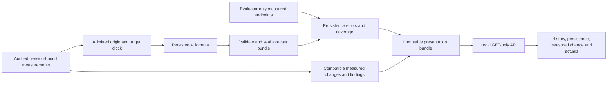

# Persistence-only MVP architecture

Implementation update — 2026-10-30: the persistence input/evidence pipeline,
sealed bundles, evaluator and read-only API/dashboard are implemented in
`forecasting_mvp/persistence_flow.py`, `api.py` and `static/`. See the
[implementation report](../../PERSISTENCE_IMPLEMENTATION_REPORT.md) and
[exact operator commands/schemas](../../forecasting_mvp/PERSISTENCE.md).
A new real current-repository scan/demo and calendar data/evaluation admission
remain separate gates. Earlier future-tense statements below record the approved plan.

Updated: 2026-10-30. Implements the [persistence-only workflow](MVP_FORECASTING_PLAN.md) using the existing pipeline, immutable files and a planned local read-only API/dashboard. No model environment, checkpoint, fitting service or neural worker is needed in the active forecast path.

| Decision | Binding rule |
|---|---|
| Artifact ownership | Importers/collector own observations; target builder owns endpoint identity; persistence stage owns forecasts; evaluator owns errors; bridge maps/validates; API only reads completed bundles |
| Target/clock identity | Bind source, repository/domain/scope, target/unit, origin, horizon value/unit and policy; revision steps and elapsed days are distinct; total principal and SQALE are distinct |
| Model contract | Only `persistence`; forecast equals origin stock, predicted delta zero, interval null; no Chronos/hybrid invocation, weight selector or fallback to another model |
| Data boundary | Validate origin without reading numerical future labels; seal forecasts before evaluation opens actuals; missing/zero and pending/unsupported states remain distinct |
| Measured change | Compare compatible consecutive measurements; retain signed delta; domain/scope changes break comparability and cannot be reported as ordinary debt movement |
| Publication | New immutable COMPLETE bundles after hash/identity checks; preserve old/failed evidence; invalid origin or corrupt inputs block forecast publication |
| Local operation | API binds 127.0.0.1; GET only, explicit bundle IDs, contained paths, escaped source text, no credentials/raw private export; operators run scans/publication |

## Reuse and planned additions

Reuse existing `forecasting_mvp/baselines.py`, contracts/IO, request-admission and exact-state/evaluation patterns where they fit the registered target. Extract only the persistence view from authorized completed principal artifacts. Do not invoke a historical runner that also loads or predicts with neural models. Historical cohorts, method populations, IDs and seals stay unchanged; presentation filtering creates no new study or superiority claim.

Planned files relative to `TechDebt360-MVP/`: `forecasting_mvp/persistence_flow.py` as the persistence-only evidence bridge, `forecasting_mvp/api.py` and `forecasting_mvp/static/`. The implementation consolidates the originally proposed bridge into `persistence_flow.py`; its active payload has one forecast method. No `hybrid.py`, weight-policy module or selector is required.

Use a distinct `persistence.presentation.v1` presentation namespace with manifest/source/target/clock/policy and artifact hashes. Records include forecast ID, repository/domain/target, origin/revision, horizon value/unit, `model=persistence`, current/predicted minutes, predicted delta zero, null interval, actual/error or null and explicit availability. Measured-change records bind both compatible observation IDs or carry a comparability/missingness reason. Preserve original forecast IDs, namespacing presentation IDs by source study and target/clock.

## Planned API and display

Base `/api/mvp/v1`: GET `/health`, `/bundles`, `/bundles/{id}/repositories`, `/history`, `/forecasts`, `/evaluations`, `/priorities` under the selected bundle. Require `horizon_value` and `horizon_unit`. Unknown IDs return 404; corrupt/incomplete bundles 409; invalid queries or a request for another model 422. An unsupported admitted horizon returns a null forecast and reason. Pending actuals do not block a valid point forecast.

Display: measured components/total → observed history and measured change → persistence point and zero projected change → measured actual/error or pending state → findings/provenance. Label revision steps versus elapsed days throughout. No Chronos/hybrid series, model chooser, contribution weight or native-interval panel is required. Archived model reports remain research links outside the live forecast flow.

Collector protections remain unchanged: explicit revision/domain binding, completed scan/export, pagination completeness, restricted untrusted builds and scanner credential isolation. The dashboard launches no scans or inference. Persistence uses the existing operator process without adding heavyweight dependencies or removing historical model environments.
