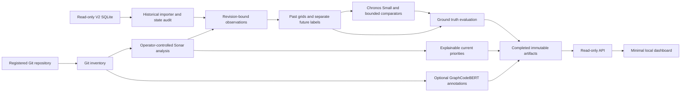

# Minimal forecasting architecture

**One Python research/application package, operator CLI, immutable CSV/JSON bundles and one read-only FastAPI dashboard.** Heavy model runtimes run serially in isolated environments behind a file interface. No microservices, distributed worker, database migration or online training. The API never launches scans or expensive inference.

This is a new MVP scope, explicitly simplifying the previous initiative architecture under the latest user instruction. The prior [spine](../2026-10-13-refinement/2026-10-13-refinement.md) is preserved as evidence; capability/tenant/repair rules are outside this new deployment, rather than silently weakened in that original document. Preserve its source/target/domain integrity, missingness, causal evaluation and typed evidence principles. Only the current MVP contracts below bind future MVP implementation.

## Decision contract

### AD-1 — One owner per artifact

- **Binds:** ingestion, collection, import, data, models, API.
- **Prevents:** two scripts assigning incompatible IDs or silently changing old artifacts.
- **Rule:** ingestion owns repository/ref/tip records; collector owns current observations; importer owns imported records; target builder owns grids/endpoints; split builder owns cohort assignments; runners own predictions; evaluator owns metrics; API only reads validated COMPLETE bundles. New `mvp_schema_version=1` is a separate namespace, never a relabeling of legacy module schema v1/v2. Deterministic IDs use SHA-256 over sorted compact UTF-8 JSON with `allow_nan=False`; record serializer version. Hash exact source bytes separately. Timestamps use UTC `Z`, CSV blanks/JSON null mean unknown; JSON forbids NaN/Infinity. `target_id` hashes the full target contract; `forecast_id` hashes dataset/source-policy version, repository/domain/scope/target, origin, track and context-policy hash. A shared `request_id` groups the core90 path used by three target IDs; it never replaces endpoint forecast IDs. `split_id` hashes repository/phase/calendar/eligibility policy and ordered assigned forecast IDs. `model_id` hashes checkpoint/code/runtime/preprocessing/postprocessing or fitted-model metadata.

### AD-2 — Measurement identity and scope

- **Binds:** collector, importer, targets, ranking.
- **Prevents:** mixing code-smell estimates with actual labor or partial Java sums with project totals.
- **Rule:** each observation binds source/repository/ref policy/revision/tree if available/logical cutoff/analysis ID/domain/metric/scope and raw hashes. Current observations additionally bind server/project/CE task/execution/export times, scanner/rules/scope/build mode and pagination completeness. `SQALE_INDEX` project stock and production-Java file-sum stock are distinct targets. Bug/security effort is a separate field; classifier scores are annotations. Imported analyzer unknowns cannot be marked own-scan verified.

### AD-3 — Calendar state and provenance

- **Binds:** Git, historical importer, target builder.
- **Prevents:** nearest-date observations or future branch knowledge creating false exact labels.
- **Rule:** use the frozen first-parent retrospective mainline and its complete, nondecreasing committer-time segment; resolve states by causal chain order at/before each cutoff. Equal times use chain order. Missing parents, ambiguous mainline tips or a time inversion touching the selected segment yield explicit unavailability. An inferred historical cutoff policy is not an online availability claim. Match the selected exact revision to a unique compatible measurement. Unchanged selected state may reuse a measurement; unmeasured changed state remains missing. Never extrapolate past the archived branch-history endpoint. Exact target endpoint is `t0 + h*86400 seconds`, h=30/60/90; weekly91 is a separate contract.

### AD-4 — Model boundary and no future labels

- **Binds:** datasets, supervised features, HF adapters, evaluation.
- **Prevents:** leakage through labels, caches, covariates or differing cohorts.
- **Rule:** prediction runners receive only past-grid/features manifest, target duration and model configuration. The operator CLI's `--dataset` path is validated in the parent, which writes a projected request folder without label files; the subprocess never receives or mounts the full dataset root. Supervised fitting receives separate phase-filtered training labels; validation evaluator exposes validation outcomes for tuning. Test endpoint measurement IDs/values remain evaluator-only and inaccessible to fit/tune/predict requests. Frozen forecast IDs bind repository/domain/target/origin/context. Identical eligible IDs, context and information budget define each comparison track. All supplied feature timestamps must be <= origin. No future Git activity or GraphCodeBERT historical recomputation is added as a covariate in the primary study. Supervised transforms fit on training only; tuning/calibration use validation; final tests open only after choices freeze.

### AD-5 — Missingness, model semantics and failures

- **Binds:** data, adapters, reports, UI.
- **Prevents:** padding or masked zeros becoming measured history and generic forecasters being called validated debt models.
- **Rule:** audit complete 90-day daily grids first, including supported same-state reuse. A gap excludes an origin from core90; do not silently fill it. If the complete track fails the registered data-cohort gate, freeze masked90 as the primary limited-data track before any model outcome: at least 80% known daily values, known origin and exact measured endpoints; preserve NaNs/masks. Do not pool tracks or claim complete-history evidence. TTM comparisons require complete native contexts in separate matched cohorts. Normalized runner result is `(series, steps)` point output plus optional `(series, quantiles, steps)`, with point kind, quantile grid and native context/horizon recorded. Quantiles are not relabeled; TTM's mean slot is not a median. OOM/load/timeouts are failure rows. Missing actual endpoints never become zero. Research results, unsupported current predictions and validated-domain observations have distinct status fields.

### AD-6 — Local publication and security

- **Binds:** CLI, scan/model runners, artifact IO, API.
- **Prevents:** partially written bundles being served or untrusted repositories controlling commands.
- **Rule:** one operator serializes scan and publication per workspace using existing local locks; no new lease/fencing service. Write a new temporary run folder, hash/validate artifacts, then atomically publish COMPLETE manifest; interrupted folders remain FAILED/INCOMPLETE, restart to a new run ID. Model runners use argv lists and fixed budgets, no shell interpolation. API binds 127.0.0.1 and has GET routes only, path containment, escaped source text and no credential export. Untrusted builds run as a non-root user in a pinned rootless container with read-only source, private scratch/output and dependency cache, no host home/socket mounts, no inherited secrets, network disabled and explicit CPU/RAM/timeout limits. A prior dependency-fetch phase has no Sonar credentials. Scanner runs separately with a generated trusted settings file and forced approved server/project/revision/scope; repository scanner settings and redirects cannot select credential destinations. Only scanner/export receive the dedicated token. No source-controlled commands enter the scanner phase. If the local runtime or existing adapter cannot honor this boundary, collection is blocked until a narrow wrapper is supplied; source-only fallback is a separate sensitivity domain.

### AD-7 — Minimal deployment, ranking and model selection

- **Binds:** application, research reports, dashboard.
- **Prevents:** unvalidated predictions becoming risk scores or enterprise scope entering the MVP.
- **Rule:** file manifests are the source of truth; API indexes them in memory at startup, restarted after new runs. No additional mutable database. Current finding priorities sort maintainability severity (BLOCKER, CRITICAL, MAJOR, MINOR, INFO), estimated minutes descending, then stable issue ID ascending; unknown factors go to a separate incomplete queue. Map modern severities using the pinned analysis export, not an invented cross-version translation. Forecast view displays per-horizon predictions/errors and domain-specific evaluation status, separate from finding rank. Validation selects one default per horizon from the identical-context data-audit-registered primary track (core90, or masked90 fallback); persistence/CatBoost may win. TTM matched-track winners remain separately labeled research comparators, not global defaults chosen by comparing different-cohort MAEs. Imported results never automatically qualify a new current analyzer/repository domain.

## Proposed module layout and ownership

Everything below is **future new code** under `/home/hp/tst/td_pipeline_module_level/td_pipeline/forecasting_mvp/`; it does not exist now. Retain legacy `forecasting/` unchanged unless a narrowly identified helper must be extracted with regression proof.

| Module | Owner/responsibility | Input → output |
|---|---|---|
| `contracts.py`, `io.py` | Contributor A; typed records, schema, hashes/publication | Raw records → checked bundles; reuse safe IO patterns from legacy `contracts.py` |
| `ingest.py`, `git_state.py` | A; local registration, frozen ref/tree, causal mainline | Operator path/ref → repository registry, commits and branch audit |
| `v2_import.py`, `observations.py` | A; SQLite read-only joins, metric/domain inventory | V2 DB/hash → imported observations/audit; no SQL mutations |
| `targets.py`, `splits.py`, `features.py` | A; daily grids, exact labels, allowed past features, frozen splits | Observations/commits/policies → past and label bundles; reuse purge concepts |
| `adapters/chronos.py`, `adapters/ttm.py`, `adapters/tabular.py` | B; isolated runners and contract normalization | Past-only request → forecasts/failures/environment metadata |
| `evaluate.py` | B; paired comparisons, metrics and resource report | Frozen predictions + sealed labels → evaluation bundle |
| `sonar_project.py`, `java_units.py`, `graphcodebert.py` | A/B; current project export and optional Java classifier | Completed collector evidence + immutable source → typed current evidence |
| `prioritize.py`, `api.py`, `static/index.html`, `static/app.js`, `static/style.css` | B; static presentation and read-only routes | COMPLETE bundle registry → JSON, evidence tables, historical charts |
| `cli.py`, `__main__.py` | A; explicit foreground stages | Registered paths/configs → new immutable output directory and exit code |

Fixed CLI commands: `audit-v2`, `build-dataset`, `split`, `fit`, `predict`, `evaluate`, `register`, `collect-current`, `annotate`, `prioritize`, `assemble`, `serve`; exact argument contracts are in [experiment plan](MVP_EXPERIMENT_PLAN.md). `evaluate` owns validation decision/model-registry output, including frozen setting-specific model IDs; `assemble` only validates and packages completed study/current bundles. It cannot retune or change predictions. SourceUnit ID hashes blob/path/byte range/extractor; annotation ID additionally hashes checkpoint/preprocessing/label policy.

The [reuse digest](digests/code-reuse.md) enumerates existing components. Existing project-history nearest-date code and row-shift labels are replaced for this track, not reused unchanged. Existing module graph/deep-model designs are deferred.

## Shared file contracts

CSV has one named header with no duplicate columns; numerics finite, labels signed only for derived deltas. JSON manifest lists schema/source/license/domain/target/cohort/runtime/code hashes and every artifact's byte hash. IDs never depend on mutable absolute file locations. Missing tree hashes in V2 are null and reduce provenance claims, not invented Git trees.

| Record/artifact | Required fields |
|---|---|
| `repositories.json` | `repository_id, source_kind, local_git_path?, ref_policy, frozen_tip, known_history_end, license_status` |
| `observations.csv` | `observation_id, repository_id, revision, analysis_id, source_hash, historical_time, execution_time?, domain_id, metric=SQALE_INDEX, scope_id, value_minutes, provenance_status` |
| `past_grid.csv` | `forecast_id, repository_id, origin_utc, context_days, grid_utc, selected_revision?, input_observation_id?, value_minutes?, state_kind=MEASURED/REUSED_SAME_STATE/MISSING_STATE, reason?`; primary complete track rejects missing state |
| `features.csv` | `forecast_id, track, feature_policy_hash, max_feature_utc, current_minutes, lag7/30/60, mean30/90, slope30/90, std30/90, observed_revision_count`; masked90 additionally includes known-grid fraction and per-feature availability flags from its hashed feature projection; size covariates belong only to a separate ablation |
| `targets.json` | `target_id, metric, unit, scope_id, domain_policy, horizon_days, duration_seconds, cadence_seconds=86400, population=whole_repository_stock, endpoint_policy, context_policy` |
| `labels.csv` | `forecast_id, target_id, endpoint_utc, endpoint_revision, endpoint_observation_id, actual_minutes, actual_delta_minutes, eligibility_status, reason`; split publisher emits filtered `train_labels.csv`, `validation_labels.csv`, `test_labels.csv`; fit reads train only, validation evaluation reads validation, final evaluation reads test after freeze |
| `splits.json` | repository partition, absolute UTC boundaries, ordered IDs by phase/track/horizon, embargo, purge reasons and source policy hashes |
| `predictions.csv` | `forecast_id, target_id, model_id, split_id, status, predicted_minutes?, raw_predicted_minutes?, predicted_delta_minutes?, q10?…q90?, raw_q10?…raw_q90?, point_kind, reason, wall_seconds, peak_memory_bytes?` — one endpoint record per target |
| `forecast_path.csv` | `forecast_id, model_id, step, forecast_utc, native_point?, raw_point?, q10?…q90?, raw_q10?…raw_q90?`; optional native path, no fabricated intermediate actual values |
| `evaluation.json` | cohort/horizon/domain, eligible/attempted/success/missing counts, MAE/RMSE/skill, macro metrics, interval metrics, CI or insufficient-cluster reason, limitations |
| `annotations.json` | source unit/blob/coordinates, checkpoint/preprocessing/label hashes, four sigmoid scores, score-only status, eligibility/overlength/permission reasons |

Prediction runners must reject label files in the request manifest. Trainer requests allow only the hashed training-label projection, with no validation/test labels. Reconcile `predicted_delta = predicted_stock - observed_origin_stock` without clamping the delta; stock output clipping to nonnegative is one common preregistered policy and raw values are retained. Decile loss uses actual endpoint values and the corresponding native endpoint quantiles, never an unobserved full future path.

`java_units.py` uses the [Tree-sitter Java grammar](https://github.com/tree-sitter/tree-sitter-java) and [Python Tree-sitter API](https://tree-sitter.github.io/py-tree-sitter/), pinned together during authorized setup. Extract `method_declaration` and `constructor_declaration` nodes from immutable UTF-8 blobs; reject nodes containing parser errors, unsupported encoding or normalization/token-limit ambiguity. Store blob/path/byte range/original line range and extractor hashes before author normalization. No regex guessed method boundaries. Classifier loading and exact checkpoint label mapping remain separate gates. This parsing choice adds no compiler/build execution or semantic graph claim.

## Minimal API and dashboard

Base `/api/mvp/v1`; responses include `schema_version, bundle_id, status, provenance, data`. GET only, completed explicit bundle IDs; never “latest analysis” as an evidence selector. Unknown IDs return404, incomplete/hash-invalid bundles409, invalid query422; an admitted bundle with unsupported horizon returns200 with `status=UNSUPPORTED_DATA`, null forecast and reason. No arbitrary path parameters or download of original DB/models/credentials.

| Endpoint | Contract |
|---|---|
| `/health` | application/schema status only |
| `/bundles` | completed known bundles and source/domain/study labels |
| `/bundles/{id}/repositories` | repository IDs, current measurement and historical coverage |
| `/bundles/{id}/history?repository_id=...` | logical UTC cutoff, stock, revision, observed/reused/missing flags |
| `/bundles/{id}/forecasts?repository_id=...&horizon=30` | registered predictions with track/model/core-default marker and unsupported reasons; horizon enum30/60/90 |
| `/bundles/{id}/evaluations?track=core90` | baseline comparison, model cohort and actual future-value provenance |
| `/bundles/{id}/priorities?repository_id=...` | finding order and explicit severity/minutes/ID factors |
| `/bundles/{id}/annotations?repository_id=...` | GraphCodeBERT candidates with four scores and exploratory warnings |

Use static HTML/JS and SVG charts: selector → historical SQALE plot → exact-horizon endpoint predictions/80% intervals → baseline metrics → current findings → annotation/provenance panel. Plot forecast lines only where valid; no interpolation over missing ground truth. Show current measurement and imported research replay as distinct panels. A current repo without trusted context displays the measured finding list and “forecast unavailable,” not a transplanted V2 forecast. [FastAPI static serving](https://fastapi.tiangolo.com/tutorial/static-files/) supports this minimal layout. Backend package versions are pinned during authorized setup after import checks, not assumed compatible with every model runtime.

## Runtime budgets and recovery

Use the existing Python3.12 research seed and CatBoost1.2.8 as source-inspected starting points. A new separate Chronos environment and, only if needed, IBM's exact supported TTM environment avoid changing legacy locks. Hardware is unconfirmed: propose a 16GB-RAM CPU host for smoke runs, serial batch1 and no GPU requirement until measured. This is a budget assumption, not a proven minimum or speed guarantee. Sonar/build may need additional host resources; do not colocate memory-heavy model runs and scans.

Default future smoke timeout 15 minutes/model, full pilot 8 machine-hours cumulative; log elapsed/RSS and stop before increasing the budget. At most one model load retry for transient resource failure; no silent checkpoint/model switch. Collection permits one pilot rerun after a recorded infrastructure fix; preserve original failure artifacts. CLI exit0 success,2 insufficient/blocked data,3 corrupt/contract mismatch,4 runner failure. No automatic retries, deployment or model promotion from the dashboard.

Deferred decisions are outside the MVP: remote access, multiple operators, model drift automation, large collection, module identity expansion and remediation. If required later, create a new scope; the local operating restrictions above cease to be sufficient for an enterprise service.
