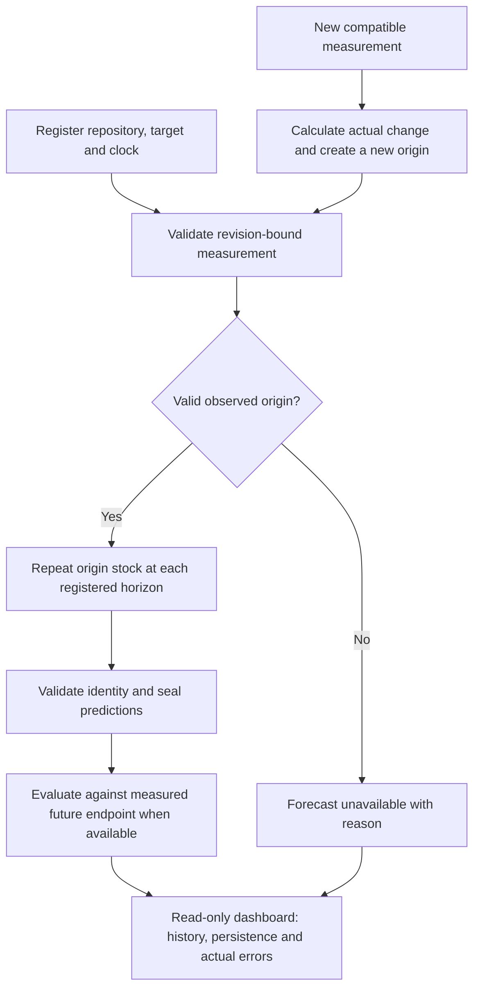

# MVP forecasting workflow: persistence only

Implementation update — 2026-10-30: the persistence input/evidence pipeline,
sealed bundles, evaluator and read-only API/dashboard are implemented in
`forecasting_mvp/persistence_flow.py`, `api.py` and `static/`. See the
[implementation report](../../PERSISTENCE_IMPLEMENTATION_REPORT.md) and
[exact operator commands/schemas](../../forecasting_mvp/PERSISTENCE.md).
A new real current-repository scan/demo and calendar data/evaluation admission
remain separate gates. Earlier future-tense statements below record the approved plan.

Updated: 2026-10-30, Africa/Cairo. Active user decision: **persistence is the only MVP forecaster**. This supersedes the earlier two-forecaster and hybrid requirements. Historical experiments, code, model artifacts and reports retain their original identities; no model execution follows from this documentation update.

## Forecast contract

For a registered repository, compatible target/domain and valid observed origin stock:

```text
predicted_stock(h) = observed_origin_stock
predicted_change(h) = 0
```

The primary target remains native repository total principal: maintainability + reliability + security estimated remediation minutes. Require all three finite, nonnegative, scope-compatible components. Missing components remain unknown; observed zero is valid. Estimated burden is separate from actual developer effort and architectural risk.

Persistence requires the admitted origin value and its provenance; it does not require a pretrained checkpoint, fitting, learned weights, covariates or an inference worker. It supplies a point forecast only. Prediction interval fields remain null. A zero predicted change is the method's assumption, not evidence that future debt will remain unchanged.

## Active workflow



1. **Register.** Bind source hash, repository/ref/revision, scope/analyzer domain, target/unit, origin, horizon value and horizon unit. Source permissions and provenance limits stay explicit.
2. **Validate the origin.** Match the selected source state to its compatible measured total. Reject ambiguous revisions, missing components or nonfinite/negative inputs. No missing-to-zero conversion or borrowing an old value across an unmeasured changed state. An identical selected state may reuse its measurement under the registered source policy.
3. **Produce persistence points.** Copy the valid observed origin value to every registered horizon. Record `model=persistence`, formula/policy version, target/clock and source identity. Each horizon has its own immutable forecast ID. Missing history beyond the origin does not create a synthetic context requirement; stricter historical study eligibility remains unchanged in those existing studies.
4. **Seal.** Validate finite values, zero predicted delta and exact identities, then seal the output before opening numerical evaluation outcomes. Invalid input or artifact integrity stops publication; there is no alternate model fallback.
5. **Evaluate.** Join forecast/target IDs to compatible measured endpoint records. Report actual stock, actual change and error when known. A current forecast awaiting its actual uses `NOT_YET_OBSERVED`; missing actuals are never zero. Future labels are evaluator-only and do not enter persistence requests.
6. **Publish.** Serve only validated completed artifacts through the planned read-only local API. Display measured stock/history, persistence point, horizon unit, actual/error availability and provenance. Unsupported data yield a null forecast with a reason.
7. **Refresh after measurement.** Calculate actual change from consecutive comparable observations, then create a new origin and new forecast bundle using the new stock. Preserve earlier forecasts for honest evaluation. Operators control collection/publication; the dashboard does not launch scans or automatically execute jobs.

## How debt change is handled

Measured change is `new_stock - previous_stock`, retaining increases and decreases. It is available only when both observations have compatible target, scope and analyzer domain. A domain transition is a comparability break, not an automatically attributed debt change. Findings/priorities use current measured evidence, independently of the forecast.

The dashboard shows **measured change** and **predicted change = 0** as separate fields. Persistence does not anticipate increases or decreases; the current workflow makes no advance change-warning or calibrated probability claim. If no compatible prior measurement exists, measured change is unavailable with a reason.

## Horizon and evidence boundaries

| Track | Status and allowed claim |
|---|---|
| Total principal, 3/4/12 distinct measured revisions | Existing persistence results can be replayed on the frozen retrospective cohort; label the exposed evidence and varying elapsed dates |
| Total principal, exact 30/60/90 elapsed UTC days | Retained calendar objective; require its registered target/source-state contract and separate target-specific data/evaluation gate. Display unsupported until admitted; prospective actuals may remain pending |
| Historical maintainability-only SQALE | Archived evidence with its original target, cohort and clock; do not pool with total principal |

A 12-revision result does not validate a 90-day forecast. Existing retrospective totals cover three exposed repositories and overlapping origins, not fresh unseen-project confirmation. Current repositories need their own admitted measurement domain and cannot inherit imported accuracy.

For calendar evaluation, select the last reachable source state at or before each UTC cutoff, then require its compatible measured value. An unmeasured changed state stays missing; no nearest-date substitution, interpolation or carry across changed revisions. Preserve ancestry, domain and archive-coverage checks. Register any new persistence-only population before scoring; do not change old core90/masked90 contexts, splits or labels to enlarge the completed cohort. Fresh studies preserve chronological label maturity, purging and explicit exposure; no training/model-selection stage is required for persistence.

## Evaluation

Primary: equal-repository macro MAE per target/clock/horizon. Also report pooled MAE/RMSE, repository counts, origins/endpoints, actual coverage, bias, and changed/stable/increase/decrease errors. Undefined subgroup metrics remain null. Since the same origin is subtracted from prediction and actual, stock error also measures change error.

Do not call a method's skill against itself an improvement. Historical model-comparison results remain archived reports; the live MVP does not compute Chronos/hybrid predictions or require their comparisons. No forecast interval, model-ranking stage, automatic promotion or ensemble policy is part of this workflow.

## Research archive and completion

The [Chronos result](../../CHRONOS2_TOTAL_PRINCIPAL_KAGGLE_RESULTS_REPORT.md) and [hybrid diagnostic](../../HYBRID_PRINCIPAL_DIAGNOSTIC_REPORT.md) explain the simplification. They are research history, not active model stages or mandatory live dashboard series. The [hybrid proposal](MVP_HYBRID_FORECASTING_PLAN.md) is superseded for active scope. Existing artifacts and paused-work decisions stay intact; source-specific rights limits and the 24 Phase C decisions remain unchanged.

Completion requires a valid persistence bundle, measured/pending actual status, a read-only display and a current-repository measurement demonstration. Every advertised calendar horizon must pass its own gate or be reported partial/unavailable. Pretrained AI forecasting and a multi-model comparison are no longer MVP completion requirements.

Next implementation is the persistence evidence/bundle bridge in the [roadmap](MVP_IMPLEMENTATION_ROADMAP.md), followed by the single-model dashboard and measured-change view.
