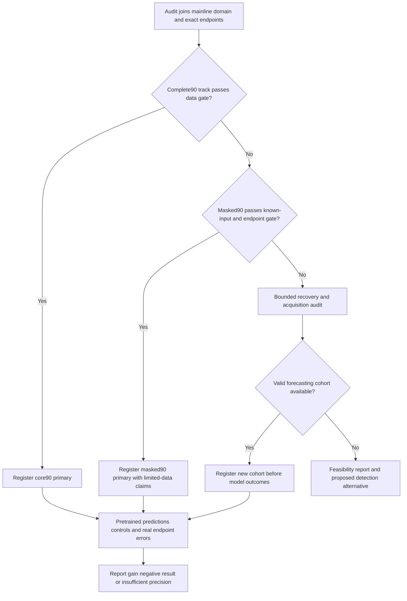

# Repository forecasting and data-feasibility plan

Date: 2026-10-13. **Proposed protocol, not completed benchmark.** Primary question: do compact pretrained forecasters improve exact 30/60/90-day repository SQALE forecasts over persistence and debt-specific tabular controls? Use current measured burden and forecast burden separately from actual developer repair effort.

## Data choice and evidence

| Source | Verified evidence and limits | MVP decision |
|---|---|---|
| Local `/home/hp/TECH_DEBT/td_V2.db` | This turn: 67,550 `SONAR_ANALYSIS`,66,711 `SONAR_MEASURES`,153,994 `GIT_COMMITS`,31 projects. Same-date detailed audit: unique revision/analysis joins, historical timestamp equality,19,954 unmeasured in-span commits, irregular gaps | Primary repository research source; no large download required; build exact states and labels later |
| [Technical Debt Dataset V2](https://github.com/clowee/The-Technical-Debt-Dataset) | Official2.0.1 release, research-purpose CC BY-NC-SA4.0,31 master histories; raw project measures, not a ready forecasting mart | Attribute dataset and retain applicable reuse/export terms; manifest input DB hash and release identity |
| Own Sonar collector | Complete revision/source proofs and Git/module code exist; no admitted real module cohort demonstrated in bounded audit; V3 operator recovery unresolved | One current repository demonstration; own-domain history only if proof exists; future recovery before rescan |
| Retained monthly source-only corpus |180 exports,144 distinct revisions across10 repositories; existing file mart mixes90/91/92 days,96.52% unchanged minute pairs | Secondary sensitivity source; no automatic compiled-domain or exact-target admission |
| [NPFDataSet](https://huggingface.co/datasets/MaramAllah/NPFDataSet) | Public card/API; unknown license; claimed 60 weekly scans, labels21/28/91 days, active bug+security+smell effort; complete coverage unaudited | Secondary investigation only; do not redistribute/use before permission, or relabel 91 as 90 |

Detailed evidence: [data audit](../2026-10-13-refinement/digests/data-reaudit.md), [fresh public-source checks](digests/research-check.md). Counts are not independent observations or valid training labels. Future endpoint cohorts remain unbuilt. V2 profiles/timestamps support linkage but not actual historical scan execution, complete analyzer invariance or online availability.

**Granularity:** native repository measures require no inferred module/file attribution, so repository is primary. Existing module schema, identity and graph work stay intact. File/monthly and module forecasts are deferred until measured component histories and stable identities exist. Aggregating existing per-file Java measures creates a different population from a native whole-project measure.

## M1 extraction and integrity algorithm

1. Open DB with SQLite `mode=ro`, record file/release hash, schema and row counts. Retain source attribution. Join `SONAR_ANALYSIS`→`SONAR_MEASURES` on project/analysis key and →`GIT_COMMITS` on project/revision. Exclude blank, duplicate, nonfinite or ambiguous keys with reasons; do not sum duplicated joins.
2. Keep **all Git commits**, including unmeasured commits, for state selection. Parse parents and branch flags; freeze the retrospective mainline tip from unique ancestry evidence. If DB metadata is ambiguous, use an already-local registered Git mirror with matching object IDs, or mark blocked. No tip chosen solely because it has the latest Sonar measurement.
3. Follow first-parent chain. Require complete relevant ancestry and nondecreasing committer timestamps for each admitted segment; equal timestamps use chain order. Reject/censor segments crossing missing parents, time inversions or ambiguous tips. Validate imported naive analysis dates against UTC Git values and explicitly record the zero-offset import policy. Commit time is an **ancestral availability approximation**, not proof of historical branch publication.
4. Preserve native project `SQALE_INDEX`, nonnegative finite minutes, plus optional `NCLOC`/complexity. Keep reliability/security fields separate. Build imported domain segments from canonicalized available full quality-profile/language metadata and scope; absent metadata blocks primary admission. Record unknown scanner/plugins/rules/build mode, never manufacture their hashes. Constant known metadata is a proxy compatibility gate, not complete analyzer certification. No target window crosses a known segment transition.
5. Publish `AUDITED_IMPORTED` linkage/data integrity rather than own `VERIFIED_SCAN`. Compute metadata coverage, excluded states, duplicate/missing records, distinct revisions, profile transitions and independently hand-inspect12 states across the pilot including unchanged and unmeasured changes. Samples check data correctness, not model efficacy.

Select a pilot deterministically using metadata only: identify each project's longest valid known-domain mainline segment; choose up to six with the longest shared chronological coverage, tie by project ID. Save every exclusion and selection rule. Outcome magnitude and forecast errors do not drive project choice. If fewer than six survive, continue a descriptive smoke case but do not present it as the full repository-generalization study.

## Exact state grids and targets

Primary metric `project_sqale_stock_minutes`; primary scope is the native project population measured by that imported domain. Repository additions/removals legitimately change stock; the result is not a causal debt-introduction or remediation measure.

Origin candidates: each Monday00: 00: 00 UTC within the admitted source-history/domain interval. Core input has **90 daily points**, `t0-89days … t0`, at exactly 86400 seconds spacing. At each grid point choose the last eligible first-parent state at/before cutoff, then locate its unique compatible measurement. Mark `MEASURED` or `REUSED_SAME_STATE`. Reuse does not create independent observations. An unmeasured changed revision yields `MISSING_STATE`; do not carry an earlier measured stock. No point extends beyond the recorded last available mainline state. Daily contexts with any missing value are excluded from the primary comparison.

For each origin and h∈{30,60,90}, `endpoint_utc = t0 + h*86400seconds`; label is measured SQALE of the selected exact state under the same known-domain policy. A scan need not occur at that exact second. Missing selected state, incompatible scope/domain, branch ambiguity or incomplete export leaves actual null with a reason. The observed debt change is `actual_stock - origin_stock`, retaining negative values.

The first future grid step is t0+1 day; Chronos output indices29/59/89 correspond to exact30/60/90 days. Request90 native forecast steps once and extract the three endpoints; store the path and native quantiles. Do not require measured values at every intervening future day for endpoint scoring. Context requires90 valid daily points; endpoints only require their exact matched states. Weekly 13 step/91 day forecasts, if used as secondary studies, have distinct target and evaluation records.

## Missingness policy and data gates

**G1 integrity:** no ambiguous scored join, wrong target unit, future feature or falsely filled endpoint; imported provenance limits documented. One failure disqualifies the affected record, not necessarily the whole database.

**G2 pilot:** six eligible repositories is a pragmatic pilot target, not a statistical sufficiency law. Report origins per horizon, distinct revisions, changing/constant endpoints, context reused fraction, excluded reasons, eligible time spans, and greedy non-overlapping h-day windows per repository. Require nonempty train/validation/test cohorts and two untouched repositories for a cross-repository pilot. Fewer series/windows yields case-study or `INSUFFICIENT_DATA`, with no generalized superiority claim.

**G3 model context:** core90 comparison requires complete 90 daily past points, origin and actual endpoint. TTM 30 requires 90; TTM 60 requires 180; TTM 90 requires 512 and native 96 future steps cropped90. Context length is not an accuracy guarantee. One endpoint-only scored origin needs89+30/60/90 days of chronological coverage for the core track, or511+90 days for TTM90; a full-path metric would additionally need each intermediate outcome. No future path is fabricated from endpoint labels.

**Limited history track:** after the strict audit, construct masked90 with a complete timestamp grid and NaNs for genuinely missing historical stock. Require at least 80% known daily values, a known origin and exact observed endpoints; freeze this proposed threshold and report distinct measured revisions. Chronos supports missing-target masks in upstream source; local correctness/performance remains untested. If core90 fails G2, register masked90 as the primary limited-data study **before any model output is inspected**; otherwise it is a secondary sensitivity. Reapply G2 to the fallback. Never pool tracks, replace missing labels, choose the track by lower forecast error or claim complete histories. The strict TTM comparison never uses LOWESS-filled gaps. This gives supported masked forecasting a fair investigation before paying for large scan collection or proposing a pivot.

Masked90 baselines receive the same values/missingness. Persistence requires the known origin; trend fits actual timestamps of known last 30 daily points with at least24 known values, otherwise a recorded persistence fallback. Exact lag values may be null. Window means/slopes/std require at least 80% known window points, otherwise null; include explicit feature availability flags and known-grid fraction. Ridge imputation/scaling uses training only, CatBoost retains NaNs; no missing past target is reported as an observed zero. The masked feature allowlist and thresholds are hashed before predictions.

## Leakage-free chronological and repository splits

Before examining model outcomes, freeze eligible repository IDs and absolute UTC split dates from metadata. Hold out `max(2,ceil(0.25*N))` repositories, sorted by SHA-256 of `study_id+repository_id`; do not fit/tune/calibrate on them. For the remaining development repositories, determine the common valid origin interval `[A,B]`, where B already excludes unavailable future history for all 90 days. Set validation start `V=A+0.60*(B-A)`, validation end `E=A+0.80*(B-A)`, rounded forward to Monday UTC; test start `T=E+90days`, rounded forward to Monday UTC. Persist these exact dates in `splits.json` before inference.

- Train development origins before V only when `label_end < V`; this purges crossing labels for each horizon.
- Validation development origins in `[V,E)`, with labels available before T; select parameters/defaults there only.
- Temporal test development origins in `[T,B]`; held-repository test origins use the same `[T,B]`. No earlier held-repository outcomes may guide tuning. Its own past stock can be supplied as context at prediction time; that is observed input, not model fitting.

Require nonempty phases and report lost origins from the 90 day embargo. If this common calendar policy is infeasible, reduce to metadata-selected longest-overlap repositories or report the case-study block; do not silently switch to random/per-row splits. Save both familiar-repository and unseen-repository results separately. An optional second rolling fold is deferred until the first full study works. Split dates may use metadata and completeness to ensure available labels; report selection/missingness bias. Labels are sealed after construction and can be read for validation only in the validation phase.

## Models, inputs and integration choices

All adapters receive target-only grids in the primary track. Numerical forecasters are not validated technical-debt models until this study. Proven current contracts and exact links are in [research-check](digests/research-check.md).

| Model | Exact planned input/output | Required role |
|---|---|---|
| Persistence | origin SQALE → same stock at all horizons; delta0 | Mandatory strongest trivial control, including unchanged series |
| Bounded linear trend | OLS last 30 daily stocks, extrapolate h, common stock≥0 postprocessing | Mandatory statistical control; not called seasonal-naïve |
| Ridge | past-only fixed summaries, direct per-horizon delta regression, α∈{0.1,1,10} on validation | Cheap feature-based control |
| CatBoost | same summaries, separate delta regressor per h; MAE,iterations200,learning rate0.05,depth∈{4,6},seed42,CPU 1 thread | Mandatory debt-specific model, reuse existing dependency/methods |
| Chronos-2 Small | ID/timestamp/target dataframe only,90 regular daily context,`cross_learning=False`,90 steps; point q50,native q10/q90 | Mandatory pretrained research model; checkpoint `ddec01313e50b6bc58ebaa92ede81bc24a3d9f9a` |
| Granite TTM-r3 | one-channel complete daily tensors/masks, native branch output, decile axes normalized; mean point convention | Conditional alternative: 30 day branch first;60/90 only if contexts and resource budget fit |
| LightGBM | same direct horizon features;200 trees,num_leaves15,learning rate0.05,seed42,1 thread | Optional comparator, maximum 4 engineering-hours within reserved comparison time; omit if package/admission exceeds this |

Fixed feature allowlist: current stock, lags at 7/30/60 days, means/slopes/std over 30/90 days, distinct revision count. No IDs as predictors. Ridge scales/imputes on training only. CatBoost numeric missing features use documented NaN handling; complete target context is required for core90 and TTM, while masked90 uses its explicitly registered missing-input rules and feature flags. A later covariate ablation can add contemporaneous Git/size information, but it is outside the mandatory MVP and must be labeled as a larger information budget.

The split publisher provides separate training-label views; fitting may read train labels, validation evaluators may read validation outcomes, and prediction subprocesses receive past-only projected requests. Final test labels stay sealed until model/configuration freeze. For a constant training delta, skip all supervised fits and publish `CONSTANT_TRAINING_FALLBACK` predicting that observed training constant, with the same assigned cohort. For constant usable feature vectors, use the training median delta and record `CONSTANT_FEATURE_FALLBACK`. Do not drop constant cases or enable a changing-target claim. [CatBoost's constant-label option](https://catboost.ai/docs/en/references/training-parameters/common#allow_const_label) motivates explicit handling rather than an undocumented fit failure.

TTM branches and SHAs: 30=`90-30-dec-90-r3` / `417bfc83545095031c2a002ddfe73ac6b700ea1a`;60=`180-60-dec-180-r3` / `1ec010e9aca3da90fc5159d109749ae96b01806e`;90=`512-96-dec-512-r3` / `7b070728ff280ee2bb682bd8dfbe71da21ca2c7c`. Use explicit `TinyTimeMixerForDecomposedPrediction` with immutable SHA, not substring-dependent `get_model(SHA)`. Package source/environment lock is pinned independently. Do not initialize an untrained multichannel model and call it unchanged pretrained inference.

For each admitted TTM horizon create a **matched context track**: same IDs and90/180/512 input points for TTM, Chronos and controls. Longer tracks do not replace core90 results. Tabular controls keep the fixed feature allowlist and additionally include full-context mean/slope/std only in the longer-context track; freeze that allowlist. Report coverage loss versus the core cohort. No shorter-context model's full-cohort score is directly compared with TTM's selected subset.

Model point forecasts and every quantile use the same preregistered nonnegative stock clipping policy, saving unclipped values too; report clipping rates. Delta remains signed. Chronos's q50 and TTM's mean-slot convention remain labeled; MAE/RMSE expose differing loss tradeoffs rather than pretending they are identical estimators. Native q10/q90 gives nominal80% intervals, not proven coverage. No95%/90% interval is manufactured by renaming them.

## Actual future values, metrics and decision

The historical evaluator joins immutable forecast IDs to **held-out measured endpoint records after predictions publish**. This produces actual stock/error now from archived later revisions; there is no need to wait 90 new days to backtest. For a truly current repo, future values require future observations or retrospective same-domain history; current guesses cannot be scored as actuals.

For n scored predictions, error e=prediction−actual: MAE=`sum(abs(e))/n`; RMSE=`sqrt(sum(e²)/n)`. Compute these per repository/horizon and report their unweighted repository averages as macro metrics, plus pooled values and denominators. Baseline skill=`1−MAE_model/MAE_baseline`; undefined when baseline MAE=0. Also report absolute error reduction in minutes, constant/changing endpoint subsets, zero-stock cases and residual plots. Never use MAPE with zero-debt targets.

For actual y, quantile qτ: pinball=`(τ−I[y<qτ])*(y−qτ)`. Report decile mean loss, empirical q10≤y≤q90 coverage, width q90−q10, crossed-quantile frequency and interval score with α0.2: width +10*(lower−y)if y<lower +10*(y−upper)if y>upper. Calibration is assessed, not asserted; a separately calibrated interval is deferred.

Pair models by identical forecast IDs. Report successful-common-cohort metrics **and** attempted/success/failure coverage for the full eligible cohort. A model with failures cannot hide them by choosing easy surviving rows. Deployment assessment includes a separately labeled persistence-on-failure policy evaluated across the full assigned cohort.

The MVP default registry selects one model per horizon on the **data-audit-registered primary track's validation**: core90 normally, masked90 only under the data-only fallback rule. Only that exact track's candidates participate. TTM matched-track winners are separate research records; do not compare their smaller-cohort MAE to the primary score to pick a global default. Setting-specific fitted model IDs include hyperparameters and training/transform hashes. The normal predictor registry freezes with the validation decision; imported-domain research defaults do not become current-domain predictions.

Primary confidence analysis uses paired repository resampling2,000 times(seed42), averaging each sampled repository's metric difference; overlapping weekly origins stay in the same cluster. Also summarize greedy non-overlapping 90 day origin blocks. With fewer than eight held-out repositories, label bootstrap bounds exploratory and avoid a formal cross-project superiority claim; even eight does not guarantee sufficient precision. Report observed cluster counts, effect bounds and ecosystem/pretraining overlap limits. Select the default on validation; final test only confirms or weakens the claim. Proposed10%gain preference cannot substitute for adequate uncertainty, runtime or useful coverage.

## Acquisition and fallback ladder

1. Reconstruct existing V2 state/grid coverage before collecting anything. Try all31 metadata-eligible projects after pilot policy freeze. Valid unchanged-state reuse can recover points without extra scans.
2. Audit already-local own snapshots and original V3 recovery evidence if accessible; no implied 72 usable scans. Bound recovery effort to 4 hours. An unavailable operator environment remains blocked.
3. Audit NPF license/card and raw snapshot availability, maximum 2 hours. Only an authorized maintainability-only, calendar-correct separate study can use it. Sixty complete weekly points alone cannot supply 52 past+13 future scored TTM 91 day path; endpoint labels are not intermediate history.
4. If still blocked, use a deduplicated retrospective **own-domain** pilot of at most 12 required states and 6 extra engineering-hours, within the 12 hour ladder. Measure actual build/scan/export time. A current-domain scan cannot fill a missing point in the old V2 domain. Choose a whole consistent new-domain series; extensive history collection exceeds MVP time and requires replanning.

For required distinct states D and reusable same-domain states R, new scans=`|D−R|`; compute time=`jobs*measured_mean_minutes*(1+retry_fraction)/60`. Estimate throughput only after a pilot; no promised runtime from source-only scans. Months of prospectively waiting for 90 day outcomes cannot fit a4–6 week evaluation plan. If only 30 passes, deliver truthful partial capability. If all horizons remain infeasible, produce the negative feasibility report and propose independent pretrained detection as the alternative; do not call a weekly 91 day relabeling successful 90 day forecasting.
