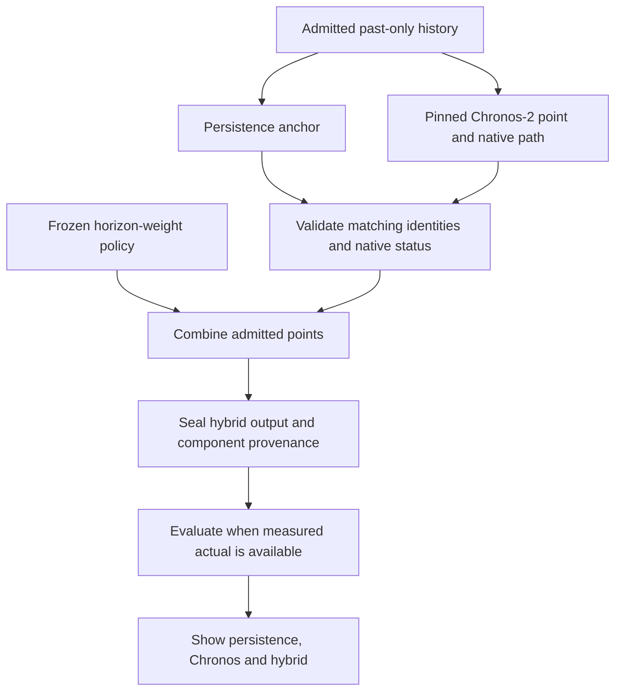

# Persistence + Chronos-2 hybrid forecasting plan

Date: 2026-10-30, Africa/Cairo. Status: fixed-grid retrospective diagnostic completed; no hybrid promoted. Product implementation and fresh validation/confirmation remain uncompleted. The user's request to use both methods together supersedes the earlier exclusion of combinations. The two base forecasters, source evidence, target/clock gates and runtime limits remain as defined in the [forecasting workflow](MVP_FORECASTING_PLAN.md).

## Latest diagnostic decision

The [2026-10-30 fixed-grid diagnostic](../../HYBRID_PRINCIPAL_DIAGNOSTIC_REPORT.md) tested all registered weights on the 226 exposed origins. None of the 25/50/75% Chronos blends beat persistence on repository-macro MAE at 3, 4 or 12 measured revisions. The 25% blend was closest, with error increases of approximately 0.000343%, 0.231210% and 0.463790% respectively. The 3-step difference is a practical near-tie, not evidence of improvement. Keep persistence as the MVP default; do not integrate a hybrid deployment policy. The protocol below remains the recorded proposal, not a winning model. No new weight search or fresh-evidence study follows automatically.

## What each method contributes

Persistence supplies a current-stock anchor: no movement from the last admitted observation. Chronos-2 supplies a possible future change inferred from target history. A small combination layer controls how much of that change enters the final forecast. Persistence can reduce an excessive Chronos movement; Chronos can move the forecast when persistence would stay flat. This is a hypothesis to test on this domain, rather than evidence that combining always improves accuracy.

Use **one fixed weight per admitted target/domain-policy/clock/context-track/horizon**, shared across repositories. Start with a point forecast combination, without a change classifier, per-origin gate, neural fine-tuning, online learning, extra covariates or another model family. Earlier Adaptive/Combined Persistence implementations remain paused; this bounded combination is a separate proposal with a separate policy identity.

Forecast averaging is an established approach, with simple averages a useful benchmark; the project-specific design below still needs its own validation. See the authors' [Forecasting: Principles and Practice, forecast combinations](https://otexts.com/fpp3/practical.html#forecast-combinations). Chronos's native output remains the pinned quantile forecast described by the [Amazon model card](https://huggingface.co/amazon/chronos-2); blending its point does not supply a validated hybrid distribution.

## The combination

For origin stock `P`, native raw Chronos median `C_raw`, admitted stock point `C = max(0, C_raw)`, and registered weight `alpha_h`:

```text
chronos_change = C - P
hybrid_point  = P + alpha_h * chronos_change
              = (1 - alpha_h) * P + alpha_h * C
hybrid_change = hybrid_point - P
raw_hybrid   = P + alpha_h * (C_raw - P)   # diagnostic; retain separately
```

All point values use the same target and units. `0 <= alpha_h <= 1`; negative/extrapolating weights are excluded. The primary hybrid combines the admitted nonnegative base points, so it stays nonnegative and lies between them. The raw diagnostic is not silently substituted for that point; clipping and blending need not commute.

| Weight | Meaning | Protocol role |
|---|---|---|
| 0 | Persistence only | Mandatory standalone control and deployment default until evidence passes |
| 0.25 | 75% persistence + 25% Chronos | Hybrid candidate |
| 0.50 | Equal-weight combination | Hybrid candidate and fixed averaging benchmark |
| 0.75 | 25% persistence + 75% Chronos | Hybrid candidate |
| 1 | Chronos only | Mandatory standalone control |

Freeze this five-value grid before evaluating any new study. Only the three interior values constitute combined forecasts. Do not search a continuous weight, add a feature gate or pick repository-specific weights in the first MVP iteration.

For `P=1000` estimated minutes and `alpha_h=0.25`, `C=1400` gives 1100; `C=600` gives 900. These examples explain arithmetic, not measured accuracy or a selected weight. Weights for 3/4/12 revisions are distinct from weights for 30/60/90 days; an unregistered horizon has no inferred weight.

## Runtime workflow



Run the two base forecasters once per admitted origin, or reuse already sealed base predictions. Combining points requires no further Chronos call. The new layer receives only paired forecast points, their origin stock and identifiers, plus the frozen policy. It does not receive actual endpoints, future features, residual labels or the full dataset.

For weight selection, materialize and seal the predictions for all registered candidate weights before opening numerical validation labels. The selector may then read only the authorized validation projection. Save the chosen policy before generating/sealing final test hybrid predictions and before numerical test labels are opened. There is no refit after selection.

A scheduled operator execution loads an explicit policy ID. The dashboard only reads completed artifacts. New actuals update error reports; they do not change weights. Any future policy revision requires a new version and separately registered evaluation.

## Development and confirmation protocol

1. **Register evidence roles.** Preserve the consumed principal run, its three exposed repositories and original method population. Old per-origin outputs may support a clearly labeled retrospective development diagnostic, in a new derived-artifact folder. They cannot supply a fresh holdout or a default-promotion result. Aggregate MAE alone cannot determine whether blending helps; paired per-origin predictions and actuals are needed.
2. **Audit complementarity on development only.** For matched cases, inspect the two errors and candidate combination errors, including whether the actual lies between the points. Report where Chronos helps or harms persistence and how averaging changes those errors. This is offline diagnosis; actual-derived error signs never become runtime features. There is no prerequisite that correlated errors guarantee useful gains.
3. **Admit fresh validation and confirmation.** Use an explicit new study with chronological development/validation and later confirmation; hold out genuinely untouched repositories if claiming unseen-project performance. Purge any earlier-role example whose endpoint has not matured strictly before the next role's first origin. Purge in actual endpoint time, using the longest registered horizon; revision steps are not days. Resolve date-only/same-day ambiguity conservatively. Retain the calendar plan's state/domain/context/embargo gates when using elapsed-day targets.
4. **Select the policy on validation only.** Score all five weights on the same full assigned cases using equal-repository macro MAE separately per target/domain-policy/clock/context-track/horizon. Include the preregistered typed fallback policy. If several weights are within 1% of the minimum MAE, choose the smallest alpha among them. If minimum MAE is zero, only exact zero ties qualify. No per-project tuning or manual weight override follows error inspection. Selecting 0 or 1 is a standalone result, not evidence of cooperation.
5. **Freeze and test once.** Freeze weight, source component IDs, selection population and all comparison settings. Evaluate the selected hybrid, persistence, Chronos and fixed 0.50 benchmark on the same untouched assigned confirmation cases. If the selected hybrid is 0.50, report the shared result once. Keep test metrics separate from validation and descriptive old-data diagnostics.
6. **Keep the result honest.** A candidate remains research-only until the promotion gates below pass. Without fresh confirmation, the artifact may say `DEVELOPMENT_ONLY` and the product retains persistence as its default. Do not rename exposed old cases to satisfy this gate.

The new study manifest must freeze actual split dates/IDs and exposure before execution; this document supplies the protocol, not a claim that fresh data already exists. Calendar and revision studies maintain separate registrations, weights and outcome tables. Failure to obtain fresh support is a recorded readiness block, not a reason to reuse exposed outcomes for confirmation.

## Measures and promotion gate

Report persistence, Chronos and hybrid together: repository-macro and pooled MAE/RMSE, absolute minute differences, skill versus **each** base model, bias, case/repository support, changed/stable/increase/decrease errors, false movement, native success/fallback/failure coverage and runtime. Report both full-assigned and matched-native-success results. A zero reference MAE makes relative skill undefined; it cannot be overcome by epsilon or claimed as a percentage improvement.

Proposed promotion conditions, registered before fresh scores:

- The selected weight is strictly between 0 and 1, and validation macro MAE is at least 10% lower than **each** standalone method at the same horizon. This deliberately tests the value of using both methods, not just beating the weaker method.
- Validation Chronos native success is at least 95%; typed fallback cases remain in the assigned comparison. All integrity checks pass and existing resource caps are respected.
- The frozen hybrid has strictly lower macro MAE than both methods on untouched confirmation. Report per-repository effects and uncertainty; small/insufficient independent support blocks broad promotion and keeps the result exploratory.
- The new study preregisters its independent-support/uncertainty acceptance rule before execution. At least eight untouched repository clusters are required to consider a broad cross-project claim, without treating eight as a power guarantee. Use paired whole-repository error-difference resampling (2,000, seed 42); broad superiority additionally requires the exploratory 95% difference bounds below zero versus both bases. Report the actual dependence and limitations.

The 10% effect and 95% success thresholds are project choices inherited from the earlier policy, extended to compare both bases. They are not established guarantees. If validation chooses a standalone method, data are insufficient or confirmation fails, do not promote the hybrid. Preserve every outcome; do not retune against the confirmation set. A narrower repository/domain case study remains possible with explicit exploratory labeling and persistence as the default reference.

## Failure handling and uncertainty

A valid native Chronos path plus a registered policy produces `HYBRID_SUCCESS`, recording requested and effective alpha. A fully validated native quantile crossing uses the existing typed persistence fallback: hybrid point `P`, effective alpha 0, status `HYBRID_PERSISTENCE_FALLBACK`, requested alpha retained, no interval. Never count that as successful native cooperation. A valid alpha-0 policy is a selected standalone result, separately labeled from a runtime fallback.

Identity mismatch, missing/nonfinite components, invalid weight/policy, malformed output and unexpected model/resource failures stop the hybrid run; do not hide these under a generic persistence fallback. An independently published persistence result remains possible as an explicit partial comparison under the base workflow.

The first hybrid is **point-only**: hybrid q10/q90 are null. Keep Chronos native q10/q90 visible only on its own row, labeled uncalibrated. Moving/scaling its interval around the hybrid point, averaging endpoints or calling alpha a confidence/probability would introduce unsupported uncertainty claims. Residual calibration, if later needed, requires a separate matured calibration set and protocol and is outside this first slice.

A convex blend shrinks Chronos movement toward zero. It cannot reverse a wrong direction, invent a movement Chronos did not predict, or eliminate every false movement on stable endpoints when alpha is positive. If the same base dominates case by case or both share a directional error, blending may bring no benefit. Existing negative Chronos results motivate a bounded experiment but do not establish a winning combination.

## MVP implementation slices and acceptance

All files below remain planned product additions under `TechDebt360-MVP/`. The diagnostic used separate local research scripts; it did not implement these production modules.

| Slice | Planned files/actions | Demonstrable acceptance |
|---|---|---|
| H0: register diagnostic and evidence | Reuse P0/P1 comparison bridge; bind paired source hashes, exposure and allowed roles | Given missing per-origin evidence or mismatched clocks, readiness fails; no accuracy is inferred from aggregate MAE |
| H1: deterministic combination | Add `forecasting_mvp/hybrid.py`, `hybrid_policy.py` and `tests/test_mvp_hybrid.py` | Given 1000/1400 and 0.25, output 1100; 1000/600 gives 900; 0/1 endpoints reproduce base points; interior output is bounded; raw/clipped policy and typed fallback preserve provenance |
| H2: selector/evaluation | Add `forecasting_mvp/hybrid_selection.py` and `tests/test_mvp_hybrid_selection.py`; separate validation-label reader | Given sealed candidate outputs, only validation selects; smallest-alpha tie rule holds; wrong role/policy fails; changing test labels cannot change selected policy |
| H3: confirm and present | Register fresh validation/test data before execution; extend planned bridge/API/static views | Given frozen policy, test output keeps its identity; UI shows three rows, contribution weight, default/candidate/fallback status, errors and no hybrid interval |

The selector records population hashes, validation scores for every grid value, the tie decision, selected alpha per contract, proposed promotion result and exposure. Deployment policy changes require their own immutable record referencing successful confirmation; no automatic online switch follows chart inspection.

`hybrid_policy_id` hashes schema/formula, weight grid, target/domain/clock/context/horizon key, base checkpoint/runtime/forecast policy identities, clipping/failure/tie rules and selection-population digest. Each hybrid row links its source persistence/Chronos forecast IDs and records `requested_alpha`, `effective_alpha`, component points, prediction/change, status and null interval fields. It is a new derived prediction with its own ID and seal; original forecast IDs, seals and old six-method results are untouched.

The fixed-grid diagnostic is complete with no adoption. Continue the non-neural evidence bridge and standalone comparison MVP; product hybrid implementation is deferred after this negative result. Any fresh selection/confirmation or changed hybrid hypothesis needs a separate study. No improved hybrid result is claimed.
