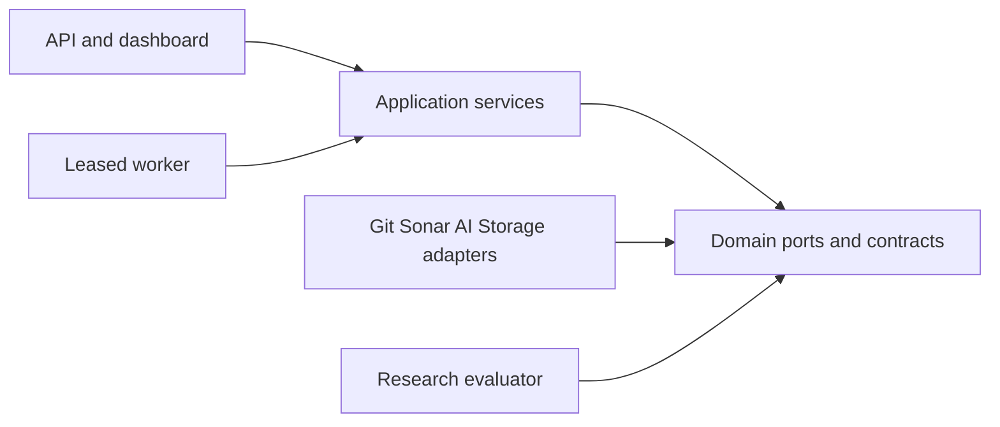

# Architecture spine: pretrained hybrid refinement

This updates the previous twelve-decision spine under the user's revised research priorities. Preserve AD IDs. AD-5/6/7/9/10/12 are extended or amended, and AD-13 establishes the experiment-first rule. The previous package stays read-only; this v2 design does not change implemented v1 artifacts.

## Design paradigm

Hexagonal modular monolith: application services call domain-owned ports; Git, Sonar, model and storage adapters implement them. One API/UI and durable worker share the domain contract. External runtimes are isolated process/tool boundaries, not business microservices.

## Invariants

### AD-1 — Typed evidence

- **Binds:** all.
- **Prevents:** category scores, generated text and measured minutes becoming interchangeable.
- **Rule:** measurements, static findings, learned annotations, deterministic graph facts, forecasts and repair outcomes have separate records. Only archived compatible analyzer evidence contributes maintainability estimate minutes; reliability/security and all-issue effort remain separate. Actual developer labor is a distinct outcome, never inferred from category scores or forecast minutes.

### AD-2 — Exact source and observation

- **Binds:** ingestion, analysis, models, API.
- **Prevents:** later source or another analysis being used under the same snapshot name.
- **Rule:** snapshot binds branch policy/cutoff/commit/tree/scope; evidence selects `(snapshot_id, analysis_id, domain_id)`. Preserve commit, availability assumption and execution/export clocks. Source units/chunks bind blob, coordinates and extractor policy; no silent latest-analysis selection.

### AD-3 — Verified publication and external exclusion

- **Binds:** analysis, jobs, storage.
- **Prevents:** CE success, partial exports or stale scanners entering trusted history.
- **Rule:** require complete CE task/server/project/analysis/revision/domain/source/pagination proofs before own VERIFIED publication. Exclude by server/project from submission through export/publication; quarantine unknown external state before reassignment. Worker fencing and cancellation guard atomic manifest publication. Imported records remain IMPORTED_PUBLIC and cannot satisfy own-domain verification.

### AD-4 — Domain and lineage

- **Binds:** history, matching, verification.
- **Prevents:** analyzer changes or scope/deletion changes being interpreted as debt evolution or repair.
- **Rule:** hash own analyzer/plugin/scanner/rule/remediation/JDK/binary/library/scope configuration; imported unknowns remain explicit in a separate approximation namespace. Use causal, conservative identities and censored ambiguous lineage. Before/after repair checks use the same analyzer domain and retained population; disappearing/deleted/excluded/suppressed findings cannot count as repairs. Whole-module stock delta and fixed-origin population are separate targets.

### AD-5 — Task-specific live capability

- **Binds:** evaluation, inference, API/UI.
- **Prevents:** experimental or expired results serving as validated predictions/classifications.
- **Rule:** forecast grants bind repository/domain/granularity/TargetContract/model/dataset/evaluation versions. A separate learned-task namespace binds task/repository/domain/granularity/model/dataset/evaluation versions plus modality/eligible unit/label/preprocessing/policy hashes; it does not require a forecast target for classification. Immutable grants and append-only revocations use expected-version active-pointer updates; enqueue/publication/every normal read atomically recheck current matching grant, expiry and revocation. States are UNSUPPORTED_DATA, RESEARCH_ONLY, VALIDATED and REVOKED_DRIFT; stored output status cannot override live eligibility. Domain/model/target/dataset/preprocessing/evaluation changes invalidate affected grants. Models cannot self-promote. License/data/load prerequisites are separate states from scientific failure; calibration is a separately versioned claim.

### AD-6 — Calendar target and feature/label separation

- **Binds:** history, forecasters, evaluation.
- **Prevents:** observation steps replacing calendar horizons or future labels leaking into models.
- **Rule:** immutable target fixes quality/metric/unit/granularity/population/lineage/origin eligibility/cadence/duration/as-of endpoint/missingness/censoring/availability. Exact 30/60/90-day targets use origin-relative UTC cutoffs at the registered duration in seconds; 13 weekly steps/91 days is a separate target. Models receive origin/past feature manifests only; future endpoint IDs/values/membership stay label-side and join after immutable prediction publication. Valid same-state reuse is distinct from filling across unmeasured changes; interpolation never creates ground truth. Adapters record native steps, endpoint mapping, point kind and quantile grid. Native 80% interval comparison requires actual 0.10/0.90 outputs; unsupported endpoints abstain without interpolation, while point eligibility remains separate.

### AD-7 — Complementary models and exact adapters

- **Binds:** classification, retrieval, generation, forecasting.
- **Prevents:** redundant permanent models or unchecked task/loader semantics.
- **Rule:** benchmark alternatives but promote at most one winner per complementary role. Register checkpoint/code/runtime/preprocessing/label/calibration/license and exact shapes; isolate incompatible runtimes. TTM uses a fitting native branch and explicit decomposed class plus immutable SHA; native point/quantile semantics and masks are checked, not inferred from the family name.

### AD-8 — Ownership and durable state

- **Binds:** application, worker, evaluation, storage.
- **Prevents:** duplicate publications or competing owners of IDs, reviews and grants.
- **Rule:** ingestion owns snapshots, analysis owns observation acceptance, identity owns source/lineage, retrieval owns chunks, ranking owns registered RankPolicy, remediation owns immutable candidates, evidence owns learned-candidate confirmation, evaluation owns grants/revocations and approval owns human export decisions. Worker executes fenced attempts only. Idempotency, reservations, disk backpressure and restore reconciliation precede replay.

### AD-9 — Registered interpretable ranking

- **Binds:** ranking, evidence, UI.
- **Prevents:** arbitrary mixed AI scores or forecast accuracy silently authorizing ranking.
- **Rule:** replace the old weighted v1 policy with one ranking-owned registered v2 lexicographic RankPolicy: descending recorded user criticality/maintainability severity/past-only first-parent 90-day added-plus-deleted-line exposure/compatible burden in minutes, then ascending stable ID. Freeze granularity/domain/development reference cohort, tiers, aggregation, membership/lineage, defaults and missingness rules; policies/cohorts are not one comparable scale. Missing factors form a separate partial queue; an unregistered policy yields factors but no rank and POLICY_NOT_REGISTERED. Verified, confirmed learned and unreviewed candidates remain separate queues. Task/type-specific confidence ordering requires validated comparability; otherwise candidate order uses stable ID. Forecast contribution requires its own utility study and new policy; classifier score never becomes minutes. Lexicographic precedence is a proposed review preference, not established business value.

### AD-10 — Two repair evidence types and immutable approval

- **Binds:** generation, verification, independent review, export.
- **Prevents:** a generated patch, green tests or human opinion being misreported as analyzer resolution.
- **Rule:** candidate binds one base observation/commit/tree, immutable patch/candidate tree/allowed files and a non-overridable minimum compile/test/differential/analyzer policy; new content creates a new Candidate ID. Budgets may stop work but cannot relax acceptance. Baseline failure or missing/timeout/incomplete evidence is PARTIALLY_VERIFIED; candidate regressions or required-check failures against a passing baseline are FAILED. EVIDENCE_VERIFIED requires all mandatory checks, targeted analyzer finding resolution with identity support and no policy-blocking new finding or hiding trick. Learned-only ENGINEERING_CHECKED means all mandatory engineering/safety checks pass without an analyzer-resolution claim. A separately stored independent ACCEPTED/REJECTED/INCONCLUSIVE review binds the exact issue/candidate/verification/rubric; acceptance never changes verification status. Approval binds base/patch/tree/verification/policy/evaluation hashes; export atomically rechecks that tuple, current base and permissions while retaining partial/review limitations. No automatic merge.

### AD-11 — Untrusted source and credentials

- **Binds:** ingestion, build/test/scanner/model, API.
- **Prevents:** repository or generated text controlling tools or leaking credentials.
- **Rule:** source/model text is data. Fixed commands run in restricted rootless copies; untrusted builds/tests have no fetch/scanner/admin secrets. Dependency fetch and scanner/export are distinct privileged phases. Candidates cannot alter tests, verification policies, scope or suppress findings. Tenant authorization precedes lookup; research permissions are explicit.

### AD-12 — Registered scientific claims

- **Binds:** datasets, evaluation, dashboard.
- **Prevents:** synthetic fixtures, repeated rows or publisher metrics becoming local scientific success.
- **Rule:** register task/cohort/splits/clone groups/budgets; purge crossing future labels; fit transformations/calibration only on train/validation. Keep sealed tests sealed until choices freeze. Report denominators, failures, abstention, actual independent blocks, grouped uncertainty and contamination limits. Native 80% intervals are distinct from separately calibrated 90%; TTM mean slot is not renamed a median. Analyzer-target and learned-only repair outcomes have separate assigned-unit denominators and cannot be pooled as a verified repair rate.

### AD-13 — Paired experiments before contribution selection

- **Binds:** research direction, roadmap, all learned roles.
- **Prevents:** choosing remediation or rejecting forecasting before comparative evidence.
- **Rule:** Experiment A investigates measured repository 30/60/90-day forecasting with naive/supervised/pretrained controls; Experiment B tests GraphCodeBERT/CodeBERT classification, lexical/CodeRank retrieval and Qwen repair against independent labels/checks. Primary selection requires comparative evidence from both arms or a documented blocking condition after the bounded data/license acquisition plan; completion order cannot pick the thesis. Select the primary contribution from recorded validity, incremental utility, generalization, cost and scope, without numerically equating MAE/F1/repair rates. If both demonstrate value within scope, select a bounded hybrid; if one does, it leads; if neither does, record negative or inconclusive results and narrow the claim. Blocked prerequisites remain pending rather than receiving invented effect/rubric scores; product promotion still requires held-out and operational gates.

## Consistency and stack seed

Schema/API v2 creates new artifacts with transformation/source hashes; existing v1 artifacts are never relabeled. Use RFC 8785 canonical UTF-8 JSON and domain-prefixed SHA-256 for policies/manifests, exact-byte hashes for blobs, UUIDs for mutable operational records, UTC timestamps and null missing values. SourceUnit/Chunk identities remain immutable content/policy hashes. Errors and role/research permissions remain those in the full solution contract; research execution/read never follows from ordinary analyst access.

| Name | Version |
|---|---|
|Python|3.12.3 locally inspected seed|
|SQLite|3.45.1 local Python binding seed|
|FastAPI|0.142.2 proposed release seed; [official release](https://github.com/fastapi/fastapi/releases/tag/0.142.2)|
|Existing analyzer recovery adapter|td360-v3 0.15.2 local source|
|Existing CatBoost research dependency|1.2.8 local forecast lock|

The local stack versions preserve the earlier inspected seed, not a claim that every new model runs on it. Model runtime/package locks follow future load checks; exact checkpoint hashes and primary-source contracts are documented in [model strategy](PRETRAINED_MODEL_STRATEGY.md) and [fresh model digest](digests/model-reverification.md). No stack seed is installed by this task.

## Operational seed and deferred decisions

One host/API/worker, SQLite metadata plus immutable artifacts, isolated build/scanner/model runners and bounded serial comparators. Keep development/research/demonstration roots separate. Private local volumes, TLS for remote use, backup/restore reconciliation, credential separation and measured resource admission are binding. Multi-host hosting, broad neural graphs and large specialists defer until their measured value and budget justify scope.

Classifier weight permission, actual as-of dataset admission, final rank tiers, package/loadability, study precision and hardware remain gated future evidence. Registration and abstention rules prevent incompatible integration while those facts are unresolved. Full contracts, experiment manifests and milestone acceptance live in the five companions; this spine carries decisions, not achieved software or model results.
