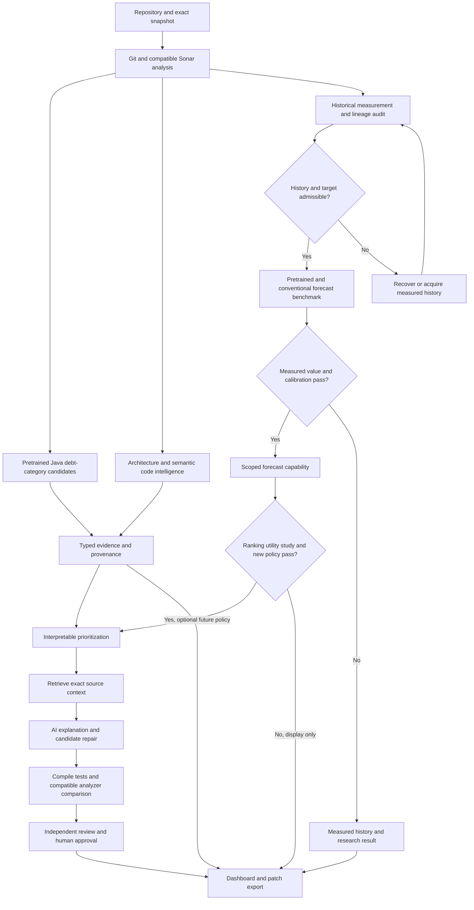
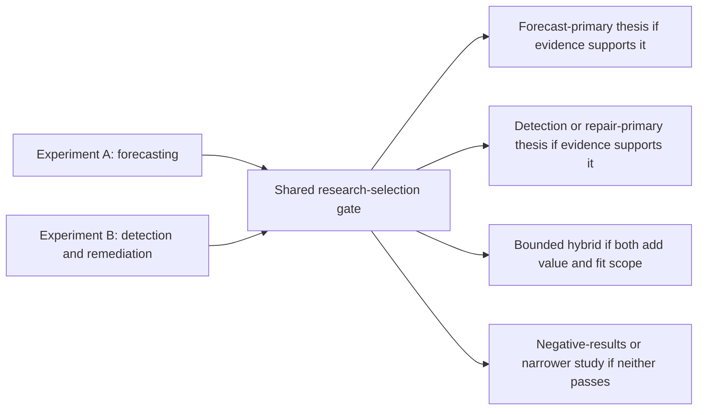

# Revised pretrained-AI-centered TechDebt360 architecture

Date: 2026-10-13. **Recommendation: a capability-aware pretrained hybrid platform, with detection/remediation and forecasting as two core research tracks. Select the primary thesis after Experiment A and Experiment B.** This revision supersedes the earlier preference for a remediation-first thesis. It preserves that package as historical evidence and retains its provenance, security and verification contracts.

This document defines future behavior. No model was loaded, no forecast or patch was evaluated, and no code, configuration or database was modified. “Verified” means an inspected local artifact or retrieved public contract; published scores are publisher evidence; experimental outcomes remain unknown. [Experiments](RESEARCH_EXPERIMENTS.md) govern promotion, and [model strategy](PRETRAINED_MODEL_STRATEGY.md) records exact checkpoints and licenses.

## What changes and what stays

Pretrained classifiers and numerical forecasters become first-class planned components. GraphCodeBERT TD is the lead Java category candidate, CodeBERT TD its matched control, CodeRankEmbed the semantic retrieval candidate, Qwen2.5-Coder7B the bounded generator, and Chronos-2-small the initial numerical candidate. Granite TTM, full Chronos-2 and TimesFM are serious forecast comparators on eligible histories. Production uses **one winner per complementary role**, not the permanent collection of every experimental model.

The old statement that TTM needs 512 observations throughout the family is corrected: R3 has short-context branches. Actual context and horizon are branch-specific. Public V2 histories deserve a repository-level 30/60/90-day investigation before a forecasting pivot. Existing own module data still does not establish a validated forecast. Architectural choice and current data readiness must not be confused with experimental superiority.

Retain the hexagonal modular monolith, one durable worker and immutable artifacts. The platform must support research-only outputs visibly; a static-analysis fallback preserves usability during blocked or failed AI runs without replacing the AI research objective.

## Integrated workflow





The primary study cannot be selected merely because one arm completes first. Distinguish prerequisite failure, inconclusive small samples and measured lack of benefit.

## Responsibilities and placement

| Component | Responsibility and data flow | Model / reuse | Evaluation and failure behavior |
|---|---|---|---|
|Repository ingestion|Resolve immutable commit/tree, source scope, branch/as-of policy; inventory Java and Git history|Reuse immutable Git reads and production-scope code|Reject inaccessible/ambiguous inputs; no source execution in API process|
|Static analysis|Compiled Java build, task/revision/domain binding, full raw export and measurement normalization|Reuse collector and V3 recovery; Sonar is the measurement source|CE success alone is insufficient; partial exports never become zero debt|
|Pretrained detection|Extract exact eligible functions; apply author normalization; produce independent category logits/scores and locations|GraphCodeBERT TD versus CodeBERT TD; diff classifier is a separate extension|License/label/preprocessing gates, clean/OOD review, per-type coverage; no authoritative debt absence|
|Architecture intelligence|Typed dependency/cycle/change evidence plus contextual retrieval; preserve unresolved coverage|Reuse lexical graphs; CodeRankEmbed; CodeAid as budget-gated specialist study|Similarity is not debt/duplication proof; generative smell claims remain candidates|
|History and lineage|Compatible observed states, causal identities, exact endpoint policy, input grids, immutable cohorts|Reuse identity/masks/dataset contracts, modify current target interfaces|Unknown endpoints, domain drift and ambiguous lineage are censored; import approximation is explicit|
|Forecasting|Numerical stock/delta prediction at registered horizons; compare target-only and covariate variants fairly|Chronos-small/full, fitting TTM R3 branch, TimesFM2.5; persistence/CatBoost/LightGBM controls|Research-only until independent data/value/calibration gates; one champion or no deployed prediction|
|Evidence assessment|Keep measurements, classifier suggestions, deterministic facts, forecasts and generated interpretation separate|No unrestricted LLM fusion score|Contradictions remain visible; model score never becomes remediation minutes|
|Prioritization|Review queues with explicit criticality, severity, measured burden, change exposure and optional validated future change|Deterministic policy first; learned ranking only with reviewer labels|Matched utility study; unsupported forecasts cannot influence operational rank|
|Context and explanation|Retrieve exact snapshot source/symbol/dependency/rule evidence; cite IDs and limitations|CodeRank versus lexical control, Qwen7B|No future target patch in index, no fabricated citations, no model-issued shell commands|
|Remediation|Generate bounded immutable candidate diff for one selected base analysis/domain|Qwen7B; SonarSweep later capacity comparison if feasible|Generation is not success; path/policy/suppression checks before isolated evaluation|
|Verification and approval|Baseline/candidate compile/tests, required differential checks, same-domain finding identity, independent acceptance|Reuse analysis adapters; new application contracts|Regression fails; missing baseline evidence is partial; immutable human approval tuple|
|Dashboard/API/evaluation|Expose evidence, research/validated states, experiments, runtime and limitations|One FastAPI API/UI, durable worker, local SQLite metadata and artifacts|Permissions, idempotency, fenced recovery, expired capability null/reason|

## Smallest complementary stack

Study shortlist: GraphCodeBERT/CodeBERT, lexical/CodeRank retrieval, Qwen generation and numerical forecasters. Intended successful MVP active set: **one Java category classifier + one retrieval model + one generator + one validated forecaster**. Four roles are a design target, not a demand that four models survive. Classifier licensing may delay that role; retrieval may lose to lexical; forecasters may lose to CatBoost/persistence. Record the result and reduce active runtime accordingly. GraphCodeBERT and CodeBERT are alternatives, not an obligatory ensemble.

TechDebtClassifier covers cleaned added lines, not whole-function debt categories. CodeAid emits smell descriptions, not calibrated architecture labels. SonarSweep generates Java; it is not an existing-code detector or a proven refactoring model. These retain documented ports and future comparison gates without joining the default runtime.

## Shared contracts and ownership

All records carry `schema_version: 2`, `schema_minor: 0`, input hashes and UTC times. This revision explicitly changes the research/target and prioritization contracts; do not silently feed v1 assumptions into v2. Operational IDs are UUIDs; immutable policies/manifests use domain-prefixed SHA-256 and RFC 8785 canonical UTF-8 JSON; raw blobs hash exact bytes. SourceUnit and Chunk identities remain immutable content/policy hashes as in the earlier contract, rather than new UUIDs. Preserve exact source coordinates, parser version and blob hash. The earlier [canonical contract detail](../2026-10-13-techdebt360/OPTIMAL_SYSTEM_ARCHITECTURE.md) remains applicable where the following v2 rules do not amend it. Existing schema-v1 artifacts remain read-only; an explicit adapter publishes a new v2 artifact with source hashes and transformation version instead of relabeling an old record.

| Record / owner | Required binding |
|---|---|
|Snapshot / ingestion|repository, branch policy, cutoff, selected commit/tree, commit timestamp, availability assumption, scope/source manifest|
|Observation / analysis service|exact `(snapshot_id, analysis_id, domain_id)`; raw task/project/revision/export/source proofs; own VERIFIED versus IMPORTED_PUBLIC|
|AnalyzerDomain / analysis service|server/plugin/scanner versions, profile/active rules/remediation settings, source/quality mode, JDK/binaries/libraries; imported unknowns explicitly null in separate approximation namespace|
|SourceUnit / identity|snapshot/blob/path/range/symbol/extractor version; same unit across classifier and retrieval must bind the same raw source|
|Annotation / model service|unit, input normalization/tokenizer hash, checkpoint/runtime, ordered type mapping, raw logits/scores, thresholds, calibration, eligibility and evidence status|
|GraphEvidence / extraction|vertex/edge kind, direction, lexical/resolved distinction, scope/membership, missing references, extractor policy; no promotion of lexical imports to compiler resolution|
|RankPolicy / ranking service|queue/granularity/domain, ordered factors/directions, tier boundaries, source units/lookback/lineage, development reference cohort, missingness/default/tie rules and immutable policy hash; registration precedes ranked output|
|TargetContract / history|quality/metric/unit, stock or delta, granularity, source population/membership, as-of endpoint, duration, grid/cadence/native steps, censoring/domain/availability policy|
|DatasetManifest / history|input observation IDs, target hash, origin/endpoint states, missingness/censoring, source/version, splits and common cohort; immutable|
|ModelVersion / model service|checkpoint and reviewed code SHA, environment lock, task/license, preprocessing/output/calibration, runtime resource profile|
|Forecast / model service|origin selector/target/cohort, endpoint, native steps, point kind, native quantiles, model/evaluation/capability grant; future measured endpoint ID is a label-side field only|
|Experiment / evaluation|preregistered arm/target, source/label/cohort/split hashes, budgets and seeds, metrics/uncertainty, failure coverage, data kind and conclusions|
|Capability / evaluation|immutable grant/version + append-only revocation; forecast key=repository/domain/granularity/TargetContract/model/dataset/evaluation versions; learned-task namespace uses task/repository/domain/granularity/model/dataset/evaluation versions plus eligible unit/modality, label/preprocessing and policy hashes; expiry/revocation checked at enqueue, publication and read|
|Recommendation / remediation|one observation, source/evidence/chunk IDs, prompt/model/budget/result hash and limitations|
|Candidate / remediation|base selector/commit/tree, allowed files, immutable patch/candidate tree, minimum verification policy; different content means a different candidate|
|Verification / analysis and remediation|before/after exact domain/source population, full baseline/candidate results, target identity/change, introduced findings, scope/suppression audit and status|
|LearnedCandidateReview / evidence service|annotation/source/observation IDs, independent reviewer and rubric/version, confirmed issue and proposed acceptance criterion; later outcome review binds exact candidate/verification hashes and records acceptance separately from analyzer resolution|
|Approval / approval service|base commit/tree, patch/candidate tree, verification manifest, policy/evaluation versions, actor/decision; recheck tuple/base before export|

API application services own repository/job/request creation; the worker executes owned ports through fenced Attempts and never grants capabilities or decides human approval. Identity owns SourceUnit/lineage mappings, retrieval owns immutable chunks, analysis owns observation validation/publication, remediation owns candidate content, and evaluation alone owns grants/revocations. A capability's active pointer changes transactionally using the expected prior version; stale evaluation cannot resurrect a revoked grant. Domain/model/target/dataset/preprocessing/evaluation changes invalidate affected grants until re-evaluation. Current eligibility is derived from the live registry; a stored output status cannot override expiry or revocation. Calibration is a separately versioned claim.

Capability states remain `UNSUPPORTED_DATA`, `RESEARCH_ONLY`, `VALIDATED` and `REVOKED_DRIFT`; expiry is checked against current UTC time independently of the stored state. Research prerequisites/runtime use distinct statuses such as `BLOCKED_LICENSE`, `BLOCKED_DATA` and `LOAD_FAILED`; none proves measured scientific failure. A model port reports registry-derived serving eligibility and cannot self-promote. Exact task/preprocessing/token-length eligibility is checked before execution; rejected-length coverage is reported without silently truncating Java functions. A category candidate with no permitted repair scope abstains rather than claiming that all four classifier types are automatically remediable.

Measurements include an explicit metric registry. [Sonar's current metrics](https://docs.sonarsource.com/sonarqube-server/user-guide/code-metrics/metrics-definition) distinguish standard `sqale_index` from multi-quality maintainability effort. Map each analyzer mode into a named target; do not presume identical cross-version semantics or double-count effort from an issue affecting multiple qualities. Current estimates, reliability/security effort, category probability and actual developer repair time stay separate.

Current own module code produces scope-changing stock delta with added/removed-file decomposition. Preserve that as its own target. A fixed-origin-member target needs a separate future adapter and new TargetContract; it cannot be claimed as current implementation. Repository stock is the first forecast study; module and file granularity expand only on genuinely adequate data and lineage.

## Model ports

Every port returns `OK`, `ABSTAIN` or `FAILED`, exact input/model hashes, output schema, runtime and reasons. No model writes authoritative measurements.

```text
ClassifyDebt(unit_id, normalization_hash, model_version)
  -> logits[4], scores[4], ordered_types, thresholds, annotation_status
RetrieveEvidence(snapshot_id, query, chunk_policy, model_version, k)
  -> chunk_ids, source_ranges, relevance_scores, retrieval_provenance
Forecast(observation_selector, target_hash, past_grid, masks, known_future_covariates, model_version)
  -> output_timestamps, native_steps, point_kind, point, quantiles, capability_state
ProposeRepair(observation_selector, finding_or_reviewed_candidate_ids, context_hash, generator_version, budget)
  -> cited_explanation, allowed_paths, immutable_diff, limitations
Verify(candidate_id, minimum_policy_hash)
  -> baseline_results, candidate_results, identity_comparison, status, evidence_manifest
```

Only genuinely known future calendar/planning inputs enter the forecast port. Future churn, debt, issues, paths and repair results are forbidden. At serving time, future endpoint state/commit is unknown; evaluation joins measured endpoint IDs later. Never let a prediction request require the actual future commit. Dataset manifests separate feature-side origin/past fields from label-side endpoint states; adapters receive only the feature manifest and registered timestamps. Label-side IDs, future membership/lineage and endpoint measurements cannot enter retrieval, model inputs or serving cache keys. Evaluation joins them only after immutable predictions are published.

Cache keys include tenant/source/snapshot, model/code/tokenizer, target/policy, inputs and generation settings. Model environments are isolated because forecaster dependencies conflict. Output schema failures and missing context are explicit abstentions/failures.

## API contracts

Prefix `/api/v2`; breaking v2 semantics do not masquerade as an additive v1 patch. Envelopes contain schema version/minor, data, provenance, evidence state and limitations. Errors contain `code, message, retryable, details, correlation_id`. Mutations require a tenant/actor/route-scoped idempotency key and canonical request hash; reusing a key with different input returns 409. Cursor pagination binds observation selector; default 50, maximum 200. Reader, analyst, approver and administrator roles remain; research execution/read are explicit permissions. Authenticate before record lookup; foreign-tenant IDs return 404. Bearer tokens or same-origin sessions are supported; session mutations require CSRF protection. Analyst permission governs approved jobs, approver permission governs decisions/exports, and administrator permission governs policy/access changes. Model text is rendered as untrusted text, never executable HTML.

| Route | Request → response | Guard |
|---|---|---|
|POST `/repositories`|URL/allowlisted path, branch, Java scope → repository|Analyst; URL/path/auth validation|
|POST `/repositories/{id}/analyses`|commit or as-of cutoff, domain → async job|Immutable resolution and per-project external exclusion|
|GET `/jobs/{id}`|→ attempt, stage, state, failures|Authorized tenant only|
|POST `/jobs/{id}/cancel`|expected Attempt/fencing number → cancellation request|Analyst; stale or late completion cannot publish|
|GET `/snapshots/{id}/evidence`|analysis/domain IDs → measurements/findings/annotations/graph links|Reject ambiguous snapshot-only selection|
|POST `/snapshots/{id}/debt-classifications`|eligible unit IDs, admitted model, mode → job|Analyst plus matching live task grant in normal mode; research_execute in research mode; blocked licenses cannot execute|
|POST `/repositories/{id}/experiments`|registered A/B manifest hash → research job|No arbitrary scripts/commands in body; requires approved prerequisites|
|GET `/repositories/{id}/history`|entity/domain/target/range → observed states and gaps|Preserve imported domain and exact target|
|POST `/snapshots/{id}/forecasts`|origin selector, entity, target hash, model, mode → job or reason|No future label fields; live valid grant or explicit research mode|
|GET `/snapshots/{id}/priorities`|selector, policy, queue → ordered factors and evidence|Unvalidated risk cannot affect normal ranking|
|POST `/annotations/{id}/reviews`|independent reviewer assessment, rubric and acceptance criterion → reviewed candidate|Analyst; immutable source/annotation binding; review is not analyzer evidence|
|POST `/findings/{id}/recommendations`|context policy, generator, budget → job|Exact source/evidence binding|
|POST `/reviewed-candidates/{id}/recommendations`|review ID, context policy, generator, budget → job|Classifier-only candidate requires recorded independent confirmation|
|POST `/recommendations/{id}/patches`|selection → isolated immutable candidate|No main working-tree mutation|
|POST `/candidates/{id}/verify`|minimum policy, bounded budget → job|Cannot relax mandatory checks|
|GET `/candidates/{id}/comparison`|→ diff, before/after tests/findings, limits|Exact patch/tree/policy hashes|
|POST `/candidates/{id}/outcome-reviews`|verification ID, independent rubric/outcome → learned-candidate acceptance|Analyst; exact content/verification binding; cannot upgrade verification status|
|POST `/candidates/{id}/approvals`|expected tuple, decision → approval|Approver; partial acceptance never upgrades verification|
|POST `/candidates/{id}/exports`|approval + expected tuple → patch artifact|Recheck current base/content/permission|
|GET `/models`, `/datasets`, `/evaluations`, `/capabilities`|→ versioned manifests/statuses|Research visibility and license restrictions|

Async mutations return 202 with job ID; synchronous record creation returns 201 and reads return 200. Invalid schema returns 422; authentication/permission failures 401/403; conflicts 409; worker/disk unavailable 503. Normal unavailable prediction data is null with a reason; normal execution without a valid grant is rejected with 422 and a reason. Research views must label uncalibrated suggestions and experimental forecasts explicitly. Research execution never publishes a validated product capability automatically.

## Interpretable prioritization

Use separate queues for verified analyzer findings, independently confirmed learned candidates and unreviewed model candidates. The v2 MVP uses a transparent **lexicographic policy**, not an opaque weighted AI score: user criticality tier descending, verified maintainability analyzer severity tier descending, trailing 90-day change-exposure tier descending, measured maintainability burden in minutes descending, then stable ID ascending. File/module severity is the maximum retained active maintainability finding severity; criticality comes from a recorded user assessment. Security/reliability remain separate queues. Change exposure is added plus deleted lines in first-parent changes over the preceding exact 90×24 hours, available at origin, excluding merge double counting and using conservative causal lineage. Frozen primary membership maps file exposure into module exposure. Tiers, defaults, boundary rules, granularity/domain and reference-cohort hashes are fixed in an immutable development-only policy; no numerical tier boundaries are claimed validated yet. A missing required factor forms a separate partial queue with its present factors displayed, rather than silently receiving zero or a new default. Lists from different policies/cohorts are not one comparable scale.

Ranking owns and registers that one policy manifest before producing any normal ranked output; clients/workers cannot invent local tier boundaries. Until registration, show the factor table with no rank and `POLICY_NOT_REGISTERED`. Lexicographic precedence is a proposed review preference to evaluate, not evidence of optimal engineer effort or business value.

Candidate queues sort first by recorded review eligibility/status. Within a validated task/type, use its registered confidence ordering and stable ID; without validated comparable confidence, sort by stable ID and expose raw scores as research annotations. Four category sigmoid scores do not imply a clean/debt probability or a universal file score. Candidate queues are not intermixed with measured minute totals.

Display each factor and original units. A calibrated future-growth probability or forecasted delta may become a separate “future deterioration” ordering after a utility study and a new policy version; it is absent from current rank when unsupported. Resolved dependency impact can be added later with an explicit extractor/coverage contract. CodeAid text does not populate a numerical severity field automatically. Compare this policy with severity-only, burden-only and churn-only orders under the same reviewer budget; retain the simplest equally useful ordering.

## Operational and verification boundaries

One API/UI, one orchestration worker, SQLite metadata on local disk, immutable JSON/CSV/Parquet/blob artifacts; no Redis, Neo4j, vector service or separate Java backend for the initial study. FastAPI 0.142.2 is a proposed verified release seed, not installed software; exact dependencies must be locked after future integration validation. SQLite permits one simultaneous writer ([official transactions](https://www.sqlite.org/lang_transaction.html)); short transactional job claims and application-owned ports suffice for one host.

Leases are keyed by server/project from before submission through complete export/publication; stale external tasks quarantine the project until reconciliation. Database fencing alone cannot stop an old scanner changing the server. Publish complete manifests atomically and reject wrong revision, domain drift, incomplete pagination or changed source scope. Recovery precedes rescanning when the submission state is unknown.

Job states are QUEUED, RUNNING, WAITING_EXTERNAL, SUCCEEDED, PARTIAL, FAILED, CANCELED and RECOVERY_REQUIRED; retries create new Attempt IDs and monotonically increasing fencing numbers. Short SQLite transactions claim work and publish only when current fencing and cancellation state still match; external work never holds the transaction open. Mandatory requested stages must all pass for SUCCEEDED; optional model failure may preserve static evidence with PARTIAL and explicit warnings. Before recovery/reassignment, bind the original task/project/revision/source proof and quarantine unknown submissions; lease expiry alone never authorizes a rescan. Restore pauses dispatch, invalidates pre-restore worker credentials/fencing, verifies referenced blobs and reconciles external tasks before any replay. Reserve per-job disk budgets, pause admission below the low watermark and resume above the high watermark; referenced evidence is never automatically deleted.

Untrusted repository build/plugins/tests receive no scanner, fetch, administrator or production credentials. Separate fetch broker/cache, restricted rootless build/test sandbox and narrowly privileged scanner/export adapter. Patches cannot change verification policies, tests, scope/exclusions or suppress findings. Repository text and model tool suggestions are data, not executable instructions. Authenticate before record lookup, redact secrets, reserve disk before work, and reconcile in-flight jobs after restore before replay.

Baseline failure, missing tests, timeout or incomplete compatible export means `PARTIALLY_VERIFIED`. Candidate regression or a required-check failure against a passing baseline means `FAILED`. `EVIDENCE_VERIFIED` requires all mandatory checks passing, targeted analyzer finding resolved with identity support, no prohibited new findings and no hiding/deletion trick. A learned-only confirmed candidate can instead receive the new v2 status `ENGINEERING_CHECKED` when every mandatory safety/differential/analyzer check passes; that status does not claim debt resolution. A separately persisted independent rubric outcome records `ACCEPTED`, `REJECTED` or `INCONCLUSIVE` against the original confirmed issue and exact candidate/verification hashes. There may be no Sonar rule to remove, so a learned-only acceptance never becomes `EVIDENCE_VERIFIED` or an analyzer-removal success. Approval/export preserves both status and review, and partial human acceptance never changes verification status. Human approval and all-tested behavior remain different claims. Main-branch apply/merge remains outside MVP.

## Hardware and user experience

Planning envelope: 8–16 CPU cores, 32 GB RAM, 100 GB free disk; one generation at a time. Qwen7B BF16 weights alone contain approximately 15.23 GB of parameter payload before runtime and caches. A 24 GB GPU is a proposed study-host budget, not a proven minimum or a guarantee of fit. A quantized variant requires its own loading, peak-memory and outcome validation; no fixed quantized GPU minimum is established. These are estimates; host capacity, latency and safe concurrency are unknown. Classifiers/embeddings/small forecasts can be tried on CPU; activation/model loading costs are measured in the first runtime gate. SonarSweep's publisher 48 GB+ requirement keeps it a separate large-host study. Never run all benchmarks resident together. Keep model loading, analysis and generation within one measured host reservation policy; experiment comparators load serially unless a later capacity gate proves safe overlap. Development fixtures, frozen licensed research corpora and validated demonstration snapshots use separate artifact/database roots. Remote access requires TLS and explicit roles; SQLite remains on private local disk, never a network share.

Dashboard views show model-suggested types and calibrated status, source evidence, measured remediation estimates, dependency coverage, actual history gaps, per-horizon forecast readiness, native/corrected intervals, review factors, candidate diffs and verification outcomes. Explain why 30 days may be eligible while 90 days is not. Distinguish valid scientific negative results from unsupported data and model runtime failure. Current measurements remain usable during blocked AI runs, while the research agenda keeps both pretrained experiments central.

## Research selection and stop rule

Do not label forecasting inferior because fresh module history is absent; first audit/import existing repository histories and price measured backfill. Do not label remediation superior because generated patches look plausible; Experiment B must independently validate detections and outcomes. [Experiment A/B](RESEARCH_EXPERIMENTS.md) compares scientific validity, measured incremental value, uncertainty, runtime/cost, independent domains and graduation scope. If both pass, a bounded hybrid is appropriate; if one passes, it leads the thesis; if neither demonstrates value, preserve useful evidence and report limitations/negative findings. No experiment is executed by this design task.
