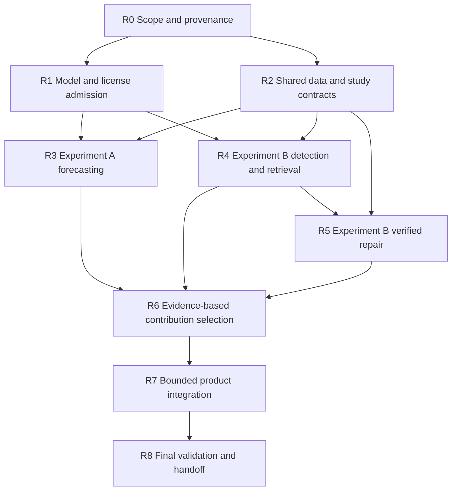

# Revised implementation roadmap

Date: 2026-10-13. **This is an actionable future plan, not authorization to implement it.** No development, package installation, scanning, training, inference or experimental execution occurred in this task. Primary contribution selection follows Experiments A and B; an architectural preference does not decide it.

## Minimum scope and budget

Aim for one Java research workflow, one classifier winner, one evidence retrieval policy, one generator and one validated numerical predictor where data supports it. Pretrained forecasting, detection, retrieval and remediation are core research roles. Experiment controls are temporary. Build a small dashboard after study gates. Keep 30/60/90-day repository forecasting as a core experiment; add module/file deployment only with actual component histories and lineage. Exclude distributed queues, graph/vector servers, full Java backend rewrites, unrestricted agents, autonomous merges, neural graphs/TCNs and permanent ensembles from the minimum scope.

The milestone estimates sum to **38–64 contributor-days**: minimum 2 + 3 + 4 + 5 + 4 + 7 + 2 + 7 + 4 = 38; maximum 3 + 5 + 7 + 8 + 7 + 12 + 3 + 12 + 7 = 64. These are implementation and experiment-work estimates, excluding major historical build repair, full backfill, independent reviewer labor and external waiting time.

At **5–8 effective contributor-days per week**, 38–64 days imply approximately **5–13 elapsed weeks before contingency** (38/8 to 64/5). At **3–5**, the range is approximately **8–22 weeks before contingency** (38/5 to 64/3). Reserve **20% contingency**, increasing the effort envelope to 45.6–76.8 contributor-days. These are planning assumptions, not an agreed schedule. Confirm the deadline, effective team capacity, hardware and reviewer access before execution. Parallelism applies only to independent work and does not increase the assumed total weekly capacity.

Human assessment is a separate dependency. The following estimates cover the pilot once; milestone references below refer to these same hours rather than additional allocations.

| Pilot assessment | Assumed workload | Reviewer labor, before adjudication |
|---|---|---|
| Function gold labels | 200–300 functions; two independent reviews of 4–8 minutes each | ~27–80 hours |
| Patch outcomes | 30 patch units; two independent reviews of 15–30 minutes each | 15–30 hours |
| Retrieval relevance | 50 queries; two independent reviews of 2–3 minutes each | ~3–5 hours |
| Total | Three distinct assessment tasks | ~45–115 hours, plus adjudication |

Gold labeling, retrieval relevance and patch acceptance are different judgments even when they concern the same code. Do not count the same completed judgment again in R4, R5 or the budget total. If contributors also serve as reviewers, account for their review hours once and reduce their effective implementation capacity accordingly. Expanded final-study annotation is additional, separately budgeted work. These estimates are not measured session hours. Final study size follows the precision assessment; the pilot does not promise a powered result across repositories.

An early **one- to two-week feasibility checkpoint** can inspect a subset, hardware and licenses. It cannot establish forecast accuracy or repair superiority. The comparative experiment and contribution-selection gate come later. Unresolved licensing, data or load prerequisites remain explicit blocked states rather than negative model-effect results.

## Dependencies

A and B share provenance and harness interfaces, not target labels or accuracy metrics. They can proceed in parallel after their role-specific prerequisites, within hardware and reviewer limits. The diagram expresses the complete study path; independent repair contract checks can proceed while classifier licensing is unresolved. Record that block and pursue permission without reporting classifier completion. If A lacks data, attempt the bounded acquisition plan before deciding its outcome. Neither a feasibility check nor a blocked arm establishes which contribution should lead the final project.

## Milestones

All efforts below are contributor-days unless explicitly identified as reviewer hours. Every action, command, check and acceptance test is planned future work.

### R0 — Refresh source, resources and study scope

**Effort: 2–3 days.** Reuse the completed re-audit and source-preservation records. Confirm the collector HEAD and uncommitted work; locate the original V3 operator environment; record GPU, disk, capacity, deadline and reviewers. Register source/data/model licenses and selected repository metadata. Preserve old scientific artifacts and sealed NPF outcomes.

**Input → output:** existing workspace, source and data → source-version inventory, resource envelope, license issue register, repository registry and A/B feasibility budget.

**Acceptance:** distinguish owned, imported and synthetic evidence; establish actual resources and review capacity; do not infer valid history from CE task counts; establish the source-hash baseline. Future verification uses read-only metadata/count checks and integrity comparisons. Missing operator access keeps recovery pending; do not assume 72 valid observations or automatically rescan.

### R1 — Pretrained task, license and runtime admission

**Effort: 3–5 days.** Preserve all 11 candidate research roles. Resolve classifier weight permissions, semantic label mapping and author normalization; inspect and pin CodeRankEmbed custom code; pin the Qwen chat template. Plan isolated load tests for Chronos-small and a TTM branch that fits actual data. Validate TimesFM/full Chronos contracts within the comparison budget. CodeAid and SonarSweep remain specialist comparators with separate task and resource gates.

TTM admission must use real branch context rather than a family-wide 512-observation assumption. Checked options include weekly 52 → 16 cropped to 13 steps, daily 90 → 30, daily 180 → 60 and daily 512 → 96 cropped to 90. The weekly task is 91 days on a weekly grid, not a substituted daily 90-day label. Each branch requires its real context at the forecast origin and compatible future evaluation observations. [Exact branches and revisions](PRETRAINED_MODEL_STRATEGY.md#ttm-branch-and-loader-decisions).

**Input → output:** exact model revisions and small fixed inputs → ModelVersion/environment records, input/output shape and eligibility report, measured latency/peak memory, and admission or blocked reason.

**Acceptance:** weights load in the recorded environment; logits, embeddings, forecasts and generated text match their contracts; execution licensing is resolved; no label or effort semantics are invented. Future tests cover TTM class dispatch with immutable SHAs, default branch mappings, masks, axes, native cropping and the `mq_q50_type="mean"` distinction; inconsistent classifier metadata; overlength inputs; OOM/timeouts; mismatched checkpoints; and custom code.

A license or contract block preserves that role's research question. An unsupported environment calls for a bounded supported runner or clarified permission. A reproducible load failure is a runtime result, not an accuracy result. Published benchmarks do not authorize product promotion.

### R2 — Shared evidence, target and experiment harness

**Effort: 4–7 days.** Adapt the existing collector, source identity and missingness handling behind versioned interfaces. Build the minimal isolated harness described in RESEARCH_EXPERIMENTS. Register exact analysis selectors, metric/domain mode, source/blob/lineage, as-of clock and cutoffs, target population, cadence, cohorts, split manifests, model/runtime and candidate-verification policies. Support 30/60/90-day targets separately; the current CLI's 90/91 support requires an additive adapter.

**Input → output:** raw measurements, Git/source and task policy → immutable eligible observations, TargetContracts, A/B manifests and machine-readable failure/coverage records.

**Acceptance:** never treat a missing target as zero; prevent future-feature and path-mapping leakage; keep domains distinct; distinguish known-state reuse from forward-filling an unmeasured change; record existing module-membership delta semantics. Future tests cover partial paginated exports, wrong revisions/profiles, ambiguous lineage, missing selected commits, duplicate revisions, overlapping label windows, training-only transforms, raw/normalized source locations and interrupted publication.

Reuse collector proofs, V3 recovery, Git reads, causal identities, checksummed publication and purged-fold concepts. Job-local configuration and API changes belong to later implementation. New HF/30/60/V2 A/B adapters are future work. If scope expands, reduce the harness to common artifact contracts and operator commands.

### R3 — Experiment A: forecasting

**Effort: 5–8 days after R1/R2.** Large fresh collection is excluded. Start with six preregistered V2 repository metadata cohorts. Construct exact state, horizon and grid contracts with compatible observed endpoints; measure coverage, distinct revisions, non-overlapping blocks and precision. Compare persistence, trend, Ridge, CatBoost and LightGBM with Chronos-small and eligible TTM branches; include full Chronos/TimesFM controls within the frozen budget. Expand to the available 31 projects only after the policy is stable.

**Input → output:** A manifest, eligible grids and models → all-origin forecasts/failures, per-horizon metrics, calibration, uncertainty, runtime and gate judgment.

**Acceptance:** use a common eligible cohort/context for target-only comparison; separate covariate and extended-context variants; use held-repository/time validation; report native 80% intervals and honest point semantics; match real context to native branch horizons; do not substitute a 13-week label for a daily 90-day label. Proposed value gate: ≥10% macro MAE gain, paired improvement confidence interval above zero, benefit in ≥70% of eligible repositories, and adequate calibration/coverage at an acceptable cost. These thresholds are preregistration proposals, not achieved results. Insufficient precision yields an inconclusive result. Valid negative or inconclusive research cannot support superiority claims.

Future tests cover as-of selected states, exact 30/60/90 grid steps, TTM native-horizon cropping, missingness, censored labels, constant series/zero denominators, cohort matching and future-covariate leakage. Missing states trigger a deduplicated backfill pilot before abandoning the arm. If only a shorter horizon has evidence of value, expose only that validated horizon. If a conventional predictor wins, use it for that target and report the foundation-model comparison honestly.

### R4 — Experiment B: detection and evidence retrieval

**Effort: 4–7 contributor-days**, plus the function-label and retrieval reviewer hours already listed in the budget. Review 200–300 pilot functions across at least five repositories, including clean negatives, OOD examples and rare types. Register unknowns, strata, clone groups and independent gold labels. Benchmark GraphCodeBERT/CodeBERT with the exact recipe, thresholds/calibration and held-project protocol. Compare CodeRankEmbed with lexical/symbol retrieval on 50 queries.

**Input → output:** B units, rubrics and models → annotations/retrieval outputs, eligibility/coverage, per-type metrics/calibration, relevance/citation metrics, runtime and preliminary admission.

**Acceptance:** resolve weight permission and semantic mapping; do not claim that resplitting pretrained training data creates an independent evaluation; do not turn static rule types into automatic Tesoro gold labels; do not interpret an all-zero vector as debt absence; disclose overlength coverage. Gate on independent precision/utility and retrieval benefit, not published F1. Future tests cover four logits and independent sigmoid, raw-to-normalized source mapping, query prefix/CLS pooling, wrong modality and exclusion of future-fix retrieval.

Retain one classifier winner or no product classifier according to measured results. Blocked licensing is not measured inferiority. Retrieval can remain lexical if embeddings add no value. Detection remains a primary-contribution candidate even if repair fails. Diff and coupling-smell tasks need separate adjudicated units; they are extensions rather than automatic R4 scope.

### R5 — Experiment B: bounded repair and independent outcomes

**Effort: 7–12 days**, plus the patch-review hours already listed and external waiting time. Create 30 prospective finding units across five repositories and 3–5 small rule families, with meaningful baseline checks. Compare available deterministic guidance/quick fixes with Qwen under local, lexical and embedding evidence conditions and equal budgets. Record immutable patches and compile/full-test/differential/same-domain analysis results, with identity, suppression and deletion checks. Assess learned-only confirmed candidates in a separate cohort without inventing Sonar finding removal.

**Input → output:** registered B repair manifest and baseline evidence → candidates, verification funnels, blinded outcome reviews, pass@1/runtime results and feasibility/value judgment.

**Acceptance:** failed baselines or missing required evidence yield partial/unsupported verification, not success; candidate regressions fail. Keep these outcomes distinct:

- `ENGINEERING_CHECKED`: all mandatory engineering, safety, differential and applicable analyzer checks pass under the registered policy. Independent semantic outcome `ACCEPTED`, `REJECTED` or `INCONCLUSIVE` remains separate and cannot change or upgrade this verification state.
- `EVIDENCE_VERIFIED`: an analyzer-backed target is resolved under the registered same-domain/source-identity policy and all minimum checks pass. Human acceptance is recorded separately.
- Learned-only accepted repair: a technically checked candidate also receives independent semantic acceptance. This does not claim analyzer debt removal or become `EVIDENCE_VERIFIED` merely through review.

Count all failures, no-candidate outcomes and timeouts in the registered eligible denominator. Fix the maximum at three candidates and preregister the token budget. For the analyzer-backed cohort, the proposed benefit gate is ≥10 percentage-point gain in accepted `EVIDENCE_VERIFIED` pass@1, paired improvement confidence interval above zero, and no systemic unsafe acceptance. Report learned-only technical/reviewer outcomes separately rather than pooling them as analyzer-target resolution. The pilot may be inconclusive.

Future tests cover stale baseline/patch approval tuples, path escapes, policy/test/exclusion changes, hidden/suppressed/deleted findings, wrong domains, absent tests, partial exports, induced regressions and mismatched human reviews. Failure to establish repair value does not force patches into the MVP. R6 may select detection, explanation or forecasting if their evidence warrants it. A SonarSweep capacity comparison follows the first study and a sufficient hardware budget. No automatic main-branch merge is planned.

### R6 — Select contribution and minimal active stack

**Effort: 2–3 days.** Compare A and B using the validity, utility, generalization, cost and scope rubric, populated only with actual evidence. Freeze the primary hypothesis, final cohort, model roles, thresholds, calibration, verification/ranking policies and resource budget. If both arms pass and fit the budget, select a bounded hybrid; otherwise lead with the credible arm. Retain one winner per role and remove benchmark controls from normal runtime.

**Input → output:** immutable A/B pilot results and reviews → evidence-based direction record, updated capability matrix, final study plan and minimal model registry.

**Acceptance:** do not combine MAE and F1 as one numerical score; do not substitute publisher metrics for local outcomes; do not count blocked prerequisites as negative effects. Record the strongest counterargument and sensitivity analysis. Keep the final held-out study untuned; pilot decisions do not establish final deployment accuracy. If both arms are inconclusive, narrow the claim or conduct a valid negative-results study. If only one passes, preserve the other as research or a future capability.

### R7 — Integrate bounded MVP

**Effort: 7–12 days.** Build one API/UI, a durable worker and SQLite metadata plus artifacts. Include exact source/analysis selectors; classification, evidence, history and conditional forecast views; transparent priority queues; recommendation, verification, outcome review, approval and export. Reuse interface/harness records and existing Python analysis code rather than historical package copies.

**Input → output:** frozen R6 model/policy/capability manifest → versioned API and dashboard with an end-to-end trace. Domain/capability changes revoke current eligibility. Research permissions remain separate from normal views. CodeRankEmbed and specialists load only if admitted. Unsupported forecasts return null with a reason.

**Acceptance:** source evidence remains visible and read-only; model annotations are identified; history, horizons, point semantics and native intervals are labeled; priority factors are auditable; approval cannot promote partial repair verification; mutations are authenticated/idempotent; no arbitrary-code endpoint is exposed. Future tests cover job leases/fencing, Sonar project quarantine, recovery before rescan, revoked/expired grants at publication/read, tenant lookup, restored jobs, disk pressure, stale approval and model unavailability.

Use thin HTML views and an API reference if UI work threatens the study. Framework migration and multi-host infrastructure remain outside scope. Positive AI evidence does not authorize unrestricted agent execution.

### R8 — Final study, reproducibility and handoff

**Effort: 4–7 days.** Expanded annotation or collection may add separately budgeted cost. After choices are frozen, execute preregistered final held-out comparisons with ablations, error analysis and negative outcomes. Archive versioned artifacts, human rubrics, actual commands/environments/runtime, bias, missingness, contamination and confidence intervals. Verify restoration/content hashes, failure paths and license-aware export.

**Input → output:** frozen MVP and study cohorts → final metrics/research claims/reproducibility manifest, capability grants/revocations, limitations and graduation report.

**Acceptance:** bound scientific claims to valid units, repositories and horizons; do not report synthetic accuracy as real evaluation; independent review resolves design, identity and verification gaps; each result has a baseline, denominator, uncertainty and provenance. Remain research-only where precision/generalization is insufficient. Data drift does not automatically trigger retraining or deployment.

## Existing-code reuse map

| Component | Retain, modify or remove from active scope |
|---|---|
| Git/source inventory | Retain immutable tree reads; add availability/branch policy and job-local inputs. |
| Sonar collector and V3 recovery | Retain exact proof/export/recovery; modify executor, credentials and project-lease isolation in future implementation. |
| Module lineage and graphs | Retain causal/missingness contracts. Lexical graphs remain coverage-limited; module forecasts await real history. |
| Forecast schema/dataset/evaluator | Retain immutable publication, purging and baseline concepts; add 30/60/repository-target adapters and HF model interfaces; preserve legacy 90/91 outputs. |
| Old source-only/CMR/NPF experiments | Retain as prior research; distinguish target versions, mixed horizons and unvalidated labels. They are not final held-out A/B proof. |
| Historical package versions/repair copies | Remove from active implementation dependencies while preserving evidence. Do not delete or deduplicate files during this planning task. |
| Pretrained adapters and application API/UI | New future work after task/experiment gates; not already implemented. |

## Explicit next actions

Under a separately authorized execution task: confirm resources, reviewers and permissions; resolve classifier weight licensing and V3 access; begin the V2 as-of cutoff audit and isolated model-contract checks; register A/B cohorts; run pretrained forecasting and detection/repair pilots; then select the primary contribution from their results. All commands and workflow steps remain future-only. The current deliverable is this design package. Nothing in this plan invokes `bmad-build` or automatically advances implementation.
