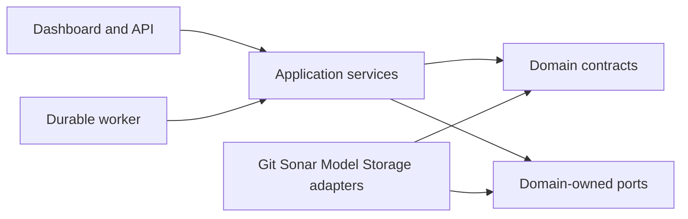

# TechDebt360 architecture spine

## Design paradigm

A hexagonal modular monolith: domain contracts own evidence semantics; adapters own Git, Sonar, model runtimes and storage. One API and one durable worker use the same application services. Sandboxed external tools are runtime boundaries, not independent business microservices.

## Invariants and rules

### AD-1 — Authoritative evidence

- **Binds:** analysis, evidence, UI, evaluation.
- **Prevents:** model opinions becoming measured findings or labor estimates.
- **Rule:** measurements, deterministic derivations, classifier annotations, forecasts, generated text and verified outcomes have distinct typed records. Only archived compatible analyzer evidence contributes maintainability estimate minutes. Reliability/security and all-issue effort stay separate.

### AD-2 — Snapshot identity and clocks

- **Binds:** ingestion, analysis, history, retrieval.
- **Prevents:** execution dates replacing historical cutoffs or stale code being explained.
- **Rule:** identify a snapshot by repository, branch-policy version, cutoff, commit/tree and source-scope hash. Store cutoff, commit time, availability time and scan/export time separately. All context and predictors bind the exact snapshot. Evidence reads also require the exact observation selector (snapshot_id, analysis_id, domain_id); no silent latest-analysis selection. Dataset manifests pin Analysis IDs; compatible reruns coexist and cannot silently replace them. All timestamps are UTC and explicitly zoned.

### AD-3 — Atomic verified publication

- **Binds:** Sonar adapter, artifact storage, jobs.
- **Prevents:** CE success or partial export entering trusted datasets.
- **Rule:** own observations become VERIFIED only after CE/task/project/analysis/revision/domain/source and pagination checks. Stage hash-addressed artifacts, then atomically insert the complete manifest and record reference. Exclusion is keyed by server identity and Sonar project key, covering submission through CE completion, full export and publication across all jobs. Expired or unknown external tasks quarantine that project until reconciled; attempt fencing also gates publication. Disposable per-analysis projects are the alternative. Imported records retain IMPORTED_PUBLIC status.

### AD-4 — Domain and lineage compatibility

- **Binds:** history, matching, graphs, forecasting, remediation.
- **Prevents:** rule drift, splits or disappearing files being interpreted as repairs.
- **Rule:** domain hash includes analyzer/plugin/scanner, rule profile/parameters/remediation settings, language/JDK/binaries mode and scope policies. Identity and membership are versioned, causal and conservative; ambiguous lineage is censored. Before/after verification uses the same domain and retained population. Imported domains hash their known source metadata and explicit unknown-field flags in a separate approximation namespace; they cannot claim equivalence to complete verified own domains.

### AD-5 — Capability-aware predictions

- **Binds:** model adapters, API, dashboard.
- **Prevents:** every repository displaying unvalidated future predictions.
- **Rule:** capability is keyed by repository/domain/granularity/TargetContract hash/model/dataset/evaluation versions; states are UNSUPPORTED_DATA, RESEARCH_ONLY, VALIDATED or REVOKED_DRIFT. Unavailable outputs are null with reasons. A checkpoint existing or loading cannot enable validated inference. Capabilities use immutable grant IDs/versions and append-only revocations. Submission, publication and every normal read atomically check the current matching grant, expiry and revocation; stale evaluation cannot resurrect a grant. Historical outputs keep old provenance but derive current serving eligibility. Calibrated probability and intervals require separate calibration evidence.

### AD-6 — Exact horizon and cohort contract

- **Binds:** datasets, prediction, evaluation.
- **Prevents:** 90-, 91-, 92-day or weekly forecasts being pooled.
- **Rule:** freeze an immutable TargetContract hash covering outcome/unit, granularity, aggregation membership, origin eligibility, cadence, endpoint selection, missingness/censoring and availability. exact90 uses an origin-relative daily UTC grid and endpoint at 90×24 hours; approx91 is a distinct 13-week target. Adapters record native steps and exact endpoint mapping, admitting only supported registered cadence. Every label is an eligible observed endpoint or documented missing/censored record; interpolation never creates ground truth. Compare identical registered origin/endpoint IDs and report abstentions. The common native 80% interval uses quantiles 0.10/0.90; adapters lacking those native endpoints abstain from interval comparisons rather than manufacture them.

### AD-7 — Model isolation and reproducibility

- **Binds:** all learned adapters and evaluation.
- **Prevents:** conflicting dependencies, generic label mappings or mutable checkpoint drift.
- **Rule:** each adapter registers task/modality, checkpoint SHA, reviewed code SHA, environment lock, preprocessing, labels, output units and calibration. Separate incompatible runtimes. License and task-semantic checks precede execution; unresolved specialists remain disabled. One evaluated generator and at most one retrieval model enter the initial product.

### AD-8 — State ownership and recovery

- **Binds:** API, worker, persistence.
- **Prevents:** duplicate scans/patches or two writers owning a job result.
- **Rule:** API owns repository/job/request records; analysis application service owns validation/publication rules; the worker executes them through fenced leased attempts. Identity owns source-unit/entity mappings, retrieval owns immutable chunks, remediation owns recommendations/candidate content, evaluation owns immutable grants/revocations and approval service owns human decisions. Claim jobs with one transaction and fencing attempt number. Artifact and manifest identity plus request idempotency prevent duplicate publication; unknown submission state triggers external reconciliation before resubmission. Disk reservations and low-space backpressure precede artifact-producing work; referenced evidence is never automatically deleted. Restore invalidates old leases, pauses dispatch and reconciles in-flight jobs/external projects before replay.

### AD-9 — Ranking and explanations

- **Binds:** ranking, retrieval, generation, UI.
- **Prevents:** incomparable confidences being fused into a debt score.
- **Rule:** measured-evidence backlog and candidate-annotation queue are separate. Ranking uses immutable factor policies specific to granularity, with frozen development-only normalization cohorts and named source units/lookback/lineage rules. Resolved graph edges mean source-file dependency to defining file, deduplicated by ordered file pair; module edges collapse through frozen membership and count unique external incoming modules. Normalize through the recorded midpoint percentile formula; insufficient resolution stays missing. Partial and complete ranks are separate and policies/cohorts are never compared as one scale. Explanations cite exact finding/source IDs. No classifier confidence is converted to minutes or money.

### AD-10 — Remediation verification and human decision

- **Binds:** generator, isolated worker, verification, API.
- **Prevents:** generated patch or lower scanner count implying behavioral correctness.
- **Rule:** candidate patches bind one base observation, base commit/tree, immutable patch/candidate tree, changed-file manifest and allowed files. A non-overridable verification-policy hash binds required compile/test/differential/analyzer checks in an isolated copy; budgets can stop work but cannot relax acceptance. A candidate regression or required-check failure against a passing baseline fails. Baseline failure or missing/timeout/incomplete checks is partial. Evidence-verified additionally requires targeted finding resolution with identity support, all minimum checks passing and no prohibited new findings or hiding tricks. Deleted/excluded/suppressed findings cannot count as fixes. Approval binds exact base/patch/tree/verification/policy/evaluation hashes; export atomically rechecks that tuple and stale base. Partial approval never upgrades verification status. No main-branch apply/merge without explicit recorded human approval.

### AD-11 — Trust boundaries

- **Binds:** ingestion, models, workers, API.
- **Prevents:** source text controlling tools or leaking secrets across jobs.
- **Rule:** repository content and generated instructions are untrusted data. Only fixed allowlisted job commands execute in rootless restricted sandboxes, never model-supplied shell. Repository build/test code has no fetch, scanner or administrator secrets; dependency fetch and trusted scanner/export are separate credential phases. Candidates cannot alter verification policies, test commands or analyzer scope/suppressions. Credentials live outside source/context, tenant access is checked before lookup, local paths are allowlisted, and export deletion honors provenance obligations.

### AD-12 — Experimental claims and change control

- **Binds:** datasets, evaluation, registry, dashboard.
- **Prevents:** synthetic tests or repeated rows becoming deployment accuracy claims.
- **Rule:** preregister targets/repositories/folds/budgets; group clones/artifacts, purge crossing future labels, fit transforms/calibration on train/validation only. Keep sealed tests sealed until choices freeze. Report paired repository/time-block uncertainty, negative results and software vs scientific validation separately. New domain/model/target revisions revoke relevant capabilities until re-evaluation.

## Consistency conventions

Operational IDs are opaque UUIDs; immutable IDs use SHA-256 with fixed type/schema prefixes and [RFC 8785](https://www.rfc-editor.org/rfc/rfc8785) canonical UTF-8 JSON, while raw blobs hash exact bytes. Source-unit identity binds snapshot/blob/coordinates/symbol/extractor version; chunk identity additionally binds exact span/content and chunk policy. Jobs, attempts, recommendations, target contracts and capability grants have shared owned identities; path or display name alone is never identity. Numbers have named units; absent values are JSON null. Contracts carry integer schema_version: 1 and schema_minor: 0; minor changes only add optional fields with defaults, while breaking semantics create a new major API/schema and dataset. Errors use code/message/retryable/details/correlation_id. Roles are reader, analyst, approver and administrator. Separate research_execute/research_read permissions govern experimental execution/visibility, without promoting research outputs into normal views.

## Stack

Seed verified by local runtime/source or primary release pages; this is a design choice, not an installation.

| Name | Version |
| --- | --- |
| Python | 3.12.3 local runtime|
| FastAPI | 0.142.2 proposed API seed; [official release](https://github.com/fastapi/fastapi/releases/tag/0.142.2)|
| SQLite | 3.45.1 local Python binding; single-host metadata seed|
| Current collector/analyzer adapter | td360-v3 0.15.2 local source|
| CatBoost research baseline | 1.2.8 existing forecast lock|

## Structural seed and environments

One host runs an API/UI process, one durable orchestration worker, SQLite metadata and a content-addressed artifact directory. Sonar/build runners and model-specific environments are isolated. Begin with one concurrent analysis and one generation job; scale only after measured contention and resource evidence. Development uses fixtures, research uses licensed frozen corpora, demonstration uses validated own snapshots. SQLite supports only one concurrent writer ([official transactions](https://www.sqlite.org/lang_transaction.html)); never put the metadata DB on a network share.

Full entities, port schemas, API route contracts, deployment budgets and failure behavior live in [solution design](OPTIMAL_SYSTEM_ARCHITECTURE.md). Rationale and alternatives live in [decision](RESEARCH_DIRECTION_DECISION.md) and [.memlog.md](.memlog.md).

## Deferred

Forecast activation awaits dataset/value gates; TTM revision/cadence selection awaits usable context. Neural graph/sequence models await evidence of tabular inadequacy and sample precision. Multi-host/multi-tenant hosting, a Java service rewrite, vector database and PostgreSQL migration await measured demand. UI framework/style details may be decided inside the API/UI unit; its evidence/status semantics above are binding. No implementation is authorized by this design.
