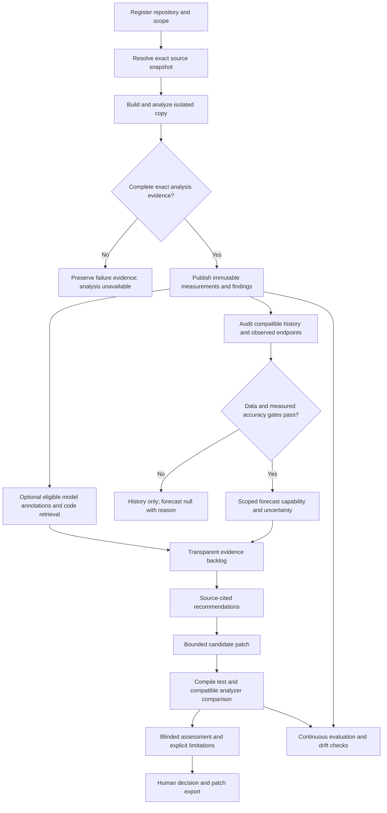

# End-to-end workflow

Date: 2026-10-13. Proposed future behavior. Existing scanners/model/training workflows were not run. [Architecture](OPTIMAL_SYSTEM_ARCHITECTURE.md) defines the data and API seams; [evaluation](MODEL_EVALUATION_PLAN.md) determines when model outputs may be promoted.

## Capability flow

## Twelve stages

| Stage | Input and exact steps | Output/success | Failure or insufficient-data behavior |
|---|---|---|---|
| 1 Repository ingestion | Authorized URL/local path, branch, language, scope policy; resolve commit/tree; retain branch manifest/cutoff/availability; inventory production Java; retain Git ancestry/activity | Repository, Snapshot, source blobs, inventory, causal identity | Invalid URL/SSRF/path rejected; inaccessible commit causes job failure; unsupported language gets inventory only; source does not execute in API |
| 2 Static analysis | Snapshot + frozen domain; isolated build; binaries/libs; scanner with unique evidence/project; retain return code/report-task/CE ID; poll; verify analysis/revision; export all pages; recheck domain and source coverage | VERIFIED Analysis, typed measurements/findings, raw manifest | Build/CE failure: preserve attempt; pending timeout: WAITING_EXTERNAL; lost submission: RECOVERY_REQUIRED; incomplete/mismatched export: no observed zero and no VERIFIED status |
| 3 Learned debt annotations | Only enabled adapter with validated license/semantics; extract exact eligible function/diff/text; apply checkpoint-specific preprocessing; mark rejected lengths/unsupported units | Annotation with raw scores/types, model/input hash and calibration state | Disabled runtime/license: no annotation; ABSTAIN reason; classifiers cannot erase findings or assign minutes |
| 4 Architecture/code intelligence | Exact source + past Git; primary module definition; dependency extraction and unresolved counts; SCC/co-change/ownership; snapshot-bound search index | Deterministic evidence with coverage, related code chunks | Partial lexical resolution stays partial; absent graph is unknown; similarity is retrieval evidence only |
| 5 Evidence assessment | Measurement/finding/domain selector + annotations + graph/Git facts; keep contradictions and provenance links | Separate measured debt, model candidates, architecture evidence and unknowns | No universal merged score; unknown remediation estimate remains null; reliability/security are separate |
| 6 Historical construction | Registered cutoffs + observed compatible exports; causal file/module lineage; feature availability registry; actual future endpoints | Immutable DatasetManifest, features/labels/masks, cohort and leakage reports | Missing endpoint/censored lineage yields a reason, not a label; public imports keep imported status; mixed domains/horizons are separate |
| 7 Prediction/forecasting | Current nonexpired capability grant; exact TargetContract; observed input grid; same cohort information; selected adapter | Point/quantile prediction with origin/endpoint/model/evaluation/grant | UNSUPPORTED normal request rejected with reason; history UI forecast is null; RESEARCH_ONLY is visible only in an explicit research view; no expiry/revocation bypass |
| 8 Prioritization | Verified finding/module evidence + published factor policy and user criticality | Complete/partial factor rankings, separate candidate queue, minutes column | Missing factor is explicit; graph incompleteness limits ranking; no probability/money conversion |
| 9 Explanation | Finding + exact base analysis/domain/source; deterministic rule guidance; authorized same-snapshot retrieval; bounded prompt | Cited reason, strategy, limitations, Recommendation | LLM failure uses rule template; fabricated citations rejected; source prompt injection is data |
| 10 Remediation | Immutable candidate patch to isolated base; fixed allowlisted verification policy; compile/tests/differential checks; same analyzer/profile before/after; suppression/deletion audit | Verification record, status, patch hash, before/after finding changes | Invalid diff/out-of-scope file fails; baseline failures/timeout/missing tests force partial status; lower count alone is not verified repair |
| 11 Backend/dashboard | Versioned records, auth roles, stable analysis selector; async jobs, cursor pagination, source views; approval bound to exact content | Evidence-first overview, history, backlog, comparison, evaluation and conditional forecast views | API rejects ambiguous analysis; tenant check before lookup; late/stale patch cannot be approved/exported as current |
| 12 Continuous evaluation | Domain/model/data changes, coverage/runtime metrics, review results, registered test sets | New immutable evaluation or capability revocation, reported drift | No automatically trained replacement; historical records retained; drift makes live inference unavailable until revalidated |

This table is a stage contract, not a mandate to activate all optional models. Stages 3 and 7 may abstain while assessment and recommendations continue.

## Success trace

1. Analyst registers a repository, declares Java production scope and selects a commit. Registration never clones into the API process or starts arbitrary repository code.
2. Worker resolves immutable source and obtains the external analyzer lease for the entire submit-through-export interval. Build runner has no Sonar token. Scanner runner receives only its analysis credential and read-only built source.
3. Exact CE/task/revision/profile/source/export checks pass. Artifact staging is committed by a complete manifest. The analysis service owns acceptance rules; the worker executes them with a fenced attempt.
4. Developer opens measured maintainability estimate and source-bound findings. Current evidence is selected by explicit `analysis_id`/`domain_id`, not “latest for snapshot.” Model annotations, if enabled, are visibly separate suggestions.
5. Ranking returns named factor values, policy version and coverage. The developer chooses a concrete finding. Rule guidance and same-snapshot context produce a cited recommendation.
6. The generator produces a bounded unified diff; path/suppression/deletion checks accept it as a candidate. It changes an isolated copy only.
7. Before/after baseline tests, compile, differential checks and compatible analyzer inventory run. The output says which findings disappeared, which appeared, whether behavioral checks passed and which uncertainty remains.
8. Approver reviews the exact diff and verification artifacts. Approval binds base/patch/candidate-tree/policy/verification hashes. Export rechecks that tuple and base freshness. Nothing merges into the repository automatically.

## Recovery paths

**CE task finishes but export fails:** retry read-only exports for the same original task/project/analysis only if current project state still binds it. If a later analysis overwrote current endpoints, the job is unrecoverable without another authorized collection path; no historical issue export is fabricated. Existing v0.15.2 recovery semantics are preserved.

**Worker dies after submission:** expire the job lease but quarantine the analyzer project; prove the old runner has stopped and query the known CE task before assigning another job. If submission identity is unknown, set state to RECOVERY_REQUIRED. Fencing a database row alone cannot stop stale external scans.

**Domain changes mid-run:** reject publication, keep artifacts, mark INCOMPATIBLE_DOMAIN. New profile/settings produce a new domain hash; older history remains a separate series.

**Dataset has short/irregular history:** expose actual measured points and missingness. Evaluate simpler feature predictors only if their independent label/split gates pass. A 512-point TTM tensor filled with padding is not evidence of 512 observations. Forecast UI stays unavailable with data-acquisition instructions.

**Capability revoked while a model runs:** publication checks the active grant transactionally and refuses live eligibility. Preserve the prediction as research evidence with the original grant; serving checks current eligibility again. Historical charts label revoked outputs explicitly.

**Candidate compiles but changes behavior:** verification fails or remains partial depending on policy; a lower maintainability estimate cannot override differential failure. Baseline tests failing before change prevent “tests passed” claims. A project with no tests requires new independent assessment or remains partial; no silent acceptance.

**GPU/model unavailable:** static assessment, lexical search, measured history and rule guidance continue. Generation is disabled or queued under a measured CPU budget. This fallback preserves a useful product without inventing AI results.

## User-visible precision

Show “estimated maintainability remediation minutes,” not “hours your team will spend.” Show “model-suggested category,” not “confirmed debt.” Show “endpoint new finding,” not “introduced during the whole interval,” unless intermediate evidence exists. Show exact90/91/calendar-month horizon names. Show prediction intervals only for validated quantiles/calibration. Show “evidence-verified under these tests and analyzer settings,” not “behaviorally proven correct.” Preserve source citations and links to model/dataset/evaluation versions.

The common forecast comparison uses central 80% intervals from quantiles 0.1 and 0.9. A 90% deployment interval is a separately evaluated calibration result, as specified in the [forecasting protocol](FORECASTING_RESEARCH_PLAN.md); the dashboard must display the actual interval level.

## Outcome traceability

Every page and export must follow `Repository →Snapshot →Analysis/Domain →Finding/Measurement →Evidence/Context →Recommendation →Candidate →Verification →Approval`. Forecasts follow `Observation/Grid →TargetContract/Dataset →ModelVersion/Evaluation →CapabilityGrant →Prediction`. A reviewer can traverse to original raw evidence. Missing links fail the publication contract instead of producing a plausible dashboard value.
