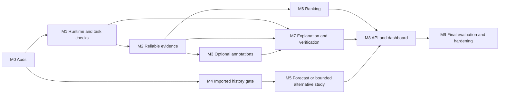

# Milestone roadmap

Date: 2026-10-13. This is a future execution plan. No implementation, installation, scan, inference, training or database/configuration mutation is authorized or performed by this document. Every milestone ends in evidence review; failed prerequisites stop dependent work.

## Planning envelope and dependency order

Assumptions: a graduation team can supply approximately 3–5 effective contributor-days per week on this project, access a Linux analysis host and obtain limited independent reviewer time. Actual team size, deadline, budget and GPU availability are unknown. Estimates below are person-days for the bounded scope, not promises. Parallel execution can shorten elapsed time only where dependencies permit; human annotation and historical build failures can dominate.

Base plan is roughly 70–119 person-days, plus an optional 7–12-day imported forecasting study and 5–15-day fresh-history pilot/extension. At the assumed 3–5 contributor-days per week, the 70–119-day base plan spans roughly 14–40 elapsed weeks before optional work. A 12–16-week target would require approximately 5–10 effective contributor-days per week and parallel independent work; it is not justified by the lower capacity assumption. Do not turn the old nine-month diagrams into a binding estimate without confirming constraints. An early one- to two-week gate provides a provisional feasibility recommendation, not a completed model comparison or final remediation thesis approval; the product seams support either outcome. Restrict it to the delivered audit refresh (0.5–1 day), runtime smoke feasibility (1–2 days) and a small imported-history audit (3–5 days). Full M0/M1/M4 and the M7 outcome pilot take the effort listed below.

M3 is optional: failure does not block M7. M5 exports an explicit disabled capability if forecasting fails; it does not block the base UI. M4 begins early on existing data and does not require new weekly scans. Full historical collection is outside the critical path unless the small pilot and precision gate justify it.

## M0 — Repository and dataset audit

**Objective:** freeze a correct map of source and evidence. Current design-time audit is delivered; future execution closes live/environment gaps.

- Tasks: identify the current collector checkout and preserve uncommitted forecasting code; isolate historical V3 packages; bind source hashes; locate original failed scan workspace/server; recount cohorts; reconcile stale profile/mart counts; resolve actual hardware/team/deadline and reviewer availability; freeze primary study repository registry.
- Reuse: current audit, raw snapshots, source preservation inventory, V2 read-only DB and existing provenance contracts. No model required.
- Inputs → outputs: source/version manifest and existing data → `audit_manifest`, gap register, repository registry, runtime envelope and evidence inventory.
- Dependencies: none. Effort: 3–5 days; existing deliverables reduce research effort but cannot close original operator access.
- Verification: inventory/hash consistency; read-only source preservation; real/test/imported evidence classification; no sealed-outcome inspection. Confirm every numeric count has a population and provenance level.
- Acceptance: one designated collector source; all included evidence versioned; submission/CE/export distinctions explicit; no unverified row promoted; hardware and scope assumptions accepted or adjusted.
- Risk/fallback: original operator access unavailable → recovery remains pending, own verified-history count stays unknown/unsupported; do not rescan automatically.

## M1 — Model verification and bounded proof of concept

**Objective:** establish task, license, loading and compute feasibility before integrating models.

- Tasks: pin Qwen checkpoint/code/runtime; test chat template and bounded output contract; establish quantization only if needed and separately validated; inspect CodeRank custom code and pooling/query prefix; measure memory/latency; conditionally load Chronos-small for the imported-history study. Resolve specialist weight licenses/labels before any use.
- Reuse/data: model digests and revisions; small manually reviewed Java/context examples. Qwen2.5-Coder7B first, lexical retrieval baseline; optionally test one fitting Qwen3.5-9B challenger under the same budget, then retain one generator. CodeRank and specialist adapters are optional; see the additional-candidate screen in model research.
- Inputs → outputs: `ModelVersion` and fixed smoke inputs → runtime manifest, output samples, schema/eligibility report, measured resource profile and admission decision.
- Dependencies: M0 envelope; no forecast accuracy conclusion before M4. Effort: 5–8 days.
- Tests: malformed/oversize/unsupported input, exact tokenizer/template, shape/label mapping, deterministic provenance, timeout/OOM and ABSTAIN behavior; no whole-repo classifier reuse across modalities.
- Acceptance: reproducible pinned load and output contract; resolved executable license; measured bounds within envelope; no model output mistaken for measurement. Failed specialists remain disabled.
- Risk/fallback: GPU inadequate or output poor → rule templates, smaller context, later separately selected model; no package/version proliferation. POC commands are in [plan](PROOF_OF_CONCEPT_PLAN.md).

## M2 — Ingestion and reliable static analysis

**Objective:** build one trusted observation path.

- Tasks: adapt current Git/source scope and collector to job-local inputs; separate fetch/build/scanner credentials; create isolated/fenced analyzer jobs; preserve CE recovery; archive complete exports; domain hash includes rule/remediation/JDK/binaries/scope; normalize quality/units; publish only after source and export integrity checks.
- Reuse: `sonar_evidence.py`, V3 export/recovery, compiled execution concepts, current source inventory/missingness. Dataset: representative own Java snapshots, Maven and Gradle coverage.
- Inputs → outputs: `Snapshot + AnalyzerDomain` → `Analysis + Measurement + Finding + immutable manifest`, or explicit failed/partial evidence.
- Dependencies: M0; M1 need not block static measurement. Effort: 10–16 days.
- Tests: wrong task/project/revision, pagination truncation/duplicate, profile drift, missing classes, lost report, stale runner, interrupted export/publication, source-scope mismatch, no findings vs failed analysis, recovery without resubmission.
- Acceptance: representative compiled own scans verified end-to-end; complete provenance; independent matched scope checks; proposed ≥90% compatible success in a registered 36-snapshot collection pilot if history extension is attempted. Pilot coverage is not a universal production guarantee.
- Risk/fallback: historical build incompatibility → restricted audited cohort or imported-domain research; source-only outputs labeled sensitivity, never a silent substitute.

## M3 — Optional technical-debt type annotations

**Objective:** determine whether one specialist adds useful evidence.

- Tasks: choose one actual modality; recover semantic label mapping/license; extract normalized eligible units and reject unsupported length; build independent positive/negative/OOD review sample; compare shortlist on identical units; fit thresholds/calibration on validation only; retain best admitted adapter or none.
- Reuse/models/data: Tesoro schema and code units for Java type research; GraphCodeBERT/CodeBERT/UniXcoder as matched alternatives, not an ensemble. Diff or issue classifiers require separate labels and study. No detector is mandatory.
- Inputs → outputs: `SourceUnit + ModelVersion` → typed `Annotation`, coverage/metric/false-positive report, admission or rejection.
- Dependencies: M1 semantic/license gate and M2 exact source identity. Effort: 5–9 days; optional final annotation effort depends on class balance.
- Tests/evaluation: multi-label independent sigmoid outputs, clean/OOD examples, no false clean guarantee, long-function abstention, clone/repository splits, per-category F1/PR-AUC/calibration, no confidence-to-minutes conversion.
- Acceptance: selected annotation meets preregistered precision/utility gates and adds beyond static evidence; otherwise disable it and document negative results.
- Risk/fallback: inadequate labels/unknown licenses → static-only path; failure does not delay remediation or UI.

## M4 — Historical dataset and forecasting feasibility

**Objective:** give forecasting its strongest low-cost test before a large backfill commitment.

- Tasks: first audit V2 revision/clock/domain/cadence/target semantics; select actual measured cutoff states; separate exact90 from weekly 91-day and calendar-month contracts; calculate eligible origin/endpoints and grouped precision; inspect small Zenodo series as external-domain replication; preserve original NPF sealed outcomes. Only then consider recovering existing own scans and a small compiled backfill.
- Reuse/data: local V2 DB, dataset/missingness/lineage contracts, `forecasting/schema.py` and evaluator concepts. Public V2 is research-only licensed; NPF requires license/provenance resolution.
- Inputs → outputs: raw imported/own observations → `TargetContract`, eligibility table, series inventory, immutable dataset/splits, power/precision note and gate decision.
- Dependencies: M0; fresh own history additionally M2. Effort: 5–8 days for imported audit; optional fresh pilot 5–15 days beyond base plan.
- Tests: timestamp/timezone joins; branch reachability; repeated source states; current/export/domain ambiguity; 90/91/92 separation; missing targets/lineage deletion; future feature contamination; no model padding counted as history.
- Acceptance: enough measured context/endpoints and independent blocks for the selected task, no fabricated labels, explicit limitations and equal-model cohort. If absent, state UNSUPPORTED_DATA and retain conditional plan.
- Risk/fallback: historical metadata or context insufficient → exact90 unsupported; a separately named step/91-day study may still be defensible; measured history remains useful.

## M5 — Bounded forecasting study or alternative primary experiment

**Objective:** select the research branch by evidence.

- Forecast branch tasks: compare persistence/zero delta/trend and Ridge/CatBoost/LightGBM/Random Forest; then Chronos-small/full/TimesFM; admit TTM only on fitting revision and enough actual context. Evaluate matched rolling/repository holdout, changing/constant subsets, common 80% intervals and measured runtime. Do not tune on sealed tests.
- Alternative branch tasks: if forecasting data/skill fails, prepare the preregistered remediation cohort and provenance/evidence-selection ablations; no forced new-finding or CMR target swap. CMR/JIT can remain secondary research with independent label gates.
- Inputs → outputs: registered dataset/model/fold versions → predictions/metrics/uncertainty/capability decision, or bounded alternative experiment manifest.
- Dependencies: M1+M4 for forecast; M2+M7 feasibility for final remediation outcome study. Effort: 5–8 base days for branch setup/decision; optional forecast benchmark adds 7–12 days.
- Tests/evaluation: common-origin matching, train-label maturity, zero denominators, native horizon/grid conversion, quantile semantics, failed-model coverage and capability states.
- Acceptance: if numerical deployment is proposed, clear value/calibration/resource gates in [forecast plan](FORECASTING_RESEARCH_PLAN.md); a negative study remains an acceptable academic result. If no forecast passes, normal product returns null/reason.
- Risk/fallback: no model beats naive → retain measured history, choose simpler model or no prediction; do not rescue with GraphSAGE/TCN complexity.

## M6 — Transparent prioritization

**Objective:** make the measured backlog actionable without an opaque debt score.

- Tasks: version factor policies by granularity; freeze graph direction/coverage and churn normalization; preserve minutes as burden column; separate candidate/verified and partial/complete queues; add user criticality and explanatory factors; run fixed-budget reviewer comparison.
- Reuse/data: causal Git/lexical graph extraction, verified findings; no new learned model required.
- Inputs → outputs: explicit observation selector + factor policy → ranked items with raw/normalized factors, missingness, policy hash and rationale.
- Dependencies: M2; M3/M5 optional. Effort: 4–7 days.
- Tests/evaluation: duplicate graph edge handling, zero/tied factors, missing-data renormalization, cross-granularity prohibition, repeated deterministic ranks; compare severity/effort/churn baselines and reviewer utility.
- Acceptance: all ranks auditable; no score implies effort/monetary cost; utility evidence or transparent simple filters retained.
- Risk/fallback: combined rank loses → use strongest simple ordering and expose factors rather than claim an optimal score.

## M7 — Explanations and verified remediation

**Objective:** test the primary candidate design on direct outcomes.

- Tasks: source-bound context/recommendation schema; Qwen bounded prompts; lexical retrieval baseline and optional CodeRank; immutable allowed-path candidates; minimum non-overridable verification policy; compile/tests/differential checks; same-domain before/after inventory; suppression/deletion audit; blinded review and approval tuple.
- Reuse/models/data: trusted M2 analyzer, Git snapshots; Qwen candidate; optional CodeRank; preregistered Java cohort spanning 3–5 rule families with meaningful tests.
- Inputs → outputs: `Finding + ObservationSelector + context policy` → `Recommendation →CandidatePatch →Verification →Approval/export`.
- Dependencies: M1+M2; M3 optional. Effort: 15–24 days, including 30-unit pilot setup; final human review may add elapsed time.
- Tests/evaluation: stale base, invalid diff, path escape, suppressed rule/deleted source, no tests, failing baseline, induced regression, incomplete after scan, patch/approval hash mismatch; paired pass@1 and accepted verified outcomes with fixed budget.
- Acceptance: 30-unit feasibility cohort yields adequate complete evidence; no systematic unsafe acceptance; final scientific claims meet independent review/effect gates or are exploratory/negative. No automatic main-branch merge.
- Risk/fallback: sparse test coverage or poor patches → recommendations only, templated guidance, or A2 forecasting thesis if its gates pass; retain failure analysis.

## M8 — API and dashboard

**Objective:** expose already validated capabilities through one coherent application.

- Tasks: FastAPI/domain services, SQLite metadata and artifact registry, durable leases/idempotency, explicit observation selector, permissions; views for source evidence/history/ranks/capabilities/verification; atomic expiry/revocation/approval checks; disabled capability behavior; licensing-aware exports.
- Reuse: all preceding typed artifacts and core Python adapters. No model/database migration framework rewrite required by the design.
- Inputs → outputs: registered records → versioned `/api/v1` contracts, research/normal views and explicit approval export.
- Dependencies: M2+M6+M7; M5 contributes either granted or unsupported capability. Effort: 12–20 days.
- Tests: tenant/access boundaries, ambiguous snapshot analysis, malformed input/cursor, repeated Idempotency-Key, worker restart/late publication, source HTML escaping, research permission, expired grant, stale approval, no history/model unavailable paths.
- Acceptance: complete registered repository→evidence→recommendation→verification trace; unsupported outputs are null with a reason; no fictional forecast chart; protected mutations are authenticated; no arbitrary shell endpoint.
- Risk/fallback: UI effort threatens study → thin HTML views and API docs; avoid React/Spring/microservice expansion.

## M9 — End-to-end validation and hardening

**Objective:** establish reproducibility and defensible final claims.

- Tasks: freeze final models/policies; open sealed cohort once; evaluate preregistered comparisons; independent error review; failure/recovery/load limits; license/provenance audit; backup/restore and disk backpressure; resource profiles; thesis/artifact manifest.
- Reuse/data: all immutable experiment/output manifests and evaluation contracts; no automatic retraining.
- Inputs → outputs: final candidate system + sealed cohort → final metrics/ablations, reproducibility package, limitations/capability registry and acceptance record.
- Dependencies: all activated milestones; inactive ones require an explicit NOT_EVALUABLE record. Effort: 6–14 days.
- Tests/evaluation: full workflow with real representative evidence, fixtures for adversarial failures, grouped uncertainty, reproducible rerun, sample hash restore, stale external task reconciliation, memory/disk saturation, comparative utility and patch review.
- Acceptance: no unsupported scientific claim; denominator and versions for every result; clear negative findings; protected repository unchanged without approved future action; independent review resolves high contract gaps.
- Risk/fallback: uncertain results → narrower claim and negative-results thesis; keep a credible measured platform instead of declaring predictive accuracy.

## Stop conditions and scope control

After M0/M1/M4 feasibility, select a primary thesis: evidence/remediation if verification and generation study are feasible; imported repository forecasting if history strength/baselines warrant it and repair infrastructure is weak. The final normal product cannot present either as validated before experiments.

Do not advance when required artifacts, licenses, measurement integrity or test conditions fail. The software/scientific gates remain separate. No neural graphs, broad architectural smell generator, 20-model text suite, autonomous apply, distributed queue or custom Java backend belongs to this minimum plan. Any addition needs an observed benefit and an explicit new scope decision.
