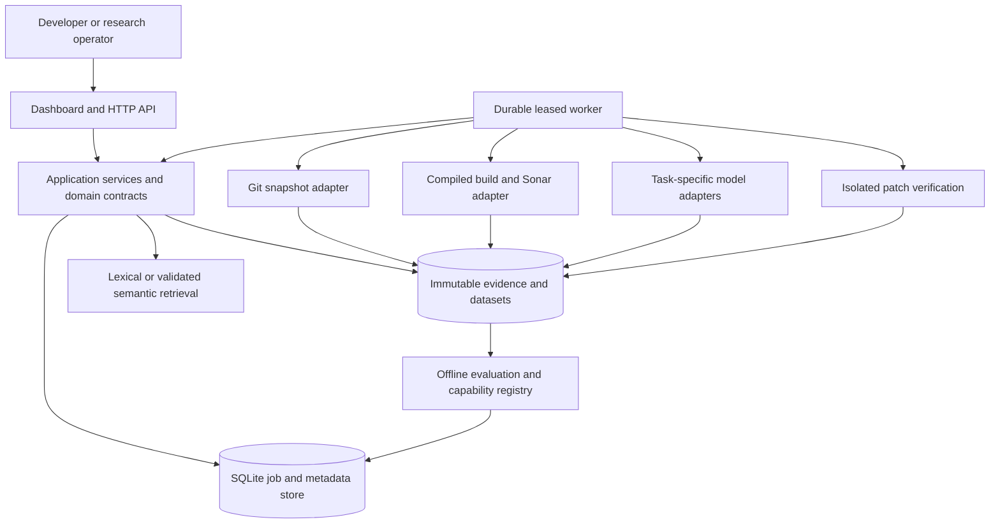
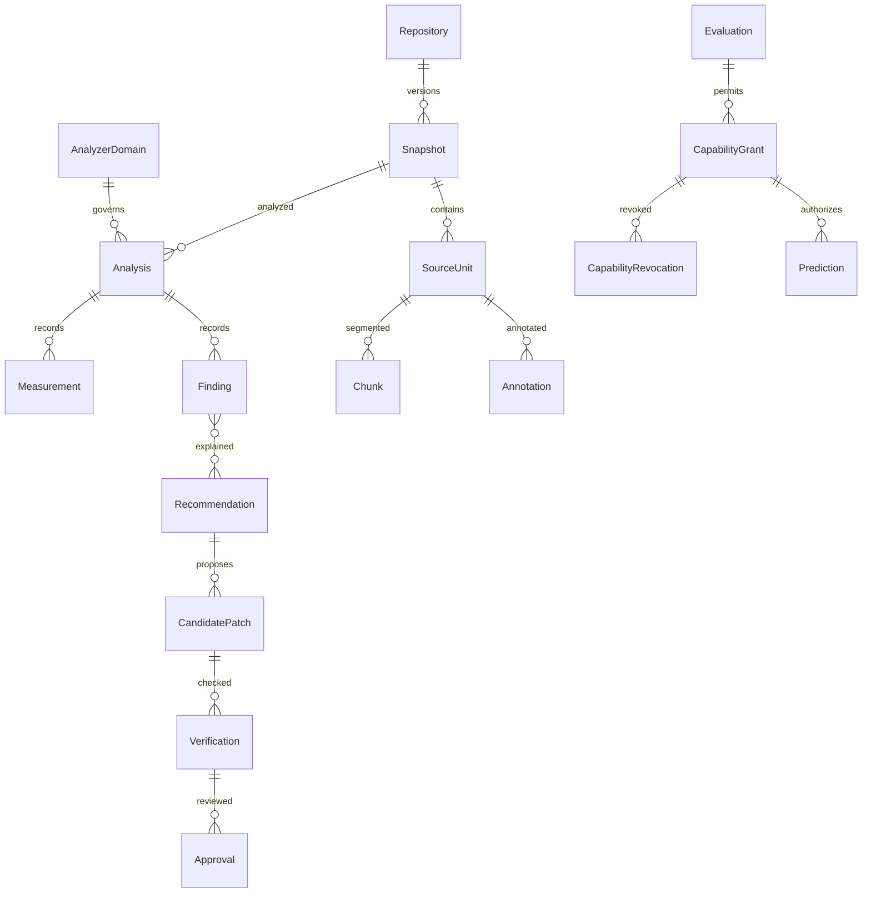

# Optimal system architecture

Date: 2026-10-13. Proposed design; no component below was implemented in this task. Binding invariants are in the [BMAD architecture spine](2026-10-13-techdebt360.md). Evidence and direction selection are in [audit](CURRENT_SYSTEM_AUDIT.md), [model research](PRETRAINED_MODEL_RESEARCH.md) and [decision](RESEARCH_DIRECTION_DECISION.md).

## Product and boundaries

TechDebt360 becomes an evidence-grounded Java debt workbench: verified current maintainability measurements, source-linked architecture evidence, transparent review queues, assisted explanations and bounded patch verification. Numerical prediction is a capability for specifically validated repositories and domains, not a mandatory screen. The primary research bet is whether evidence selection and isolated verification improve useful remediation over simple baselines. This superiority is a hypothesis, not an existing result.

Use a **hexagonal modular monolith**. Preserve Python collection and evaluation code behind ports. Choose one FastAPI API/UI application, one durable worker, SQLite operational metadata, immutable JSON/CSV/Parquet research artifacts and filesystem blobs. No existing Java backend was found to reuse. A Spring rewrite creates a second language boundary without demonstrated value; a Streamlit-only demo is cheaper but less suited to the requested API and approval contracts. API plus a small HTML/JavaScript dashboard is the selected seed. [FastAPI release 0.142.2](https://github.com/fastapi/fastapi/releases/tag/0.142.2) and [deployment documentation](https://fastapi.tiangolo.com/deployment/) were verified; dependency compatibility remains a future integration check.



### Module ownership

| Unit | Owns | Input → output | Reuse |
| --- | --- | --- | --- |
| Repository service | Registration, source policy and branch manifests | URL/allowlisted path → Repository/Snapshot | Git immutable reads |
| Analysis service | Job request and verified publication rules | Snapshot + Domain → Analysis/Measurement/Finding | `sonar_evidence.py`, V3 recovery/export |
| Identity service | Source-unit, file and module IDs; membership histories | Past-only trees and matches → Entity/LineageEdge/SourceUnit | `forecasting/identity.py`, matcher policies |
| Evidence service | Typed assertions and provenance relationships | Measurements/classifications/graphs → evidence view | Existing raw exports and contracts |
| History service | Immutable target and dataset manifests | Eligible observations → feature/label partitions | `forecasting/dataset.py`, schema/masks |
| Model service | Runtime dispatch and task contracts | Versioned typed requests → annotations/predictions/text | Small new adapters; existing CatBoost research |
| Retrieval service | Snapshot index and chunk definitions | Query + Snapshot + access scope → chunks/scores | Lexical baseline; CodeRank optional |
| Ranking service | Factor policies and queues | Verified evidence → ranked backlog | New deterministic logic |
| Remediation service | Recommendations, immutable candidates and verification rules | Evidence + base commit → bounded patch/outcome | New service over preserved analyzer |
| Approval service | Human decisions and export authorization | Immutable verification tuple → Approval | New application service |
| Evaluation service | Experiment manifests and capability grants/revocations | Frozen cohorts → evaluation and capability evidence | Grouped/purged evaluator |
| Worker | Attempt leases, resource limits, execution and recovery | Job → Attempt/Artifacts | Existing orchestration via isolated adapter |
| API/UI | Request records, authorization and presentation | Contracts → views | New minimal application |

The worker calls application ports, never imports an adapter's mutable global configuration into the API process. Analysis service owns validation and publication rules; the fenced worker executes those rules. Existing collectors run in a job-local process/workspace with validated outputs. Only identity owns source identity mappings; only evaluation grants or revokes capabilities; a runtime model cannot self-promote.

## Canonical data contracts

All schemas below are proposed v1 contracts. Operational records use opaque UUIDs; immutable content, manifests and policies use SHA-256 identities. Every record carries integer `schema_version: 1` and `schema_minor: 0`. A minor revision only adds optional fields with defined defaults; breaking semantics require a new major schema/API and dataset. Every derived record also carries `run_id`, `input_manifest_sha256` and `created_at`.

Canonical hashes use [RFC 8785](https://www.rfc-editor.org/rfc/rfc8785) canonical JSON encoded as UTF-8 for structured content, with a fixed domain prefix and schema major: `SHA256(prefix + NUL + major + NUL + canonical_bytes)`. The schema defines which fields belong to each hash; exclude its own ID/hash field and mutable lifecycle metadata. Encode prefix and major as fixed ASCII strings with NUL separators. Raw blobs use SHA-256 of exact bytes. Prefixes distinguish target contracts, domains, source units, chunks, factor policies and manifests. Reject nonfinite numbers; store UTC times ending in `Z`. Units are named explicitly; missing values are null, never zero. Paths are normalized relative POSIX paths and cannot escape the repository root. Source ranges are 1-based inclusive line/Unicode-scalar column coordinates, bound to an exact blob; extractor versions document coordinate handling.

Imported historical domains use a separate namespace: known fields plus explicit null unknowns, missing-field flags, source version/hash and compatibility_state=IMPORTED_APPROXIMATION. No fabricated analyzer/build settings complete the hash. Such a domain supports only the registered bounded research interpretation and is never equal to a verified own domain. Own-domain publication still requires every mandatory field.

An **observation selector** is the exact tuple `(snapshot_id, analysis_id, domain_id)`. All measurement, finding, evidence and ranking reads require it. A snapshot-only request with multiple possible analyses is rejected as ambiguous; no adapter chooses the latest silently. Compatible reruns coexist under separate Analysis IDs, with execution evidence preserved; a dataset pins its chosen Analysis IDs and never substitutes a rerun. Domain equality permits comparisons but does not imply identical output. Investigate differing reruns before treating either as a canonical replacement.

| Record | Required fields and constraints |
| --- | --- |
| Repository | `repository_id, tenant_id, canonical_url, default_branch, source_policy_id, license_status`; unique tenant + canonical URL; credentials referenced by secret ID |
| Snapshot | `snapshot_id, repository_id, cutoff_at, branch_manifest_id, commit_sha, tree_sha, commit_at, available_at, scope_sha256, source_manifest_sha256`; unique repository + branch policy version + cutoff + commit/tree + scope |
| AnalyzerDomain | `domain_id, server_version, plugins, scanner_digest, profile_hash, active_rule_hash, remediation_config_hash, source_policy_hash, analysis_mode, java_source_level, jdk_digest, binary_library_policy_hash`; domain ID is the canonical hash |
| Analysis | `analysis_id, snapshot_id, domain_id, ce_task_id, sonar_project_key, server_identity, server_analysis_id, export_manifest_hash, executed_at, exported_at, provenance_status, coverage`; VERIFIED requires complete exact-bound artifacts; imports remain IMPORTED_PUBLIC |
| Entity | `entity_id, repository_id, kind:file/module/repository, definition_version`; identity never derives from display name alone |
| SourceUnit | `source_unit_id, snapshot_id, entity_id, blob_hash, path, range, symbol_key, extractor_version`; immutable hash of snapshot/blob/coordinates/symbol and extractor policy; symbol alone is not identity |
| Membership/Lineage | `lineage_id, snapshot_id, entity_id, file_id, path, confidence_state, evidence_hash, lineage_policy_hash`; one file → one primary module per definition; typed splits/merges censor ambiguous targets |
| Measurement | `analysis_id, entity_id, metric_id, value, unit, status:OBSERVED/MISSING/INCOMPATIBLE, reason, raw_artifact_hash`; unique analysis/entity/metric; registered aggregation semantics |
| Finding | `finding_id, analysis_id, entity_id, rule_id, quality:MAINTAINABILITY/RELIABILITY/SECURITY, location, message, active_state, remediation_minutes, raw_issue_key, raw_hash`; no cross-quality sum as maintainability |
| Annotation | `annotation_id, snapshot_id, source_unit_id, model_version_id, modality, labels, raw_scores, calibration_id, eligibility, context_hash`; model opinion, not a Finding |
| Chunk | `chunk_id, source_unit_id, snapshot_id, blob_hash, range, chunk_policy_hash, content_hash`; immutable chunk identity includes exact span/content and policy; never reuse by path alone |
| EvidenceLink | `subject_type, subject_id, object_type, object_id, relation:SUPPORTS/CONFLICTS/DERIVED_FROM, extractor_version, source_hash`; no score arithmetic in links |
| TargetContract | `target_contract_hash, outcome, unit, granularity, aggregation_policy_hash, membership_policy_hash, origin_policy_hash, cadence_seconds, horizon_seconds, native_step_policy, endpoint_policy, missingness_policy, censoring_policy, availability_policy`; immutable hash fixes all target semantics |
| DatasetManifest | `dataset_id, target_contract_hash, input_hashes, cohort_ids, origin_ids, endpoint_ids, partitions, domain_ids, cutoff_policy, lineage_policy, missingness_report, leakage_report, artifact_hashes`; immutable, pins selected observations |
| Prediction | `prediction_id, snapshot_id, analysis_id, domain_id, entity_id, origin_id, endpoint_id, target_contract_hash, endpoint_at, native_steps, point, point_kind, quantiles, unit, model_version_id, dataset_id, evaluation_id, capability_grant_id, reason`; live eligibility is derived, not frozen in a state field |
| ModelVersion | `model_version_id, model_id, checkpoint_sha, code_sha, environment_hash, task, preprocessing_hash, labels_hash, license, quantization, runtime_profile, validation_status`; no mutable main revision at runtime |
| Experiment/Evaluation | `experiment_id, preregistration_hash, split_hash, model_versions, cohort_hash, target_contract_hash, metrics_hash, uncertainty_hash, data_kind, decision`; scientific and software evidence separate |
| CapabilityGrant | `capability_grant_id, repository_id, domain_id, granularity, target_contract_hash, model_version_id, dataset_id, evaluation_id, grant_version, state, limitations, expires_at, evidence_hash`; immutable version; one active pointer per capability key |
| CapabilityRevocation | `revocation_id, capability_grant_id, reason, invalidating_revision, revoked_at`; append-only; stale evaluation cannot replace a newer revocation |
| FactorPolicy | `factor_policy_hash, granularity, cohort_definition, metric_definitions, graph_extractor_policy_hash, minimum_resolution_coverage, normalization_manifest_hash, weights, missingness_policy, tie_policy`; immutable |
| Recommendation | `recommendation_id, observation_selector, finding_ids, context_hash, prompt_hash, model_version_id, generation_parameters_hash, output_hash, limitations`; immutable source-bound model/rule result |
| CandidatePatch | `candidate_id, recommendation_id, base_snapshot_id, base_analysis_id, domain_id, base_commit, base_tree_hash, finding_ids, patch_hash, candidate_tree_hash, changed_file_manifest_hash, allowed_paths, verification_policy_hash, attempt_budget`; immutable candidate content; lifecycle status stored separately |
| Verification | `verification_id, candidate_id, policy_hash, base_tree_hash, candidate_tree_hash, before_analysis_id, after_analysis_id, domain_id, compile_result, test_result, differential_result, introduced_findings, resolved_findings, suppressed_or_deleted, status, limitations, artifact_hashes`; immutable evidence |
| Approval | `approval_id, candidate_id, verification_id, base_commit, base_tree_hash, patch_hash, candidate_tree_hash, verification_manifest_hash, policy_hash, evaluation_version, actor_id, decision, decided_at`; approval binds exact reviewed content |
| Job/Attempt | `job_id, request_id, tenant_id, kind, input_manifest_hash, mandatory_stages, state`; each Attempt has `attempt_id, job_id, fencing_number, lease_owner, lease_expires_at, heartbeat_at, external_submission_state, external_task_id, stage, error`; monotonically increasing fencing number |

SQLite foreign keys are enabled. Evidence rows are append-only and corrected through superseding records. Tenant access is checked before entity lookup. Short transactions serialize metadata mutations; scans/inference run outside them. Bulk artifacts are not millions of database cells. Metadata and complete manifest-referenced blobs are backed up together, with hash-verified restore. Dataset/source licenses and retention/deletion requests are tracked in registry metadata.



### Example evidence response

```json
{
  "schema_version": 1,
  "schema_minor": 0,
  "observation_selector": {
    "snapshot_id": "snapshot-uuid",
    "analysis_id": "analysis-uuid",
    "domain_id": "domain-sha256"
  },
  "maintainability_estimate": {"value": 240, "unit": "remediation_minutes", "status": "OBSERVED"},
  "actual_repair_hours": null,
  "classifications": [],
  "forecast_capability": {"state": "UNSUPPORTED_DATA", "reason": "NO_VERIFIED_MODULE_HISTORY"},
  "forecast": null,
  "provenance_manifest": "artifact-sha256"
}
```

Values and IDs are illustrative contract examples, not measured project outputs.

## Model adapters and data flow

Ports return `status=OK/ABSTAIN/FAILED`, provenance, runtime/memory measures, task-specific payload and warnings. Type/schema violations fail inference, never silently repair label semantics.

| Port | Exact input | Output and semantics | Default/fallback |
| --- | --- | --- | --- |
| ClassifyJavaDebtTypes | Eligible normalized Java function, exact SourceUnit, ≤512 tokens, semantic label map | Four independent scores/types; no debt-absence guarantee | Disabled pending license/local test; static findings remain |
| ClassifyDiffRisk | Added lines cleaned with author recipe; base/head SHAs | Possible-debt ranking score; probability only with calibration evidence | Disabled; deterministic scan comparison |
| ClassifyIssueText | Issue body/as-of revision; category checkpoint | Binary score for named category | Disabled pending license/mapping; manual search |
| RetrieveCode | Query, authorized snapshot index, k=5, filters | Chunk IDs, path/range/blob hash, relevance score | Symbol/lexical baseline; optional 768D CodeRankEmbed |
| GenerateRecommendation | Observation selector, finding IDs, selected context, allowed strategy | Source-cited explanation, limitations, optional unified diff | Qwen 7B candidate; templated rule guidance |
| ForecastSeries | Registered observations/masks, TargetContract, origin ID, only known-future covariates | Identified mean/median, native quantiles, endpoint prediction, reliability state | Null with reason; persistence research baseline |
| VerifyCandidate | Immutable candidate hashes and minimum verification policy | Compile/test/analyzer comparisons and bounded outcome | No verification claim on missing checks or timeout |

Qwen2.5-Coder-7B-Instruct is the first generative candidate; CodeRankEmbed is added only after retrieval/patch ablation. Other specialists remain optional research adapters. Chronos2-small is the first conditional forecast candidate, with full Chronos2 and TimesFM2.5 comparators; Granite TTM-r3 is admitted only with adequate measured context and the specific validated branch. [Model research](PRETRAINED_MODEL_RESEARCH.md) fixes tasks/revisions and outstanding checks.

Forecast comparison uses the **native 80% central interval**, quantiles **0.10 and 0.90**, when supplied by the exact model. Record its native quantile grid and point-kind; do not manufacture a quantile by interpolation to claim native coverage. An adapter without the required native endpoints abstains from interval comparisons while point evaluation remains separately eligible. Calibrated intervals require held-out calibration evidence and a separate version.

The exact90 TargetContract binds a daily UTC origin-relative grid and endpoint at origin + 90×24 hours, not nearest calendar month or 13 weekly steps. A cadence adapter records its native step count and exact endpoint mapping. Admit it only when the registered grid has eligible observed endpoint labels and the model genuinely supports that cadence; do not manufacture training ground truth by interpolation. Weekly 13-step approx91 belongs to a distinct TargetContract and capability, not pooled with exact90. Missing/censored endpoint labels and adapter abstentions remain in the registered cohort report.

Preprocessing caches include source/snapshot/scope and model/tokenizer/code/preprocessing revisions. Embeddings use chunk and model hashes. Generated outputs include prompt, generation parameters and every evidence/context hash. No cross-tenant/snapshot reuse by path alone. Report rejected-length coverage; do not silently truncate Java functions. Models never query live Sonar databases or write findings.

Past-only cutoffs govern Git/activity/size/complexity/graph features. Availability time excludes backdated commits absent from the observed branch at origin. Retrospective studies lacking availability logs state the limitation and freeze an ancestral first-parent approximation. Known-future covariates are calendar/release plans genuinely known at origin; future churn, complexity, issue counts and remediation outcomes are forbidden.

### Capability serving and revocation

Capability key is repository/domain/granularity/TargetContract/model/dataset/evaluation version. Default state is UNSUPPORTED_DATA; other states are RESEARCH_ONLY, VALIDATED and REVOKED_DRIFT. Evaluation publishes immutable grants and revocations, then transactionally changes the active pointer using the expected prior version. A stale evaluator cannot resurrect a revoked grant.

Forecast submission, publication and every normal-mode read atomically check the active matching grant, absence of revocation and expiry against current UTC time. Publication checks also include current worker fencing. Domain/model/target/dataset/evaluation revisions invalidate relevant grants until re-evaluation. Historical predictions retain their original grant and remain research artifacts; normal UI eligibility always derives from the current registry. Expired/revoked outputs become null with reasons in normal views. A stored prediction state cannot override registry eligibility.

## Prioritization and conflict policy

Maintain a verified findings/modules queue and a separate learned/unresolved candidate queue. Neither is a universal AI debt score. Security and reliability retain separate queues/governance.

For complete maintainability factor vectors, policy v1 is `priority = 0.40*S + 0.25*C + 0.20*D + 0.15*B`. Weights are versioned, adjustable preferences, not learned causality or business-cost truth. Minutes stay a separate burden column.

The factor policy is immutable and **specific to file or module granularity**. Lists with different factor policy/cohort hashes are not compared as if one scale. `S` uses analyzer severity INFO=0.1, LOW=0.25, MEDIUM=0.5, HIGH=0.75, BLOCKER=1, with raw legacy mapping preserved. Module `S` is the maximum severity of retained active maintainability findings; a finding inherits its containing entity's `C`, `D` and `B`. `B` is user criticality in [0,1], with explicit default 0.5.

`C` is added plus deleted lines in first-parent changes over the trailing exact 90 days, as available at origin, excluding merge double counting and using conservative causal file lineage. File churn sums into modules through the frozen primary membership; ambiguous renames/membership make the factor missing. Normalize against a frozen development-only reference distribution for the same granularity/domain/scope, excluding test data. The policy records origin/cohort manifest hashes. Percentile is `(count below x + 0.5*count equal x)/N`; N=0 yields missing. Values outside the reference range saturate to [0,1].

`D` uses a directed **resolved Java dependency graph**: vertices are scoped files; edge A→B means a resolved dependency in A refers to a symbol defined in B. Deduplicate file-pair edges; count unique incoming file neighbors, excluding self-edges. A module graph collapses files through frozen primary membership and deduplicates ordered module pairs. Its fan-in counts unique external modules, not summed imports. External unresolved libraries and lexical-only guesses are excluded and reported in resolution coverage. The initial resolved factor policy requires at least 90% of references classified as repository-internal by its frozen extractor to resolve to scoped symbols; the denominator, unresolved and external classifications are archived. This is a ranking policy choice, not evidence that the current lexical extractor achieves it. The immutable factor policy records this minimum resolution coverage; below that registered threshold, or with missing graph evidence, D is missing rather than zero. Normalize through the same percentile formula using a separately frozen granularity/domain reference manifest and extractor policy hash.

Missing `C` or `D` yields partial ranking through observed-weight renormalization; the output names present factors and coverage. Complete and partial cohorts stay separate. Zero available weight yields no rank. Ties sort by verified finding count descending, then stable entity/finding ID ascending. Predicted risk does not enter v1.

Conflicts remain visible: a verified finding can coexist with a low classifier score; a high classifier score does not create measured debt; similar code does not prove duplication; lexical cycles are coverage-limited candidate signals. Suppression/deletion remains flagged. Future growth can become a separately displayed factor only after new ranking validation and a new policy version.

## API contracts

Prefix `/api/v1`. Auth uses bearer tokens or same-origin sessions; session mutations require CSRF protection. Roles are **reader, analyst, approver, administrator**. Permissions are explicit: reader can see normal evidence; analyst can request approved jobs; approver records patch decisions; administrator configures policies/access. Separate `research_execute` and `research_read` grants allow experimental execution and visibility respectively; ordinary analyst access does not imply either. Research responses carry RESEARCH_ONLY and cannot enter normal validated views.

Mutation requests require Idempotency-Key, scoped by tenant/actor/route and canonical request hash. Reuse with different input returns conflict. Normal envelopes contain schema version/minor, data, provenance and limitations. Errors contain code/message/retryable/details/correlation_id. Stable cursor pagination binds ID, snapshot and exact observation selector; default 50, maximum 200. Reject unknown fields, invalid UTC dates, unsupported languages and excessive inputs. Async POST returns 202/job_id; reads return 200. Foreign-tenant IDs return 404; invalid schema 422; missing authentication 401; forbidden permission 403; state/idempotency conflict 409; invalid capability execution 422 with reason; worker downtime or disk backpressure 503 with retry guidance. Model text is never trusted HTML.

| Route | Body/query → response | Condition |
| --- | --- | --- |
| POST `/repositories` | Canonical URL/allowlisted path, branch, source policy → Repository | Analyst; path/URL validation |
| GET `/repositories/{id}` | → metadata, available observation selectors, capabilities | Reader |
| POST `/repositories/{id}/analyses` | Commit/cutoff, domain, scope policy → Job | Analyst; commit resolved once; as-of mode explicit |
| GET `/jobs/{id}` | → state, stage, Attempt, progress, heartbeat, error | Reader |
| POST `/jobs/{id}/cancel` | Expected fencing number → cancellation request | Analyst; late external completion cannot publish |
| GET `/snapshots/{id}/measurements` | Analysis ID + Domain ID, entity/metric → measurements | Reader; exact selector required |
| GET `/snapshots/{id}/findings` | Analysis ID + Domain ID, quality/rule/status/cursor → findings | Reader; exact selector required |
| GET `/snapshots/{id}/evidence` | Analysis ID + Domain ID, entity/finding → links | Reader; exact selector required |
| GET `/repositories/{id}/history` | Entity, TargetContract, domain, range → pinned observations/masks | Reader; incompatible domains separated |
| POST `/snapshots/{id}/classifications` | SourceUnit IDs, modality, ModelVersion → Job | Analyst; approved adapter only |
| POST `/snapshots/{id}/forecasts` | Observation selector, entity, TargetContract, ModelVersion, mode → Job/reason | VALIDATED in normal mode; research_execute for research mode |
| GET `/snapshots/{id}/rankings` | Analysis ID + Domain ID, FactorPolicy hash, queue → vectors/coverage/ranks | Reader; exact selector required |
| POST `/findings/{id}/recommendations` | Strategy, context policy, ModelVersion → Job/Recommendation | Analyst; finding-bound selector |
| POST `/recommendations/{id}/candidates` | Candidate selection → isolated candidate Job | Analyst; one base observation; no main apply |
| POST `/candidates/{id}/verify` | Approved test-policy hash, bounded budget → verification Job | Analyst; minimum policy cannot be relaxed |
| GET `/candidates/{id}/comparison` | → exact trees/patch, tests, analyzer comparison, limitations | Reader |
| POST `/candidates/{id}/approvals` | Verification ID, expected approval tuple, decision → Approval | Approver; mismatched/stale tuple rejected |
| POST `/candidates/{id}/exports` | Approval ID + expected tuple → immutable patch artifact | Approver; transactionally recheck tuple/base/permission |
| GET `/models`, `/datasets`, `/evaluations` | → versioned registry/provenance/limits | Reader; research_read for research results; licensing restrictions enforced |
| GET `/repositories/{id}/capabilities` | → active grants, revocations, expiry and reasons | Reader |

The MVP exports approved patches; no automatic main-branch write endpoint exists. Later Git integration requires a separately authorized action and a fresh base/approval check. History construction and evaluation run as offline operator commands with immutable manifests, not arbitrary-code API endpoints.

## Remediation verification and approval

Candidates bind one base observation selector and findings from that analysis only. Patch hashes, candidate tree and allowed files are immutable; generating a different patch creates a new Candidate ID. Lifecycle events never mutate approved content. A versioned minimum verification policy sets allowlisted commands, required compile/test/differential checks, analyzer comparison rules, per-stage resource/time bounds and acceptance thresholds. Caller budgets may reduce work and cause partial/failed results, but cannot weaken acceptance.

A failed baseline, missing tests, unexecuted required differential checks, timeouts or incomplete compatible analyzer evidence make the assessment PARTIALLY_VERIFIED. A candidate compilation or required-check failure against a passing baseline, or a confirmed regression, is FAILED. EVIDENCE_VERIFIED requires all registered mandatory checks to complete and pass, the targeted finding to be resolved with identity support, no policy-blocking introduced finding and no suppression, exclusion or deletion trick. It still lists behavior outside the tested policy. Compare the same analyzer domain and retained source population. Deleted/excluded/suppressed items cannot count as resolved; report them separately. GENERATED, FAILED, PARTIALLY_VERIFIED and EVIDENCE_VERIFIED are distinct outcomes.

Approval binds the exact base commit/tree, immutable patch/candidate tree, verification manifest, policy and evaluation version. Partial evidence may receive an explicitly recorded human acceptance for export with its limitations preserved; it never changes verification status. Base or content changes invalidate the approval. Export atomically checks the approval tuple, current base and permissions; a stale-base export is rejected, even if its Candidate ID remains unchanged.

## Jobs, recovery and failure semantics

States: QUEUED → RUNNING → SUCCEEDED/PARTIAL/FAILED/CANCELED; RUNNING → WAITING_EXTERNAL → RUNNING; lost submission/lease → RECOVERY_REQUIRED. An approved retry creates a new Attempt. Stages include INGEST, BUILD, SUBMIT, CE_WAIT, EXPORT, VERIFY_PUBLISH, MODEL, TEST and COMPARE. Partial analyzer export never grants VERIFIED. Optional model failure can leave trusted static evidence in a PARTIAL job. Success requires all requested mandatory stages; optional failures retain warnings.

A worker uses a short SQLite BEGIN IMMEDIATE transaction to claim a job and increment its fencing number, then commits before work. Proposed heartbeat is 30 seconds, expiry 120 seconds. Every publication checks the current Attempt and cancellation state in the metadata transaction; stale Attempts cannot mutate trusted results.

Sonar exclusion is keyed by `(server_identity, sonar_project_key)` and covers **submission through CE wait, complete export and verified publication** across all snapshots/jobs. A lease keyed by Analysis ID alone is forbidden. Either use this exclusion with one runner or allocate unique disposable projects. Expiry does not make an unknown external task safe: quarantine the project, reconcile the exact task/analysis and terminate or await stale runners before reassignment. Recovery binds original source proof and task/revision/domain, not latest project state. Late CE results from canceled/stale jobs do not publish.

A crash after submission recovers known task IDs and original source proof before retry; missing `report-task.txt` alone does not authorize a repeat scan. Unknown submission state requires reconciliation. Staged blobs are hash-checked and adopted only when all manifests/attempt inputs match; otherwise garbage collect after retention. Three bounded transport retries use backoff; deterministic build/schema/domain failures stop. Cancellation records the request and terminates owned runners when possible.

Before starting artifact-producing work, reserve a policy-defined disk budget with low/high watermarks. Below the low watermark, pause admission and return backpressure; resume only above the high watermark after reconciling reservations; it never deletes referenced evidence or frozen corpora automatically. In-flight export may use its reserved budget; failed writes remain unverified. Stop optional generation/cache growth before exhausting space needed for final manifests/recovery. Resource and disk reservation limits are recorded per job.

After restoring a backup, disable dispatch, reconcile referenced blobs and hashes, invalidate all pre-restore worker leases/fencing credentials, mark in-flight jobs RECOVERY_REQUIRED and quarantine their external projects. Reconcile external tasks against restored request/source manifests; do not replay jobs merely because the backup lacks their last result. Resume only after one owner reclaims each recoverable task or records manual resolution. Restore rehearsals exercise these cases.

## Deployment, auth and operations

Proposed envelope: one Linux host, 8–16 CPU cores, 32GB RAM and 100GB free storage; optional 24GB GPU for bounded-context Qwen BF16, or a separately evaluated 8–12GB quantized runtime. These are estimates, not proven requirements on the user's hardware. Begin with 4k input/1k output tokens and one concurrent generation. CPU generation must be measured and may be disabled. Sonar/build memory limits are measured in M2, not derived from model size. Exact runtime/dependency locks follow integration validation.

API binds localhost in development; remote access uses a TLS reverse proxy and explicit roles. SQLite and artifacts use private local volumes. Internal model/Sonar services use secret references, never tokens in logs/context. Repository build scripts, plugins and tests execute untrusted code even when their launcher is allowlisted. Rootless build/test containers get source copies, resource limits, no host Docker socket and no production, scanner, administrator or repository-fetch credentials. Dependency acquisition uses a separate broker/cache with narrowly scoped fetch access; the build receives cache artifacts, not broker credentials. Scanner submission/export is a distinct trusted adapter phase with a narrowly scoped analysis token and read-only source/build inputs. Network is disabled in build/test phases after approved dependency acquisition. Candidate patches cannot change test commands, verification policies, analyzer scope/exclusions, build security controls or suppression annotations. URL fetch blocks internal metadata addresses and unexpected protocols. Repository comments/issues remain untrusted data; only fixed allowlisted commands run. Reviewed pinned remote model code loads only in an isolated runner.

Metrics include export coverage, queue/CE latency, failures, attempts, disk reservations/backpressure, blob integrity, eligible classification coverage, model latency/memory, abstention, capability expiry/drift, and patch success by rule/repository. Logs use correlation IDs/hashes and redact source/secrets. Backups run daily and before cohort publication; later operations exercise weekly restores. Retention is license-aware; deletion of frozen evidence requires a recorded decision. Domain/model revisions invalidate affected capabilities; population/feature drift initiates research review, not automatic retraining.

## Dashboard behavior

Views cover repository overview, measured minutes by file/module, rule/category evidence, separate security/reliability, transparent backlog, history gaps/domains, capability status, conditional forecasts with target/horizon/coverage, source citations, immutable patch/test/analyzer comparisons and evaluation versions. Each observation view displays its selector. Model annotations stay visibly distinct from analyzer findings. Unsupported, expired or revoked forecasts are null with reasons and a data-acquisition route. Quantiles are prediction intervals, not confidence in engineer labor hours. Remediation status names checks completed and behavior left untested.

No capability requires every model. Missing GPU leaves measurements/ranking/rule guidance usable. Missing history leaves current assessment and verification usable. A failed scan preserves Git/source inventory with analysis unavailable, never zero debt. The graduation demonstration remains useful when conditional ML hypotheses fail.
