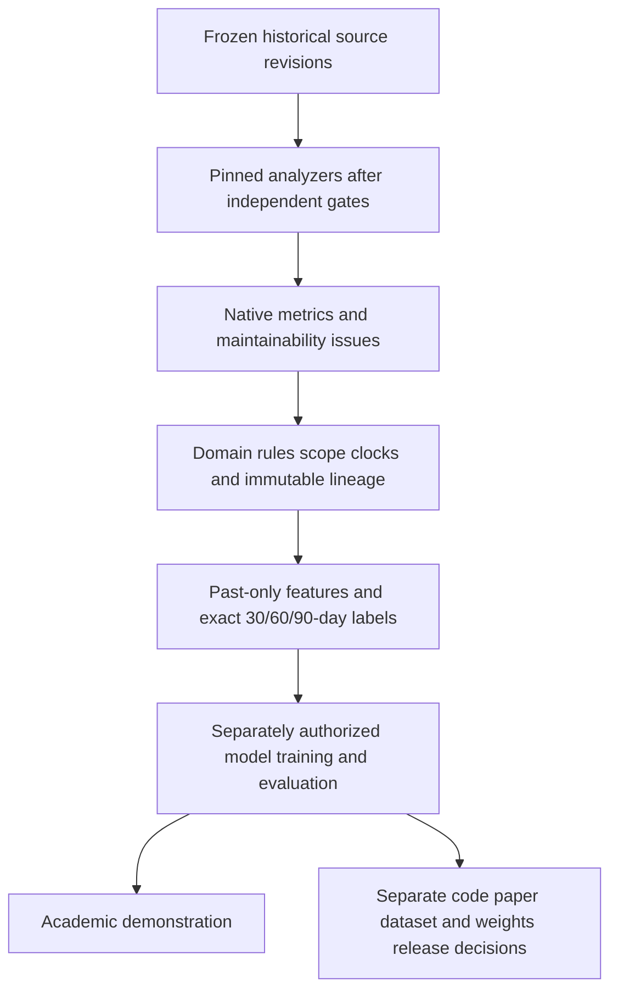

# Intended uses and data-field rights

All statuses below concern the proposed new study. Existing source/probe/build evidence is retained under its prior scope. This task authorizes publication of this sanitized dossier only.

## Workflow, conditional on later authorization

No stage is executed by this dossier. Native estimated remediation minutes are tool-defined stock/effort measures, not observed developer labor. Actual execution timestamps must remain distinct from retrospective code cutoffs. Missing measurements stay missing; future state labels are separate from prediction inputs.

## Separate use questions

| ID | Intended use | Decision | Status |
| --- | --- | --- | --- |
| U01 | Historical analyzer execution without AI | D-U01 | NOT_APPROVED |
| U02 | Internal raw-output retention | D-U02 | NOT_APPROVED |
| U03 | Feature and exact-target derivation | D-U03 | NOT_APPROVED |
| U04 | Local offline model training | D-U04 | NOT_APPROVED |
| U05 | Local inference and evaluation | D-U05 | NOT_APPROVED |
| U06 | External AI processing | D-U06 | NOT_APPROVED |
| U07 | Academic demonstration | D-U07 | NOT_APPROVED |
| U08 | Paper and aggregate publication | D-U08 | NOT_APPROVED |
| U09 | Public integration source code | D-U09 | NOT_APPROVED |
| U10 | Derived dataset publication | D-U10 | NOT_APPROVED |
| U11 | Model artifact publication | D-U11 | NOT_APPROVED |
| U12 | Raw output redistribution | D-U12 | NOT_APPROVED |
| U13 | Analyzer binary redistribution | D-U13 | NOT_APPROVED |
| U14 | Rule text redistribution | D-U14 | NOT_APPROVED |
| U15 | Commercial or hosted use | D-U15 | NOT_APPROVED |

The full exact question for each use is in intended_use_matrix.json and HUMAN_DECISIONS.md. Non-AI collection, local training, local inference, hosted processing, demonstrations, papers, code, datasets, weights, raw exports, binaries, rule text and commercial hosting are distinct questions. Local/offline models are outside the analyzer Program; no network requirement is assumed to define the restriction.

## Field-family review

Every family has separate internal research, local AI, external AI, publication, redistribution and commercial/hosted entries, all NOT_APPROVED. Retention is also NOT_APPROVED for new collection. An identifier/provenance finding does not establish these permissions. The JSON records all six modes and exact decision links.

| Field | Provenance / intended semantic role | Retention and publication |
| --- | --- | --- |
| F01 Repository identifiers and commits | Frozen Git/provider registry, not native analyzer output; Verified identity only; repository/provider terms and redistribution approval are distinct | NOT_APPROVED; no new collection |
| F02 File paths and source metadata | Frozen Git inventory; native component paths must be independently reconciled; Paths may expose source or personal information; minimization is a review requirement | NOT_APPROVED; no new collection |
| F03 Native maintainability debt estimates | Planned Standard-mode native sqale_index; no measurements collected; Tool-defined debt stock in estimated minutes, not actual repair labor | NOT_APPROVED; no new collection |
| F04 Native remediation time | Planned native effort fields and rule remediation functions; Issue effort/stock relationship and override semantics need exact domain proof; never infer actual developer effort | NOT_APPROVED; no new collection |
| F05 Rule identifiers and metadata | Planned pinned analyzer/profile/rule exports; Identifiers, descriptions, examples and formulas need separate granular review | NOT_APPROVED; no new collection |
| F06 Issue counts and severities | Planned native analysis-bound issue payloads; Standard severities and MQR quality impacts must not be pooled as equivalent | NOT_APPROVED; no new collection |
| F07 Analysis and availability timestamps | Planned server/CE/execution/retrieval clocks plus frozen code cutoffs; Do not backdate execution to the historical cutoff; metadata is not permission | NOT_APPROVED; no new collection |
| F08 Active rule/profile configurations | Planned complete paginated active-rule/profile/override exports; Configuration may contain rule text; no raw disclosure approval | NOT_APPROVED; no new collection |
| F09 Source excerpts and code snippets | Existing third-party source or future issue context; not needed in public numeric MVP dataset; Source attribution, analyzer output terms and privacy each require review | NOT_APPROVED; no new collection |
| F10 Derived forecasting labels | Future authorized native measurements plus exact state/endpoint proofs; 30/60/90 days are exact UTC durations; transformations do not remove upstream restrictions | NOT_APPROVED; no new collection |
| F11 Derived feature tables | Future admitted Git/native F0/F1 fields available by cutoff; Past-only and missingness rules required; no analyzer-data licensing shortcut | NOT_APPROVED; no new collection |
| F12 Aggregated evaluation statistics | Future authorized predictions and ground truth; Aggregates and anonymization are not automatic permission; no numerical experiment here | NOT_APPROVED; no new collection |
| F13 Model training datasets | Future separately admitted features/labels; Data source, purpose, retention, transfer and model-learning permissions must all be enumerated | NOT_APPROVED; no new collection |
| F14 Model artifacts and weights | Future authorized fitting/adaptation and preprocessing state; Potential information retention and downstream redistribution need separate permission | NOT_APPROVED; no new collection |
| F15 Raw scanner/server outputs | Future authorized logs/API exports/analysis receipts; Private by default; sanitize secrets and bound retention even when collection is approved | NOT_APPROVED; no new collection |
| F16 Analyzer binaries | Existing pinned third-party JARs/images, no new binary access/export; Do not redistribute under source-repository licenses or scanner license | NOT_APPROVED; no new collection |
| F17 Rule text and remediation examples | Pinned program/rule documentation and future exports; Treat separately from numeric IDs; no entire third-party extracts in dossier | NOT_APPROVED; no new collection |

Some proposed uses are hypothetical rather than planned requirements for every field: e.g. the academic numeric pilot does not need binary or rule-text redistribution. A future approval must explicitly identify the applicable field/use subset. No approval for a required use implies approval of an optional one. Source snippets should be omitted from the default numeric release proposal and reviewed separately if later needed.

Owner/institution and any required licensor/data-provider reviewer must set storage location, access, encryption/secrets controls, retention/deletion, recipients, release license and attribution. No retention period is invented here. Do not delete protected original evidence under a newly drafted retention plan.

Numeric-only tables, anonymization, aggregation, derived labels and model weights are not automatic licensing exceptions. Sending analyzer output to an AI assistant to seek licensing advice is itself part of the external-processing question; the draft can be sent as text/identity questions to a qualified human without attaching restricted raw outputs.

No measurement table, target, feature dataset, forecast, training run or numerical outcome is created or accessed in Phase C. Source/publication, analyzer-use, dataset-use and runtime permissions remain independent.
